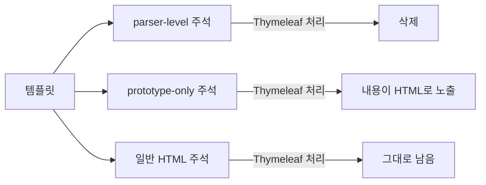

## 들어가며 (Situation)

`chap07-thymeleaf`는 강사님이 준 템플릿 위에 직접 컨트롤러와 예제를 채우는 실습이었다. 그동안 `th:text="${message}"` 정도만 썼는데, 이번에는 표현식 종류를 한꺼번에 다뤘다.

| 표현식 | 이름 | 예 |
|--------|------|----|
| `${...}` | 변수 표현식 | `${member.name}`, `${param.title}` |
| `*{...}` | 선택 변수 표현식 | `th:object="${member}"` 안에서 `*{age}` |
| `#{...}` | 메시지 표현식 | `#{message.value}` → `messages.properties` |
| `@{...}` | 링크 표현식 | `@{/lecture/expression(title='링크', no=1)}` |
| <code>&#124;...&#124;</code> | 리터럴 치환 | <code>&#124;name = '*{name}'&#124;</code> |
| `[[...]]`, `[(...)]` | 인라인 표현식 | `th:text`, `th:utext`와 같은 역할 |

컨트롤러는 일부러 이름이 `null`인 회원과 태그가 들어간 문자열을 넘긴다.

```java
@GetMapping("/expression")
public ModelAndView expression(ModelAndView mv) {
    mv.addObject("member", new MemberDTO(null, 20, '남', "서울시 서초구"));
    mv.addObject("hello", "hello!<h3>Thymeleaf</h3>");
    mv.setViewName("lecture/expression");
    return mv;
}
```

## 문제 상황 (Task)

브라우저 화면만 보면 표현식마다 무엇이 어떻게 바뀌는지 정확히 알기 어렵다. 태그는 렌더링돼 버리고, 주석은 안 보인다. 몇 가지가 헷갈렸다.

1. `th:text`와 `th:utext`는 같은 문자열을 실제로 어떻게 내보낼까?
2. 이름이 `null`인 회원은 화면에 어떻게 나올까?
3. 주석 두 종류(parser-level, prototype-only)는 결과 HTML에 남을까?
4. `<script th:inline="javascript">` 안의 `[[...]]`는 무엇으로 바뀔까?

## 해결 과정 (Action)

### 1. 화면 대신 응답 HTML을 받아 보기

브라우저가 해석하기 전의 HTML을 보려고 curl로 받았다. `index.html` 버튼과 같은 파라미터(`?title=표현식&no=5&no=6`)를 붙였다.

```bash
curl -s "localhost:8080/lecture/expression?title=%ED%91%9C%ED%98%84%EC%8B%9D&no=5&no=6"
```

### 2. `th:text`와 `th:utext`: escape 여부

```html
<!-- 템플릿 -->
<li th:text="${ hello }"></li>
<li th:utext="${ hello }"></li>
```

```html
<!-- 결과 -->
<li>hello!&lt;h3&gt;Thymeleaf&lt;/h3&gt;</li>
<li>hello!<h3>Thymeleaf</h3></li>
```

`th:text`는 `<`를 `&lt;`로 바꿔서 글자로 보여 주고, `th:utext`는 태그를 그대로 넣는다. 인라인 표현식도 똑같았다. `[[${hello}]]`는 escape된 결과, `[(${hello})]`는 태그 그대로였다.

`th:utext`에 사용자가 쓴 글이 들어가면 그 안의 `<script>`도 그대로 실행된다. 이것이 XSS(크로스 사이트 스크립팅)다. 기본은 `th:text`, `th:utext`는 서버가 만든 믿을 수 있는 HTML에만 쓴다.

### 3. 같은 `null`, 다른 결과

```html
<p th:text="${ member.name }"></p>
<p th:object="${ member }" th:text="|name = '*{ name }'|"></p>
```

```html
<p></p>
<p>name = &#39;null&#39;</p>
```

`th:text`에 `null`이 오면 빈 문자열이 된다. 그런데 리터럴 치환 `|...|` 안에서는 `null`이 **글자 `null`**로 바뀌어 문자열에 붙었다. 이름이 없는 회원에게 "name = 'null'"이 보이는 셈이다. 문자열을 합칠 때는 `${member.name ?: '이름 없음'}`처럼 기본값(엘비스 연산자)을 주는 편이 낫다.

### 4. 파라미터가 없으면 500

주소창에 `/lecture/expression`만 치면 500이었다. 파라미터 `no`가 하나만 있어도 500이었다.

```text
SpelEvaluationException: EL1012E: Cannot index into a null value                    # no 없음
SpelEvaluationException: EL1025E: The collection has '1' elements, index '1' is invalid  # no=5 하나
```

`${param.no[0]}`은 `no`가 없으면 `null`에 인덱스를 쓰고, `${param.no[1]}`은 하나뿐인 배열의 두 번째 칸을 찾는다. `th:text`는 `null`을 빈칸으로 넘어가 주지만, **`null`에 인덱스를 거는 것**은 표현식 평가 자체가 실패한다. 안전하게 쓰려면 `${param.no?.[0]}`처럼 안전 탐색 연산자를 쓴다.

### 5. 주석 두 종류

```html
<!-- 템플릿 -->
<li>parser-level 주석</li>
<!--/* 주석내용 */-->
<li>prototype-only 주석</li>
<!--/*/ 주석내용 /*/-->
```

```html
<!-- 결과 -->
<li>parser-level 주석</li>

<li>prototype-only 주석</li>
 주석내용 
```

parser-level 주석은 **통째로 사라졌고**, prototype-only 주석은 주석 기호만 사라지고 내용이 **화면에 보이게** 됐다. 반대로 평범한 `<!-- -->` HTML 주석은 결과에 그대로 남아서, 페이지 소스 보기로 누구나 읽을 수 있다. 개발 메모는 parser-level 주석에 적어야 사용자에게 나가지 않는다.



### 6. 자바스크립트 인라인: 따옴표와 `<\/`

```html
<script th:inline="javascript">
    let hello = /*[[${ hello }]]*/ '기본값';
</script>
```

```javascript
let hello = "hello!<h3>Thymeleaf<\/h3>";
```

JavaScript 모드에서 `[[...]]`는 값의 타입에 맞는 **JavaScript 리터럴**이 됐다. 문자열이라 큰따옴표가 붙었고, `</h3>`는 `<\/h3>`로 바뀌었다. 문자열 안에 `</script>`가 들어와도 스크립트 태그가 일찍 닫히지 않게 하려는 escape다. 주석 뒤의 `'기본값'`은 지워졌다. 그래서 템플릿을 그냥 파일로 열어도(정적) `'기본값'`이 쓰여 문법 오류가 없다. 이것이 내추럴 템플릿이다.

하나 더 발견했다. 주석 처리한 줄도 바뀌었다.

```javascript
// let hello = [[${ hello }]];      → 결과: // let hello = "hello!<h3>Thymeleaf<\/h3>";
```

JavaScript의 `//` 주석은 Thymeleaf에게는 그냥 텍스트다. 그래서 그 안의 `[[...]]`도 평가됐다. 서버 값을 노출하고 싶지 않다면 JS 주석이 아니라 parser-level 주석으로 막아야 한다.

## 결과 (Result)

| 확인 항목 | 결과 HTML |
|-----------|-----------|
| `th:text` / `th:utext` (`<h3>` 포함) | `&lt;h3&gt;` / `<h3>` |
| `${member.name}` (null) | 빈칸 |
| <code>&#124;name = '*{name}'&#124;</code> (null) | `name = 'null'` |
| 파라미터 없이 `param.no[0]` | 500 (EL1012E) |
| parser-level / prototype-only 주석 | 삭제 / 내용 노출 |
| JS 인라인 문자열 | `"hello!<h3>Thymeleaf<\/h3>"`, 기본값 삭제 |
| JS `//` 주석 안의 `[[...]]` | 평가됨 |
| 환경 | Spring Boot 4.1.2, Thymeleaf (spring-boot-starter-thymeleaf) |

배운 점은 다음과 같다.

- 템플릿 엔진은 화면이 아니라 **문자열(HTML)을 만드는 도구**다. 결과를 확인할 때는 화면보다 응답 소스를 본다.
- 같은 `null`도 어디에 쓰이느냐에 따라 빈칸, `'null'`, 500으로 결과가 달랐다.
- escape는 기본값이고, 끄는 쪽(`th:utext`, `[(...)]`)을 쓸 때 이유가 있어야 한다.

## 더 학습하면 좋은 개념

- **XSS와 출력 escape** — 입력이 아니라 출력 시점에 escape하는 이유.
- **SpEL 안전 탐색 연산자 `?.`와 엘비스 연산자 `?:`** — null에서 터지지 않게 표현식을 쓰는 방법.
- **`th:fragment`, `th:replace`** — 이번 실습의 `fragment.html`처럼 헤더·푸터를 조각으로 나눠 재사용하기.
- **메시지와 국제화(i18n)** — `#{...}`가 `messages_en.properties` 같은 언어별 파일을 고르는 방식.

## 참고 자료

- [Thymeleaf 3.1 Tutorial - Using Thymeleaf](https://www.thymeleaf.org/doc/tutorials/3.1/usingthymeleaf.html)
- [Thymeleaf Tutorial - Comments and Blocks](https://www.thymeleaf.org/doc/tutorials/3.1/usingthymeleaf.html#comments-and-blocks)
- [Thymeleaf Tutorial - JavaScript inlining](https://www.thymeleaf.org/doc/tutorials/3.1/usingthymeleaf.html#javascript-inlining)
- [Spring Framework Reference - SpEL Safe Navigation Operator](https://docs.spring.io/spring-framework/reference/core/expressions/language-ref/operator-safe-navigation.html)
- [OWASP - Cross Site Scripting Prevention Cheat Sheet](https://cheatsheetseries.owasp.org/cheatsheets/Cross_Site_Scripting_Prevention_Cheat_Sheet.html)

---

**요약**
1. curl로 응답 HTML을 받아 보니 `th:text`는 `<h3>`를 `&lt;h3&gt;`로 escape했고 `th:utext`는 태그를 그대로 넣었다. 그래서 `th:utext`는 믿을 수 있는 값에만 쓴다.
2. 이름이 `null`인 회원은 `th:text`에서는 빈칸이었지만 리터럴 치환 `|...|`에서는 글자 `'null'`이 됐고, 파라미터 없는 `param.no[0]`은 500이었다.
3. parser-level 주석은 삭제되고 prototype-only 주석은 내용이 노출됐으며, JS 인라인은 `"...<\/h3>"` 리터럴을 만들고 JS `//` 주석 안의 표현식까지 평가했다.
