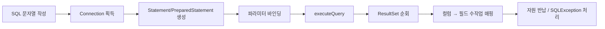

## 들어가며 (Situation)

JPA 강의 첫 프로젝트 `chap01-jpa-intro`는 JPA를 바로 쓰지 않고 시작한다. `section01`에서는 일부러 **JDBC를 직접 써서** 메뉴를 조회하고, 그 과정에서 생기는 문제를 확인한다. `section02`에서는 같은 기능을 JPA로 다시 만든다.

수업 코드 주석은 출발점을 이렇게 설명한다.

> Spring 이 만들어 준 DataSource(커넥션 풀)에서 Connection 을 꺼내 사용할 뿐
> SQL 작성, 실행, ResultSet -> 객체 변환은 모두 개발자가 직접 해야 한다.

[JDBC 실습]()에서는 `DriverManager`로 커넥션을 직접 열었다. 이번에는 Spring Boot가 `application.yaml`을 읽고 **DataSource(HikariCP 커넥션 풀)**를 빈으로 만들어 준다. 커넥션을 준비하는 일은 줄었지만, 나머지 일은 여전히 개발자 몫이다.

## 문제 상황 (Task)

`JdbcProblem` 클래스의 주석은 JDBC를 직접 쓸 때의 문제를 네 가지로 정리한다. 이 글에서는 앞의 두 가지를 다룬다.

1. **코드 중복**: 데이터 변환, SQL 작성, JDBC 코드를 조회할 때마다 반복해서 작성한다.
2. **SQL에 의존적인 개발**: 요구사항이 바뀌면 SQL, DTO, 매핑 코드를 차례로 고쳐야 한다.

(3. 패러다임 불일치와 4. 동일성 보장 문제는 [패러다임 불일치 글]()과 [동일성 보장 글]()에서 다룬다.)

확인할 것을 정했다.

- 조회 하나에 실제로 어떤 코드가 반복될까?
- "카테고리 이름도 보여주세요"라는 요구 하나에 몇 군데를 고쳐야 할까?

## 해결 과정 (Action)

### 1. 실행 환경

`Section01Application`의 `main`을 실행하면 콘솔 메뉴가 뜬다. `@SpringBootApplication`이 붙은 클래스의 패키지(`section01.jdbc`) 아래만 스캔하기 때문에, 섹션마다 실행 클래스를 따로 두어도 서로 섞이지 않는다.

```text
========== section01. JDBC 를 직접 사용할 때의 문제점 ==========
1. 메뉴 전체 조회 (반복되는 JDBC 코드와 수작업 매핑)
2. 요구사항 변경 : 메뉴 조회 시 카테고리명도 함께 조회 (SQL 에 의존적인 개발)
3. 메뉴와 해당 메뉴의 카테고리 조회 (패러다임 불일치)
4. 같은 메뉴를 두 번 조회해서 비교 (동일성 보장 문제)
9. 프로그램 종료
```

`JdbcProblem`은 생성자로 `DataSource`를 주입받는다.

```java
@Component
public class JdbcProblem {

    private final DataSource dataSource;

    public JdbcProblem(DataSource dataSource) {
        this.dataSource = dataSource;
    }
    ...
}
```

### 2. 첫 실행부터 실패: `2SELECT`

1번(메뉴 전체 조회)을 누르자마자 프로그램이 종료됐다.

```text
메뉴 번호를 입력하세요 : 실행 SQL : 2SELECT menu_code, menu_name, menu_price, category_code, orderable_status FROM tbl_menu
Exception in thread "main" java.lang.RuntimeException: java.sql.SQLException: Statement.executeQuery() cannot issue statements that do not produce result sets.
```

SQL 문자열 맨 앞에 `2`가 들어가 있었다. 메뉴 번호를 입력하다가 에디터에 잘못 들어간 것으로 보인다.

```java
String query = "2SELECT menu_code, menu_name, menu_price, category_code, orderable_status FROM tbl_menu";
```

이 실수에서 두 가지를 알 수 있다.

- SQL은 그냥 **문자열**이다. 오타가 있어도 컴파일러는 잡아 주지 않는다. 실행해 봐야 알 수 있다.
- 메뉴 1회 실패로 프로그램 전체가 끝났다. `main`의 `try-catch`는 `NumberFormatException`만 잡는다. `SQLException`을 감싼 `RuntimeException`은 그대로 `main` 밖으로 나간다.

에러 메시지도 "문법 오류"가 아니었다. MySQL Connector/J 드라이버가 이 문장을 결과 집합(ResultSet)을 돌려주는 문장으로 보지 않았고, 그래서 `executeQuery()` 호출을 거부했다.

### 3. 조회 하나에 반복되는 코드

오타를 빼고 보면 `findAllMenu()`의 핵심은 아래와 같다.

```java
try (Connection con = dataSource.getConnection();
     Statement stmt = con.createStatement();
     ResultSet rset = stmt.executeQuery(query)) {

    while (rset.next()) {
        // 조회 결과(행) 1개를 객체 1개로 직접 옮겨 담는다.
        Menu menu = new Menu();
        menu.setMenuCode(rset.getInt("menu_code"));
        menu.setMenuName(rset.getString("menu_name"));
        menu.setMenuPrice(rset.getInt("menu_price"));
        menu.setCategoryCode(rset.getInt("category_code"));
        menu.setOrderableStatus(rset.getString("orderable_status"));

        menuList.add(menu);
    }

} catch (SQLException e) {
    throw new RuntimeException(e);
}
```

`JdbcProblem`에는 조회 메서드가 네 개(`findAllMenu`, `findAllMenuWithCategoryName`, `findMenuByMenuCode`, `findCategoryByCategoryCode`) 있다. 네 메서드 모두 같은 틀을 따른다.



메서드마다 다른 부분은 **SQL 문자열과 매핑 대상 필드뿐**이다. 나머지는 복사해서 붙여 넣은 코드다. `try-with-resources` 덕분에 `close()` 코드는 줄었지만, 커넥션을 얻고 문장을 만들고 결과를 옮겨 담는 흐름은 매번 다시 써야 한다.

매핑 코드에는 컬럼 이름이 **문자열로** 들어 있다. `rset.getInt("menu_code")`에서 컬럼 이름을 잘못 쓰면 이것도 실행해 봐야 안다. `ref_category_code`처럼 NULL이 허용되는 컬럼은 `getInt()` 대신 `getObject("ref_category_code", Integer.class)`로 꺼내야 한다. `getInt()`는 NULL을 0으로 돌려주기 때문이다. 이런 세부 사항도 모두 개발자가 기억해야 한다.

### 4. 요구사항 변경: "카테고리 이름도 보여주세요"

2번 메뉴는 요구사항이 바뀐 상황을 재현한다. 메뉴 목록에 카테고리 번호 대신 **이름**을 보여 달라는 요구다. 이 요구 하나를 위해 바뀐 것을 정리했다.

| 바뀐 곳 | 1번 (기존) | 2번 (변경 후) |
|---------|-----------|---------------|
| SQL | `FROM tbl_menu` | `FROM tbl_menu m JOIN tbl_category c ON ...` |
| 결과를 담는 클래스 | `Menu` | `MenuCategoryDTO` (새로 생성) |
| 매핑 코드 | `setCategoryCode(rset.getInt("category_code"))` | `setCategoryName(rset.getString("category_name"))` |
| JDBC 틀 | 있음 | 거의 그대로 **한 번 더** 작성 |

실행 결과는 정상이었다.

```text
실행 SQL : SELECT m.menu_code, m.menu_name, m.menu_price, c.category_name, m.orderable_status FROM tbl_menu m JOIN tbl_category c ON m.category_code = c.category_code ORDER BY m.menu_code
MenuCategoryDTO(menuCode=2, menuName=쉬림프스무디, menuPrice=5000, categoryName=기타, orderableStatus=Y)
MenuCategoryDTO(menuCode=3, menuName=생갈치쉐이크, menuPrice=6000, categoryName=기타, orderableStatus=Y)
...
MenuCategoryDTO(menuCode=37, menuName=인삼아이스크림, menuPrice=7000, categoryName=한식, orderableStatus=Y)
```

결과는 맞게 나왔지만 코드가 바뀐 순서를 보면 문제가 드러난다.


요구사항이 바뀌면 **SQL부터** 고치고, 그 SQL 결과 모양에 맞춰 클래스를 새로 만든다. `MenuCategoryDTO`의 주석도 같은 점을 지적한다.

> SQL 이 바뀔 때마다 이런 클래스가 계속 늘어나게 된다.

객체를 먼저 설계하고 저장 방식을 맞추는 것이 아니다. **테이블과 SQL을 먼저 정하고 객체가 그 모양을 따라간다.** 수업 주석의 표현으로는 "객체 중심이 아닌 SQL(테이블) 중심으로 개발"하게 된다.

### 5. JPA는 무엇을 대신하는가

`section02`의 `JpaSolution` 주석은 JPA를 쓰면 해결되는 지점을 세 가지로 정리한다.

> SQL 작성, JDBC 코드, DB 데이터 <-> Java 객체 매핑 코드
> 위 3가지 내용은 JPA 를 사용했을 때 자동으로 수행해준다.

같은 "메뉴 1개 조회"를 비교하면 차이가 크다.

```java
// section01 (JDBC) - findMenuByMenuCode() : SQL + try 블록 + 매핑 약 25줄
// section02 (JPA)
Menu foundMenu = manager.find(Menu.class, menuCode);
```

JPA 쪽 코드가 실제로 어떤 SQL을 만드는지는 [엔티티 매핑 글]()에서 확인했다.

## 결과 (Result)

| 확인 항목 | 결과 |
|-----------|------|
| JDBC 조회 메서드 수 | 4개, 모두 같은 Connection → Statement → ResultSet → 매핑 틀 |
| 메서드마다 다른 부분 | SQL 문자열과 매핑할 필드뿐 |
| "카테고리 이름" 요구로 바뀐 곳 | SQL, DTO 클래스(신규), 매핑 코드, JDBC 틀 복사 — 4곳 |
| `2SELECT` 오타 | 컴파일 통과, 실행 시 `SQLException` → 프로그램 종료 |
| 환경 | Java 21, Spring Boot 4.1.2, HikariCP 7.0.2, mysql-connector-j 9.7.0 |

배운 점은 다음과 같다.

- JDBC를 쓰면 SQL과 컬럼 이름이 모두 문자열이다. 오류는 실행해 봐야 드러난다.
- 요구사항이 바뀌면 SQL → DTO → 매핑 코드 순으로 연쇄 수정이 일어난다. 이것이 "SQL에 의존적인 개발"의 실체다.
- DataSource는 커넥션 준비만 대신해 준다. SQL 작성과 객체 변환은 여전히 개발자가 해야 한다.

## 더 학습하면 좋은 개념

- **ORM(Object-Relational Mapping)** — 객체와 테이블 사이의 변환을 프레임워크가 맡는 방식. JPA는 이 방식의 자바 표준 명세다.
- **Spring `JdbcTemplate`** — JPA로 가기 전 단계. JDBC 틀(커넥션, 예외 처리)은 없애 주지만, SQL 작성과 `RowMapper` 매핑은 여전히 개발자가 한다.
- **MyBatis** — SQL을 XML로 분리하고 결과 매핑을 설정으로 처리한다. "SQL은 직접 쓰되 반복 코드는 없애는" 다른 선택지다.
- **커넥션 풀(HikariCP)** — `dataSource.getConnection()`이 매번 새 연결을 여는 것이 아니라 풀에서 빌려 오는 이유.

## 참고 자료

- [Oracle Java Tutorials - Processing SQL Statements with JDBC](https://docs.oracle.com/javase/tutorial/jdbc/basics/processingsqlstatements.html)
- [Oracle Java Tutorials - The try-with-resources Statement](https://docs.oracle.com/javase/tutorial/essential/exceptions/tryResourceClose.html)
- [Spring Boot Reference - SQL Databases (DataSource 설정)](https://docs.spring.io/spring-boot/reference/data/sql.html)
- [Jakarta Persistence 3.2](https://jakarta.ee/specifications/persistence/3.2/)

---

**요약**
1. JDBC로 메뉴를 조회하는 메서드 4개는 모두 Connection → Statement → ResultSet → 수작업 매핑의 같은 틀을 반복했고, 메서드마다 다른 것은 SQL과 필드뿐이었다.
2. "카테고리 이름도 보여 달라"는 요구 하나로 SQL, DTO 클래스, 매핑 코드, JDBC 틀까지 4곳을 고쳐야 했다. 테이블과 SQL이 객체 설계를 끌고 가는 구조다.
3. SQL 문자열 오타(`2SELECT`)는 컴파일을 통과했고, 실행 중 `SQLException`을 일으켜 프로그램이 종료됐다.
