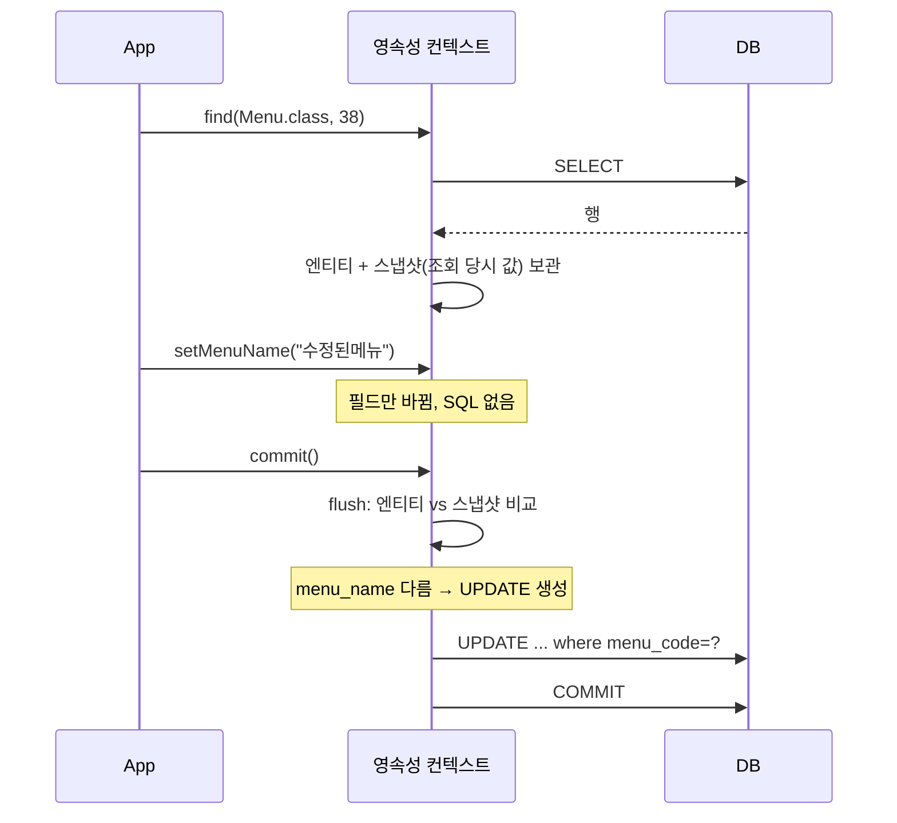

## 들어가며 (Situation)

`chap02-persistence-context`의 3번 기능은 메뉴 이름 수정이다. JDBC였다면 `UPDATE tbl_menu SET menu_name = ? WHERE menu_code = ?`를 쓰고 `executeUpdate()`를 불렀을 것이다. 그런데 `EntityManagerCRUD.modifyMenuName()`에는 `update` 비슷한 호출이 하나도 없다.

```java
public void modifyMenuName(int menuCode, String menuName) {

    EntityManager manager = factory.createEntityManager();

    Menu foundMenu = manager.find(Menu.class, menuCode);
    System.out.println("수정 전 메뉴 : " + foundMenu);

    EntityTransaction transaction = manager.getTransaction();
    transaction.begin();

    try {
        // setter 메서드를 사용해서 값 변경
        foundMenu.setMenuName(menuName);
        System.out.println("=======commit 하기 전=======");
        transaction.commit();
    } catch (Exception e) {
        transaction.rollback();
    }

    System.out.println("수정 후 메뉴 : " + manager.find(Menu.class, menuCode));
    manager.close();
}
```

조회한 객체의 setter를 부르고 커밋할 뿐이다.

## 문제 상황 (Task)

수업 주석은 이렇게 설명한다.

> Update : update 관련 메서드는 존재하지 않는다.
> - 영속성 컨텍스트는 엔티티를 처음 조회(find) 하는 순간 엔티티의 상태(스냅샷)를 보관하고 있다.
> - 보관 된 스냅샷과 commit 시점의 엔티티를 비교해서 변경 된 부분이 있다면 UPDATE 쿼리문을 만들어서 쓰기 지연 저장소에 등록 후 DB 에 전송한다.
> - 위 과정을 변경 감지(Dirty Checking) 라고 한다.

확인할 것을 정했다.

1. UPDATE는 정확히 언제 나갈까? setter를 부르는 순간일까, commit 때일까?
2. 값이 바뀌지 않았다면 UPDATE는 어떻게 될까?
3. 이름만 바꿨는데 UPDATE 문에는 어떤 컬럼이 들어갈까?

## 해결 과정 (Action)

### 1. 실행: UPDATE는 commit 때

[persist 글]()에서 등록한 38번 메뉴(`블로그테스트메뉴`)의 이름을 `수정된메뉴`로 바꿨다.

```text
Hibernate: select m1_0.menu_code,m1_0.category_code,m1_0.menu_name,m1_0.menu_price,m1_0.orderable_status from tbl_menu m1_0 where m1_0.menu_code=?
수정 전 메뉴 : Menu(menuCode=38, menuName=블로그테스트메뉴, menuPrice=5000, categoryCode=4, orderableStatus=Y)
=======commit 하기 전=======
Hibernate: update tbl_menu set category_code=?,menu_name=?,menu_price=?,orderable_status=? where menu_code=?
수정 후 메뉴 : Menu(menuCode=38, menuName=수정된메뉴, menuPrice=5000, categoryCode=4, orderableStatus=Y)
```

`setMenuName()`은 `=======commit 하기 전=======` 출력보다 **먼저** 호출됐다. 그런데 UPDATE는 그 출력 **뒤에** 나왔다. setter는 자바 객체의 필드만 바꿨고, UPDATE는 `commit()`이 일으킨 flush에서 만들어졌다.



### 2. "수정 후 메뉴" 조회에는 SELECT가 없다

로그를 다시 보면 커밋 후 `manager.find(Menu.class, menuCode)`를 호출했는데 **SELECT가 나가지 않았다.** 같은 `EntityManager`의 1차 캐시에 38번 메뉴가 이미 있기 때문이다. ([동일성 보장 글]()과 같은 원리)

그래서 이 "수정 후 메뉴" 출력은 엄밀히 말하면 **DB를 다시 읽은 값이 아니다.** 메모리에 있는 객체를 다시 보여 준 것이다. 이번에는 UPDATE가 성공했으니 결과가 같지만, 커밋이 실패했다면 DB와 다른 값이 출력될 수 있다. DB 값을 확인하려면 새 `EntityManager`로 조회하거나 DB를 직접 봐야 한다.

### 3. 값이 같으면 UPDATE가 없다

같은 38번 메뉴를 **같은 이름**(`수정된메뉴`)으로 한 번 더 수정했다.

```text
Hibernate: select m1_0.menu_code, ... from tbl_menu m1_0 where m1_0.menu_code=?
수정 전 메뉴 : Menu(menuCode=38, menuName=수정된메뉴, menuPrice=5000, categoryCode=4, orderableStatus=Y)
=======commit 하기 전=======
수정 후 메뉴 : Menu(menuCode=38, menuName=수정된메뉴, menuPrice=5000, categoryCode=4, orderableStatus=Y)
```

**UPDATE가 아예 나가지 않았다.** setter는 똑같이 호출됐다. 하지만 flush 때 스냅샷과 비교해 보니 값이 같았고, 그래서 Hibernate는 UPDATE를 만들지 않았다. 변경 감지는 "setter가 호출됐는가"가 아니라 **"조회 당시와 값이 다른가"**를 본다.

### 4. 이름만 바꿨는데 모든 컬럼을 UPDATE

UPDATE 문을 자세히 보면 바꾸지 않은 컬럼까지 들어 있다.

```sql
update tbl_menu set category_code=?,menu_name=?,menu_price=?,orderable_status=? where menu_code=?
```

Hibernate는 기본적으로 **모든 컬럼을 UPDATE하는 SQL**을 쓴다. 컬럼 구성이 항상 같으므로 SQL을 미리 만들어 두고 재사용할 수 있기 때문이다. 바뀐 컬럼만 UPDATE하고 싶다면 Hibernate의 `@DynamicUpdate`를 쓸 수 있다. 컬럼이 아주 많은 테이블이 아니라면 기본 방식으로 충분하다.

### 5. 실험: flush만 하고 rollback하면?

"flush = DB에 SQL 전송"이고 "commit = 트랜잭션 확정"이라면, flush 후 rollback하면 어떻게 될까? `em.flush()`를 직접 호출해서 실험했다. (확인용 **예시 코드**, 실험용으로 넣은 40번 메뉴 사용)

```java
tx.begin();
IdentityMenu c = em.find(IdentityMenu.class, 40);
c.menuName = "실험B-수정";
System.out.println("값 변경 끝, flush 호출");
em.flush();
System.out.println("flush 끝, rollback 호출");
tx.rollback();
// 새 EntityManager 로 DB 값 확인
```

```text
값 변경 끝, flush 호출
Hibernate: update tbl_menu set category_code=?,menu_name=?,menu_price=?,orderable_status=? where menu_code=?
flush 끝, rollback 호출
Hibernate: select ... from tbl_menu im1_0 where im1_0.menu_code=?
rollback 후 DB 값 -> IdentityMenu(menuCode=40, menuName=실험B)
```

- `flush()`를 부르자 **commit 전인데도 UPDATE가 DB로 전송됐다.**
- 그 뒤 rollback하자 DB 값은 원래 이름(`실험B`)으로 돌아왔다.

flush는 SQL을 DB에 **보내는** 것이고, 그 결과를 **확정**하는 것은 commit이다. flush된 SQL도 트랜잭션 안에 있으므로 rollback하면 취소된다. [MySQL 트랜잭션 글]()에서 COMMIT 전에 실행한 UPDATE를 ROLLBACK으로 되돌린 것과 같다.

| 동작 | SQL 전송 | DB 확정 |
|------|----------|---------|
| setter 호출 | X | X |
| `flush()` | O | X (rollback 가능) |
| `commit()` | O (자동 flush) | O |

### 6. 비교: JDBC의 수정

| 항목 | JDBC | JPA 변경 감지 |
|------|------|---------------|
| 수정 방법 | UPDATE SQL 작성 + `executeUpdate()` | 조회한 엔티티의 값 변경 |
| 수정할 컬럼 지정 | SQL에 직접 | Hibernate가 스냅샷과 비교 |
| 값이 같을 때 | SQL 그대로 실행 | UPDATE 생략 |
| 전제 조건 | 없음 | 엔티티가 **영속 상태**여야 함 |

마지막 행이 중요하다. 변경 감지는 영속성 컨텍스트가 스냅샷을 가진 엔티티, 즉 `find()`로 가져온 엔티티에만 동작한다. `new Menu()`로 만든 객체의 값을 바꿔도 UPDATE는 나가지 않는다. 그리고 [동일성 보장 글]()에서 본 것처럼 `readOnly = true` 트랜잭션에서는 값을 바꿔도 UPDATE가 나가지 않았다.

## 결과 (Result)

| 확인 항목 | 결과 |
|-----------|------|
| setter 호출 시점 SQL | 없음 |
| UPDATE 전송 시점 | `commit()` (자동 flush) |
| 같은 값으로 수정 | UPDATE **0건** |
| UPDATE 컬럼 | 바꾼 1개가 아니라 4개 컬럼 전체 |
| commit 후 같은 매니저로 `find()` | SELECT 없음 (1차 캐시) |
| `flush()` 후 `rollback()` | UPDATE는 전송됐지만 DB 값은 원래대로 |

배운 점은 다음과 같다.

- JPA의 수정은 "UPDATE를 호출하는 것"이 아니라 "영속 엔티티의 값을 바꾸고 커밋하는 것"이다.
- 변경 감지는 스냅샷과 현재 값을 비교한다. setter를 불렀어도 값이 같으면 UPDATE는 없다.
- flush는 전송, commit은 확정이다. flush된 변경도 rollback으로 취소된다.

## 더 학습하면 좋은 개념

- **준영속(detached) 상태와 `merge()`** — `close()`된 매니저에서 가져온 엔티티는 변경 감지가 되지 않는다. 이 경우 수정하는 방법.
- **`@DynamicUpdate`** — 바뀐 컬럼만 UPDATE하는 Hibernate 기능과 그 트레이드오프.
- **Setter 대신 의미 있는 메서드** — `chap01`의 `changeMenuName()`처럼, 변경 감지를 쓰는 엔티티에서 setter를 열어 두지 않는 이유.
- **낙관적 락(`@Version`)** — 두 사용자가 같은 엔티티를 동시에 수정할 때 나중 커밋이 앞의 변경을 덮어쓰지 않게 막는 방법.

## 참고 자료

- [Hibernate ORM 7.4 User Guide - Persistence Context / Flushing](https://docs.hibernate.org/orm/7.4/userguide/html_single/)
- [Jakarta Persistence 3.2 API - EntityManager](https://jakarta.ee/specifications/persistence/3.2/apidocs/jakarta.persistence/jakarta/persistence/EntityManager.html)
- [Jakarta Persistence 3.2 Specification](https://jakarta.ee/specifications/persistence/3.2/jakarta-persistence-spec-3.2.html)

---

**요약**
1. `modifyMenuName()`에는 update 메서드가 없다. `find()`로 가져온 엔티티의 이름을 바꾸고 커밋하자 flush 시점에 UPDATE가 나갔다.
2. 같은 이름으로 다시 수정하면 스냅샷과 값이 같아 UPDATE가 0건이었다. UPDATE는 바꾼 1개 컬럼이 아니라 4개 컬럼 전체를 대상으로 했다.
3. `flush()`를 직접 부르면 commit 전에도 UPDATE가 전송되지만, 이후 rollback하면 DB 값은 원래대로 돌아왔다. flush는 전송이고 commit은 확정이다.
