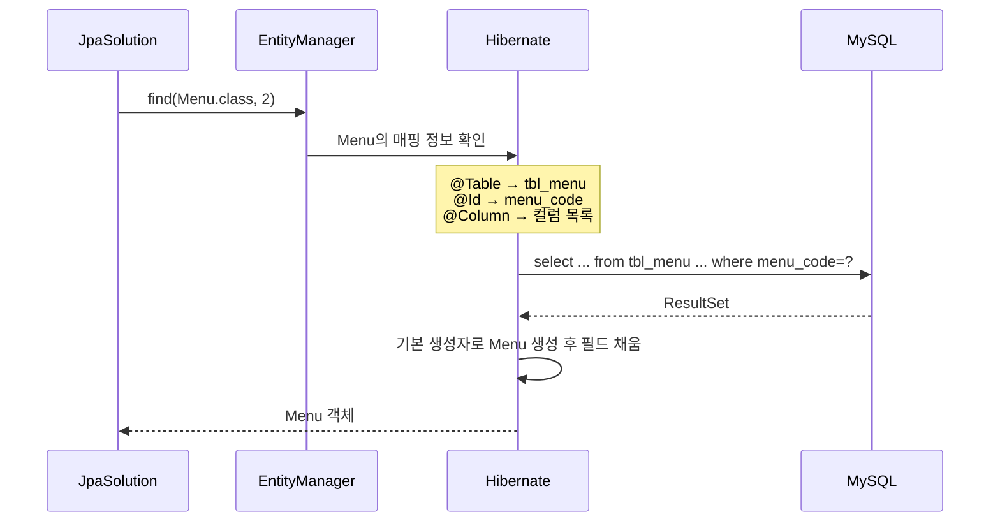

## 들어가며 (Situation)

[앞 글]()에서는 JDBC로 메뉴를 조회할 때마다 SQL, JDBC 틀, 매핑 코드가 반복되는 것을 확인했다. `chap01-jpa-intro`의 `section02`는 같은 기능을 **JPA**로 다시 만든다.

수업 주석은 JPA를 이렇게 정의한다.

> 자바 진영의 ORM (Object Relational Mapping) 기술 표준이다.
> Java 객체를 Database 와 매핑한다.

JPA는 **명세(인터페이스)**이고, 실제로 SQL을 만들고 실행하는 것은 구현체인 **Hibernate**다. 실행 로그 앞에 `Hibernate:`가 찍히는 이유가 이것이다.

## 문제 상황 (Task)

JPA를 처음 쓰면서 확인할 것을 정했다.

1. JPA를 쓰려면 프로젝트에 무엇을 설정해야 할까?
2. 클래스와 테이블은 어떻게 연결할까?
3. `manager.find()` 한 줄은 실제로 어떤 SQL이 될까? 없는 메뉴를 조회하면 어떻게 될까?

## 해결 과정 (Action)

### 1. 의존성: starter 하나

`build.gradle`에서 JPA 관련 의존성은 두 줄이다.

```groovy
implementation 'org.springframework.boot:spring-boot-starter-data-jpa'
runtimeOnly 'com.mysql:mysql-connector-j'
```

`spring-boot-starter-data-jpa` 하나에 Hibernate, Jakarta Persistence API, Spring Data JPA, HikariCP가 함께 들어온다. 클래스패스에서 실제 버전을 확인했다.

| 라이브러리 | 버전 | 역할 |
|-----------|------|------|
| jakarta.persistence-api | 3.2.0 | JPA 명세 (`@Entity`, `EntityManager` 등) |
| hibernate-core | 7.4.13.Final | JPA 구현체 (SQL 생성·실행) |
| spring-data-jpa | 4.1.2 | Spring의 JPA 지원 |
| HikariCP | 7.0.2 | 커넥션 풀 |
| mysql-connector-j | 9.7.0 | MySQL JDBC 드라이버 |

JPA도 결국 내부에서는 **JDBC 드라이버로 DB와 통신한다.** JDBC가 사라지는 것이 아니라, JDBC 코드를 Hibernate가 대신 쓰는 것이다.

### 2. application.yaml

```yaml
spring:
  datasource:
    driver-class-name: com.mysql.cj.jdbc.Driver
    url: jdbc:mysql://localhost:3306/menudb
    username: wanted
    password: wanted
  jpa:
    show-sql: true
    hibernate:
      ddl-auto: none
    properties:
      hibernate:
        format_sql: true
```

| 설정 | 의미 |
|------|------|
| `datasource.*` | DB 접속 정보. 수업 주석대로 MySQL 의존성을 추가하면 이 정보가 있어야 앱이 실행된다 |
| `jpa.show-sql` | Hibernate가 만든 SQL을 콘솔에 출력 |
| `hibernate.format_sql` | 출력되는 SQL을 줄바꿈해서 보기 좋게 정리 |
| `hibernate.ddl-auto` | 앱 실행 시 테이블을 어떻게 다룰지 |

`ddl-auto` 값은 수업 주석에 정리되어 있다. Spring Boot 공식 문서 기준으로 지원하는 값은 `none`, `validate`, `update`, `create`, `create-drop` 다섯 가지다. 주석에는 `validate`(엔티티와 테이블 구조가 맞는지 검사만 함)가 빠져 있어서 표에 함께 적었다.

| 값 | 동작 |
|----|------|
| `create` | 실행 시 테이블을 새로 생성 (기존 데이터 삭제) |
| `create-drop` | 실행 시 생성, 종료 시 삭제 |
| `update` | 변경된 엔티티 구조를 테이블에 반영 |
| `validate` | 엔티티와 테이블이 일치하는지 검사만 함 |
| `none` | 아무것도 하지 않음 |

`menudb`에는 이미 `tbl_menu`, `tbl_category`와 데이터가 있다. 그래서 `none`으로 둔다. 실수로 `create`를 쓰면 실습 데이터가 날아간다. 공식 문서에 따르면 H2 같은 내장 DB가 아니면 기본값도 `none`이다.

> **주의**: `username`/`password`가 yaml에 그대로 적혀 있다. 로컬 실습 DB라서 괜찮지만, 실제 프로젝트에서는 `${DB_PASSWORD}`처럼 환경 변수로 빼고 저장소에 올리지 않아야 한다.

### 3. 엔티티 매핑: 클래스 ↔ 테이블

`section02.Menu`는 JDBC 버전 `Menu`와 필드는 비슷하지만 어노테이션이 붙는다.

```java
@Entity
@Table(name = "tbl_menu")
@NoArgsConstructor
@AllArgsConstructor
@Getter
@ToString
public class Menu {

    @Id
    @Column(name = "menu_code")
    private int menuCode;

    @Column(name= "menu_name")
    private String menuName;

    @Column(name= "menu_price")
    private int menuPrice;

    @ManyToOne
    @JoinColumn(name = "category_code")
    private Category category;

    @Column(name = "orderable_status")
    private String orderableStatus;
    ...
}
```

| 어노테이션 | 수업 주석 / 의미 |
|-----------|------------------|
| `@Entity` | JPA가 관리하는 객체라는 것을 명시 |
| `@Table(name = "tbl_menu")` | 이 엔티티와 매핑될 테이블 이름 |
| `@Id` | 기본 키(PK)에 해당하는 필드. `find()`가 이 값으로 조회한다 |
| `@Column(name = "...")` | 필드와 매핑될 컬럼 이름 |
| `@ManyToOne` + `@JoinColumn` | 다른 엔티티와의 연관관계 ([다음 글]()) |

JDBC에서는 `rset.getInt("menu_code")`처럼 **코드 안에서** 컬럼과 필드를 연결했다. JPA에서는 어노테이션으로 **선언만** 해 두면 Hibernate가 그 정보를 읽어 SQL과 매핑을 처리한다.

`@Setter`가 없다는 점도 눈에 띈다. 이름을 바꿀 때는 `changeMenuName()`이라는 메서드를 따로 만들어 쓴다. 아무 필드나 바꿀 수 있는 setter 대신, 바꿔도 되는 것만 의도가 드러나는 메서드로 열어 둔 것이다.

`@NoArgsConstructor`는 필요해서 붙였다. JPA 명세는 엔티티에 **인자 없는 생성자**를 요구한다. Hibernate가 조회 결과로 객체를 만들 때 이 생성자를 쓰기 때문이다.

### 4. find() 한 줄이 만든 SQL

`JpaSolution`은 `EntityManager`를 주입받아 조회한다.

```java
@PersistenceContext
private EntityManager manager;

public void findMenu(int menuCode) {
    // 엔티티 매니저가 관리하는 엔티티를 find (조회)
    Menu foundMenu = manager.find(Menu.class, menuCode);
    System.out.println("Found menu: " + foundMenu);
}
```

2번 메뉴를 조회한 실행 결과다.

```text
Hibernate:
    select
        m1_0.menu_code,
        c1_0.category_code,
        c1_0.category_name,
        c1_0.ref_category_code,
        m1_0.menu_name,
        m1_0.menu_price,
        m1_0.orderable_status
    from
        tbl_menu m1_0
    left join
        tbl_category c1_0
            on c1_0.category_code=m1_0.category_code
    where
        m1_0.menu_code=?
Found menu: Menu(menuCode=2, menuName=쉬림프스무디, menuPrice=5000, category=Category(categoryCode=10, categoryName=기타, refCategoryCode=2), orderableStatus=Y)
```

`find(Menu.class, 2)`에서 Hibernate가 한 일을 순서대로 정리했다.



- SQL은 매핑 정보로 **자동 생성**됐다. `where m1_0.menu_code=?`처럼 파라미터는 `?`로 바인딩된다. [PreparedStatement 글]()에서 배운 방식 그대로다.
- `m1_0`, `c1_0`은 Hibernate가 붙인 테이블 별칭이다.
- `ResultSet`에서 객체로 옮기는 코드도 없었다.

### 5. 없는 메뉴를 조회하면: null

현재 `tbl_menu`에는 1번 메뉴가 없다. 1번을 조회했다.

```text
Hibernate:
    select ... from tbl_menu m1_0 left join tbl_category c1_0 ... where m1_0.menu_code=?
Found menu: null
```

`find()`는 행이 없으면 예외를 던지지 않고 **`null`을 반환**한다. JDBC 버전은 `if (rset.next())`로 직접 확인해서 `null`을 돌려줬는데, `find()`도 같은 결과를 준다. 그래서 `find()` 결과를 바로 쓰는 코드는 `null`을 먼저 확인해야 한다. 이 확인을 빠뜨렸을 때 생긴 `NullPointerException`은 [동일성 보장 글]()에서 다룬다.

### 6. 의외로 동작한 타입 불일치

`section02.Category`를 보다가 이상한 점을 발견했다.

```java
@Id
@Column(name = "category_code")
private String categoryCode;   // DB 컬럼은 int

@Column(name = "ref_category_code")
private String refCategoryCode; // DB 컬럼은 int (NULL 허용)
```

DB의 `category_code`는 `int`인데 엔티티 필드는 `String`이다. 그래도 조회는 정상이었고 `categoryCode=10`이 찍혔다. MySQL 드라이버가 숫자 컬럼을 문자열로 읽어 주기 때문에 이번에는 우연히 동작한 것으로 보인다. 하지만 `ddl-auto: validate`로 바꾸면 타입 불일치로 실행이 실패할 가능성이 높다. 컬럼 타입에 맞춰 `int`(NULL이 허용되는 `ref_category_code`는 `Integer`)로 맞추는 편이 안전하다.

## 결과 (Result)

| 항목 | JDBC (section01) | JPA (section02) |
|------|------------------|-----------------|
| 메뉴 1개 조회 코드 | SQL + try 블록 + 매핑 약 25줄 | `manager.find(Menu.class, menuCode)` 1줄 |
| SQL 작성 | 직접 | Hibernate가 매핑 정보로 생성 |
| 컬럼 ↔ 필드 연결 | `rset.getXxx("컬럼명")` 코드 | `@Column` 선언 |
| 없는 PK 조회 | 직접 `null` 처리 | `null` 반환 |
| 환경 | — | Hibernate 7.4.13, Jakarta Persistence 3.2.0 |

배운 점은 다음과 같다.

- JPA는 명세이고 Hibernate가 구현체다. 내부적으로는 여전히 JDBC 드라이버를 쓴다.
- 매핑은 어노테이션으로 "선언"한다. SQL 생성과 객체 변환은 그 선언을 읽은 Hibernate가 한다.
- `show-sql`/`format_sql`을 켜 두면 JPA가 실제로 무슨 SQL을 보내는지 볼 수 있다. JPA를 배우는 동안에는 꼭 켜 두자.

## 더 학습하면 좋은 개념

- **`@GeneratedValue`와 기본 키 생성 전략** — `tbl_menu`의 `menu_code`는 `AUTO_INCREMENT`인데 엔티티에는 아직 반영되지 않았다. [persist 글]()에서 이 문제가 실제로 드러난다.
- **Spring Data JPA Repository** — `find()`조차 직접 호출하지 않고 인터페이스 선언만으로 조회 메서드를 만드는 다음 단계.
- **JPQL** — PK가 아닌 조건(이름, 가격 등)으로 조회할 때 쓰는 객체 기준 쿼리 언어.
- **스키마 관리 도구(Flyway, Liquibase)** — 운영 환경에서 `ddl-auto` 대신 테이블 변경 이력을 관리하는 방법.

## 참고 자료

- [Jakarta Persistence 3.2 Specification](https://jakarta.ee/specifications/persistence/3.2/jakarta-persistence-spec-3.2.html)
- [Jakarta Persistence 3.2 API - EntityManager](https://jakarta.ee/specifications/persistence/3.2/apidocs/jakarta.persistence/jakarta/persistence/EntityManager.html)
- [Hibernate ORM 7.4 User Guide](https://docs.hibernate.org/orm/7.4/userguide/html_single/)
- [Spring Boot How-to - Database Initialization (ddl-auto)](https://docs.spring.io/spring-boot/how-to/data-initialization.html)

---

**요약**
1. `spring-boot-starter-data-jpa` 하나로 JPA 명세(3.2.0)와 구현체 Hibernate(7.4.13)가 들어오고, `application.yaml`에 DB 접속 정보와 `show-sql`, `ddl-auto: none`을 설정했다.
2. `@Entity`, `@Table`, `@Id`, `@Column`으로 클래스와 테이블을 연결하자 `manager.find(Menu.class, 2)` 한 줄이 `select ... where menu_code=?`로 바뀌어 실행됐다.
3. 없는 PK를 조회하면 `find()`는 `null`을 반환했다. `int` 컬럼을 `String` 필드로 매핑한 `Category`도 이번에는 동작했지만 타입을 맞추는 편이 안전하다.
