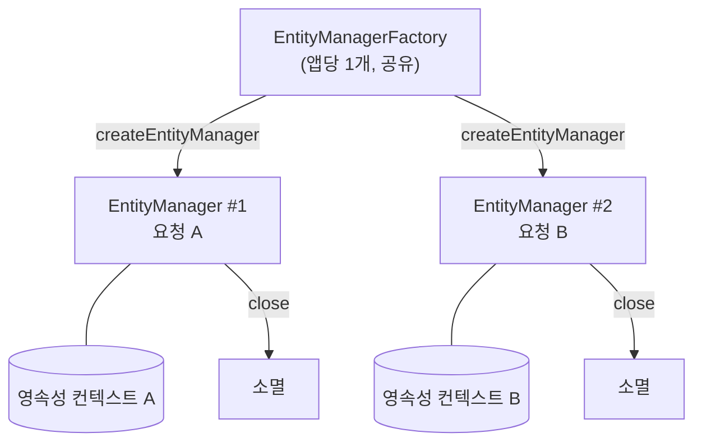
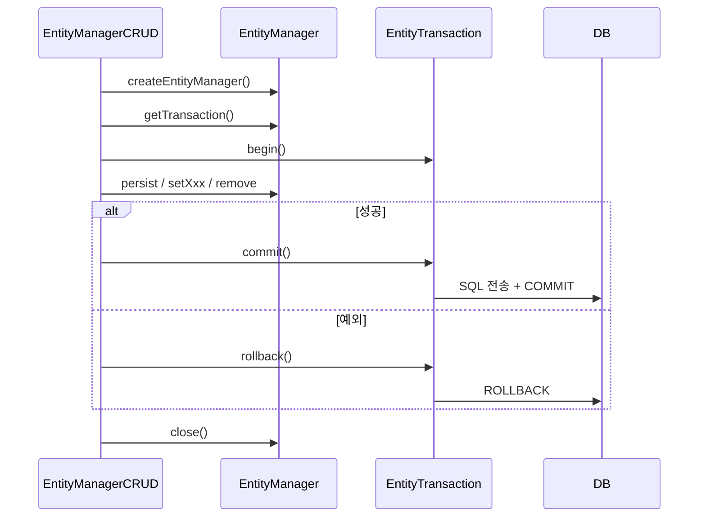

## 들어가며 (Situation)

JPA 두 번째 프로젝트 `chap02-persistence-context`는 `EntityManager`로 CRUD(조회·등록·수정·삭제)를 직접 해 보는 실습이다. `section01`의 `EntityManagerCRUD` 클래스를 열자마자 `chap01`과 다른 점이 보였다.

```java
@Component
public class EntityManagerCRUD {

//    @PersistenceContext
//    private EntityManager manager;
    private final EntityManagerFactory factory;

    public EntityManagerCRUD(EntityManagerFactory factory) {
        this.factory = factory;
    }
    ...
}
```

`chap01`에서 쓰던 `@PersistenceContext` 필드 주입이 주석 처리되어 있다. 대신 `EntityManagerFactory`를 주입받는다. 수업 주석은 이유를 이렇게 설명한다.

> 엔티티 매니저는 기능 1개 당 1개의 매니저를 별도로 생성해야 한다.
> 즉 필드에서 매니저를 공유하는 것이 아닌, 1개의 요청 시 1개의 매니저만 존재해야 한다.

## 문제 상황 (Task)

이 주석을 읽고 질문이 생겼다.

1. `EntityManagerFactory`와 `EntityManager`는 각각 무엇이고, 왜 하나는 공유하고 하나는 매번 만들까?
2. 그렇다면 `chap01`의 `@PersistenceContext` 필드 주입은 잘못된 코드였을까?
3. 조회(`find`)에는 없던 `EntityTransaction`이 등록·수정·삭제에는 왜 필요할까?

## 해결 과정 (Action)

### 1. 세 객체의 관계

| 객체 | 개수 | 수명 | 스레드 공유 |
|------|------|------|-------------|
| `EntityManagerFactory` | 애플리케이션당 1개 | 앱 시작 ~ 종료 | 가능 (thread-safe) |
| `EntityManager` | 요청(작업)마다 1개 | `createEntityManager()` ~ `close()` | **불가** |
| `EntityTransaction` | `EntityManager`마다 | `begin()` ~ `commit()`/`rollback()` | — |

Spring Framework 공식 문서도 같은 점을 짚는다.

> Although `EntityManagerFactory` instances are thread-safe, `EntityManager` instances are not.

`EntityManagerFactory`는 엔티티 매핑 정보 분석, DB 연결 설정처럼 **만드는 비용이 큰** 객체다. 그래서 앱 전체에서 하나만 만들어 공유한다. Spring Boot가 앱 시작 시 빈으로 등록해 두고, 생성자 주입으로 받는다.

`EntityManager`는 내부에 **영속성 컨텍스트**를 하나씩 가진다. 여러 요청이 하나의 `EntityManager`를 공유하면, A 사용자가 조회한 엔티티와 B 사용자가 수정 중인 엔티티가 같은 1차 캐시에 섞인다. 그래서 요청마다 새로 만들고 다 쓰면 닫는다.



### 2. 수업 코드의 패턴: 만들고, 쓰고, 닫는다

`EntityManagerCRUD`의 모든 메서드는 같은 흐름을 따른다.

```java
public void findMenuByMenuCode(int menuCode) {
    // manager 는 1회 요청 시 인스턴스를 생성하며
    // 요청이 종료되면 없앤다.
    EntityManager manager = factory.createEntityManager();

    Menu foundMenu = manager.find(Menu.class, menuCode);
    System.out.println("foundMenu = " + foundMenu);
    manager.close();
}
```

2번 메뉴를 조회한 실행 결과다.

```text
Hibernate: select m1_0.menu_code,m1_0.category_code,m1_0.menu_name,m1_0.menu_price,m1_0.orderable_status from tbl_menu m1_0 where m1_0.menu_code=?
foundMenu = Menu(menuCode=2, menuName=쉬림프스무디, menuPrice=5000, categoryCode=10, orderableStatus=Y)
```

`chap02`의 `Menu`는 `chap01`과 달리 `@ManyToOne` 없이 `int categoryCode`만 가진다. 그래서 JOIN 없이 `tbl_menu`만 조회했다. CRUD 동작에 집중하려고 연관관계를 뺀 것으로 보인다.

`close()`를 부르면 영속성 컨텍스트도 함께 닫힌다. [JDBC 실습]()에서 `Connection`을 반드시 닫았던 것과 같은 이유다. 다만 수업 코드는 `find()`에서 예외가 나면 `close()`까지 가지 못한다. 실무 코드라면 `try-finally`로 닫는 편이 안전하다. (`registMenu()`는 실제로 `finally`에서 `close()`한다.)

### 3. 그럼 `@PersistenceContext` 필드는 틀린 코드일까?

`chap01`의 `JpaSolution`은 `@PersistenceContext`로 `EntityManager`를 필드에 주입했다. `@Component`는 싱글톤이니, 수업 주석대로라면 모든 요청이 매니저 하나를 공유하는 위험한 코드처럼 보인다.

[동일성 보장 글]()에서 실험할 때, `@PersistenceContext`가 주입하는 것과 같은 객체의 클래스 이름을 출력해 봤다. (확인용 **예시 코드**)

```java
EntityManager manager = SharedEntityManagerCreator
        .createSharedEntityManager(ctx.getBean(EntityManagerFactory.class));
System.out.println("manager class = " + manager.getClass().getName());
```

```text
manager class = jdk.proxy2.$Proxy94
```

진짜 `EntityManager`가 아니라 **프록시**였다. Spring 공식 문서는 이것을 "shared EntityManager"라고 부른다.

> ... a shared, thread-safe proxy for the actual transactional EntityManager

이 프록시는 메서드가 호출될 때마다 **현재 트랜잭션에 묶인 진짜 `EntityManager`**를 찾아서 일을 넘긴다. 트랜잭션이 없으면 호출마다 새 `EntityManager`를 만들어 쓴다. 필드 하나를 공유하는 것처럼 보이지만, 실제로는 트랜잭션(요청)마다 다른 매니저가 일한다.

| 방식 | 매니저 생성/종료 | 트랜잭션 | 사용처 |
|------|------------------|----------|--------|
| `@PersistenceContext` 필드 | Spring 프록시가 트랜잭션 단위로 관리 | `@Transactional` | `chap01` `JpaSolution` |
| `factory.createEntityManager()` | 개발자가 직접 생성·`close()` | `EntityTransaction` 직접 | `chap02` `EntityManagerCRUD` |

정리하면 수업 주석의 원칙("요청 1개에 매니저 1개")은 맞다. 다만 `@PersistenceContext`는 Spring이 이미 그 원칙을 지켜 주는 방식이고, `chap02`는 그 과정을 **손으로 직접 해 보려고** 팩토리를 쓴 것으로 이해했다. 공유하면 안 되는 것은 `factory.createEntityManager()`로 **직접 만든** 매니저다.

### 4. EntityTransaction: 변경 작업의 경계

조회 메서드에는 트랜잭션이 없었다. 반면 `registMenu()`는 트랜잭션부터 시작한다.

```java
EntityManager manager = factory.createEntityManager();
// DML (Insert, Update, Delete) 의 경우 트렌젝션이 매우 중요하다.
// DML 중 오류가 발생하면 롤백이 반드시 필요하다.
EntityTransaction transaction = manager.getTransaction();
// 해당 코드 아래부터는 트렌젝션이 적용된다.
transaction.begin();

try {
    manager.persist(menu);
    transaction.commit();
} catch (Exception e) {
    transaction.rollback();
} finally {
    manager.close();
}
```



JPA에서 엔티티를 변경하는 작업(`persist`, `remove`, 값 변경 반영)은 **트랜잭션 안에서** 해야 한다. 그리고 실제 SQL은 `commit()` 시점에 DB로 간다. 그 이유는 [persist 글]()에서 확인했다. [MySQL 트랜잭션 글]()에서 직접 쓴 `START TRANSACTION` / `COMMIT` / `ROLLBACK`을 JPA에서는 `begin()` / `commit()` / `rollback()`으로 호출한다.

## 결과 (Result)

| 확인 항목 | 결과 |
|-----------|------|
| `EntityManagerFactory` | 앱당 1개, thread-safe → 빈으로 주입받아 공유 |
| `EntityManager` | thread-safe 아님 → 요청마다 `createEntityManager()` / `close()` |
| `@PersistenceContext` 주입 객체 | `jdk.proxy2.$Proxy94` — 트랜잭션별 매니저로 위임하는 공유 프록시 |
| 조회 | 트랜잭션 없이 `find()` 가능 |
| 등록·수정·삭제 | `begin()` → 작업 → `commit()`, 실패 시 `rollback()` |
| 환경 | Spring Boot 4.1.2, spring-orm 7.0.10, Hibernate 7.4.13 |

배운 점은 다음과 같다.

- 비싼 것(`EntityManagerFactory`)은 하나 만들어 공유하고, 상태를 가진 것(`EntityManager`)은 요청마다 만든다.
- `@PersistenceContext` 필드는 "공유 매니저"처럼 보이지만 Spring 프록시다. 실제로는 트랜잭션마다 다른 매니저가 일한다.
- 변경 작업은 트랜잭션 안에서 하고, 실패하면 반드시 롤백한다.

## 더 학습하면 좋은 개념

- **트랜잭션 범위 영속성 컨텍스트** — Spring에서 영속성 컨텍스트의 수명이 트랜잭션과 같아지는 원리. `@Transactional`과 shared EntityManager가 함께 동작하는 방식.
- **`@Transactional` vs `EntityTransaction`** — 선언적 트랜잭션과 프로그래밍 방식 트랜잭션의 차이.
- **스레드 안전성(thread safety)** — 싱글톤 빈에 상태(필드)를 두면 왜 위험한지. [빈 스코프 글]()과 이어진다.
- **JDK 동적 프록시** — `jdk.proxy2.$Proxy94`처럼 인터페이스 기반으로 만들어지는 프록시의 원리.

## 참고 자료

- [Spring Framework Reference - JPA](https://docs.spring.io/spring-framework/reference/data-access/orm/jpa.html)
- [Jakarta Persistence 3.2 API - EntityManager](https://jakarta.ee/specifications/persistence/3.2/apidocs/jakarta.persistence/jakarta/persistence/EntityManager.html)
- [Jakarta Persistence 3.2 Specification](https://jakarta.ee/specifications/persistence/3.2/jakarta-persistence-spec-3.2.html)
- [Hibernate ORM 7.4 User Guide](https://docs.hibernate.org/orm/7.4/userguide/html_single/)

---

**요약**
1. `EntityManagerFactory`는 앱당 하나를 만들어 공유하는 thread-safe 객체이고, `EntityManager`는 영속성 컨텍스트를 가진 thread-safe하지 않은 객체라서 요청마다 만들고 `close()`한다.
2. `@PersistenceContext`가 주입한 객체는 `jdk.proxy2.$Proxy94` 프록시였다. 트랜잭션마다 진짜 매니저로 위임하므로 필드에 두어도 안전하다.
3. 조회는 트랜잭션 없이 가능하지만 등록·수정·삭제는 `EntityTransaction`의 `begin()` → `commit()` 사이에서 하고, 실패하면 `rollback()`한다.
