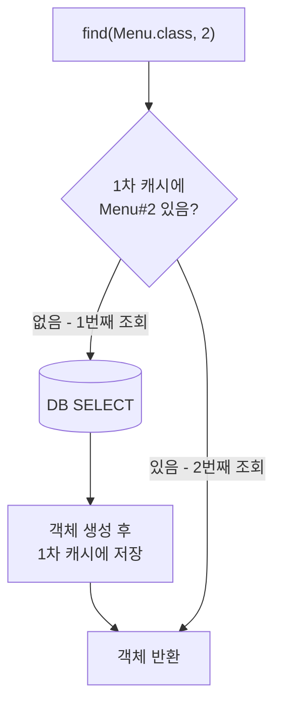

## 들어가며 (Situation)

`JdbcProblem`이 정리한 JDBC의 네 번째 문제는 **동일성 보장**이다. 수업 주석에 "중요!!"라고 표시된 부분이다.

> 하나의 DB 에서 동일한 행에 해당하는 데이터를 꺼냈는데
> 각기 다른 객체에 담았을 때 발생하는 동일성 보장 문제
> -> 한 객체에서 수정을 하게 되면 다른 객체는 수정을 알아차릴 수 없다.

자바에서 `==`는 두 변수가 **같은 객체(같은 메모리 주소)**를 가리키는지 비교한다. 이것을 동일성(identity)이라고 한다. DB의 같은 행은 프로그램 안에서도 같은 객체 하나로 다뤄져야 자연스럽다.

## 문제 상황 (Task)

JDBC 버전과 JPA 버전 모두 같은 메뉴를 두 번 조회해서 `==`로 비교한다. 확인할 것을 정했다.

1. JDBC에서는 정말 다른 객체가 나올까?
2. JPA에서는 같은 객체가 나올까? 그렇다면 두 번째 조회 때 SQL은 나갈까?
3. JPA 코드에 붙은 `@Transactional(readOnly = true)`는 결과에 어떤 영향을 줄까?

## 해결 과정 (Action)

### 1. JDBC: 조회할 때마다 new

`compareSameMenu()`는 `findMenuByMenuCode()`를 두 번 부른다. 이 메서드는 조회할 때마다 `new Menu()`로 새 객체를 만든다.

```java
Menu menu1 = findMenuByMenuCode(menuCode);
Menu menu2 = findMenuByMenuCode(menuCode);

System.out.println("menu1 = " + menu1.hashCode());
System.out.println("menu2 = " + menu2.hashCode());
System.out.println("menu1 == menu2 : " + (menu1 == menu2));

menu1.setMenuName("이름 변경 테스트");
```

2번 메뉴로 실행한 결과다.

```text
실행 SQL : SELECT menu_code, menu_name, menu_price, category_code, orderable_status FROM tbl_menu WHERE menu_code = ?
실행 SQL : SELECT menu_code, menu_name, menu_price, category_code, orderable_status FROM tbl_menu WHERE menu_code = ?
menu1 = 424504
menu2 = 2129964267
menu1 == menu2 : false
menu1 의 메뉴 이름만 변경한 후
menu1.getMenuName() = 이름 변경 테스트
menu2.getMenuName() = 쉬림프스무디
```

- SQL이 2번 실행됐다.
- 같은 행인데 `==`가 `false`다. `hashCode()`도 다르다. (Lombok `@EqualsAndHashCode`가 없으니 `Object.hashCode()`가 쓰였다.)
- `menu1`의 이름을 바꿔도 `menu2`는 여전히 `쉬림프스무디`다. 같은 메뉴가 프로그램 안에 **서로 다른 두 상태**로 존재하게 된다.

### 2. JPA: 같은 트랜잭션 안에서는 같은 객체

JPA 버전도 구조는 같다. 다른 점은 `@Transactional(readOnly = true)`가 붙어 있다는 것이다.

```java
@Transactional(readOnly = true)
public void compareSameMenu(int menuCode) {

    System.out.println("=========1번째 조회=========");
    Menu menu1 = manager.find(Menu.class, menuCode);
    System.out.println("=========2번째 조회=========");
    Menu menu2 = manager.find(Menu.class, menuCode);

    System.out.println("menu1.hashCode() = " + menu1.hashCode());
    System.out.println("menu2.hashCode() = " + menu2.hashCode());
    System.out.println("menu1 == menu2 : " + (menu1 == menu2));

    menu1.changeMenuName("테스트!");
    ...
}
```

```text
=========1번째 조회=========
Hibernate:
    select
        m1_0.menu_code,
        ...
    where
        m1_0.menu_code=?
=========2번째 조회=========
menu1.hashCode() = 893721510
menu2.hashCode() = 893721510
menu1 == menu2 : true
menu1 의 이름 변경 후!
menu1.getMenuName() = 테스트!
menu2.getMenuName() = 테스트!
```

결과가 완전히 달라졌다.

- **`2번째 조회` 아래에 SQL이 없다.** DB에 가지 않았다.
- `==`가 `true`이고 `hashCode()`도 같다.
- `menu1`의 이름을 바꾸자 `menu2`도 `테스트!`가 됐다. 같은 객체이므로 당연한 결과다.

### 3. 두 번째 조회는 어디서 왔을까: 영속성 컨텍스트

`JpaSolution` 주석은 `EntityManager`와 함께 **영속성 컨텍스트(Persistence Context)**를 설명한다.

> PersistenceContext 는 Entity 객체를 관리하는 컨테이너다.
> Application 에서 만든 Entity 객체를 EntityManager 를 통해서 PersistenceContext 에 넣을 수도 있고, 조회할 수도 있다.

영속성 컨텍스트 안에는 "엔티티 타입 + PK → 객체"를 저장하는 공간이 있다. 이것을 보통 **1차 캐시**라고 부른다. `find()`는 DB에 가기 전에 여기부터 확인한다.



1번째 조회에서 저장해 둔 객체를 2번째 조회에서 **그대로 돌려줬다.** 그래서 SQL이 없고 `==`가 `true`다. 수업 주석의 표현을 빌리면 이렇다.

> 동일한 트렌젝션 내부에서 같은 PK 값으로 조회 한 엔티티는 항상 같은 객체를 반환한다.

### 4. 실험: @Transactional이 없으면?

주석에 "동일한 트랜잭션 내부에서"라는 조건이 있다. 트랜잭션이 없으면 어떻게 될지 궁금했다. `JpaSolution`은 수정하지 않고, `@PersistenceContext`가 주입하는 것과 같은 공유 `EntityManager`로 따로 실험했다. (확인용 **예시 코드**)

```java
EntityManager manager = SharedEntityManagerCreator
        .createSharedEntityManager(ctx.getBean(EntityManagerFactory.class));

Menu menu1 = manager.find(Menu.class, 2);  // 트랜잭션 없음
Menu menu2 = manager.find(Menu.class, 2);  // 트랜잭션 없음
System.out.println("menu1 == menu2 : " + (menu1 == menu2));
```

```text
=========1번째 조회 (트랜잭션 없음)=========
Hibernate: select m1_0.menu_code, ... where m1_0.menu_code=?
=========2번째 조회 (트랜잭션 없음)=========
Hibernate: select m1_0.menu_code, ... where m1_0.menu_code=?
menu1 == menu2 : false
```

**SQL이 2번 나가고 `false`가 나왔다.** JDBC와 똑같은 결과다. Spring이 주입한 `EntityManager`는 트랜잭션이 없으면 `find()`를 호출할 때마다 영속성 컨텍스트를 새로 만들고, 호출이 끝나면 닫는다. 1차 캐시도 함께 사라진다. 동일성 보장은 JPA를 쓴다고 항상 생기는 것이 아니다. **같은 영속성 컨텍스트(= 같은 트랜잭션) 안에서만** 보장된다.

| 조건 | SELECT 횟수 | `menu1 == menu2` |
|------|-------------|------------------|
| JDBC | 2 | false |
| JPA, 트랜잭션 없음 | 2 | false |
| JPA, `@Transactional` | **1** | **true** |

### 5. 이름을 바꿨는데 DB는?

`compareSameMenu()`는 `menu1.changeMenuName("테스트!")`로 이름을 바꿨다. 실행 후 DB를 직접 확인했다.

```bash
mysql -uwanted -p menudb -e "SELECT menu_code, menu_name FROM tbl_menu WHERE menu_code=2"
```

```text
menu_code	menu_name
2	쉬림프스무디
```

**DB는 바뀌지 않았다.** 로그에도 UPDATE가 없었다. `readOnly = true`는 "이 트랜잭션은 조회만 한다"는 표시이고, Spring은 이를 런타임 최적화 힌트로 쓴다. 이번 실행에서는 객체 값이 바뀌었는데도 커밋할 때 UPDATE가 나가지 않았다. `readOnly`를 빼면 커밋 시점에 값 변경이 DB에 반영된다. 이 동작(변경 감지)은 [변경 감지 글]()에서 따로 확인했다.

`@Transactional`에 대한 수업 주석도 정리해 둔다.

> 해당 메서드가 끝나게 되고 에러가 발생하지 않으면 commit / 에러가 발생하면 rollback 을 자동 처리 해준다.

[AOP 글]()에서 본 프록시가 메서드 앞뒤에서 트랜잭션을 시작하고 끝내는 구조다.

### 6. 시행착오: 없는 메뉴로 비교하면 NPE

1번 메뉴(현재 DB에 없음)로 3번 기능을 실행했다.

```text
=========1번째 조회=========
Hibernate: select ... where m1_0.menu_code=?
=========2번째 조회=========
Hibernate: select ... where m1_0.menu_code=?
Exception in thread "main" java.lang.NullPointerException: Cannot invoke "Object.hashCode()" because "menu1" is null
```

두 가지를 알게 됐다.

- **없는 엔티티는 1차 캐시에 저장되지 않는다.** 트랜잭션 안인데도 SELECT가 2번 나갔다. 캐시할 객체가 없으니 다시 DB에 물어본 것이다.
- `find()`가 `null`을 반환했는데 바로 `menu1.hashCode()`를 호출해서 NPE가 났다. JDBC 버전 `compareSameMenu()`에는 `if (menu1 == null)` 확인이 있었는데, JPA 버전에는 빠져 있다. `main`은 `NumberFormatException`만 잡기 때문에 프로그램 전체가 종료됐다.

## 결과 (Result)

| 확인 항목 | 결과 |
|-----------|------|
| JDBC 두 번 조회 | SELECT 2번, `==` false, 수정 내용 공유 안 됨 |
| JPA + `@Transactional` 두 번 조회 | SELECT **1번**, `==` true, 수정 내용 공유됨 |
| JPA, 트랜잭션 없이 두 번 조회 | SELECT 2번, `==` false |
| `readOnly = true`에서 이름 변경 | 객체만 바뀜, DB는 `쉬림프스무디` 그대로 |
| 없는 PK 두 번 조회 | SELECT 2번 (캐시 안 됨) → `null.hashCode()` NPE |

배운 점은 다음과 같다.

- JPA의 동일성 보장은 영속성 컨텍스트의 1차 캐시에서 나온다. 같은 PK면 DB에 다시 가지 않고 같은 객체를 돌려준다.
- 그 보장은 **같은 트랜잭션 안에서만** 유효하다. 트랜잭션이 없으면 JDBC와 다를 게 없었다.
- `readOnly = true` 트랜잭션에서 엔티티를 바꾸면 객체만 바뀌고 DB에는 반영되지 않았다. 조회 전용 메서드에만 붙여야 한다.

## 더 학습하면 좋은 개념

- **트랜잭션 전파(Propagation)** — `@Transactional` 메서드가 다른 `@Transactional` 메서드를 부를 때 같은 트랜잭션(= 같은 영속성 컨텍스트)을 쓸지 정하는 규칙.
- **`equals()`/`hashCode()`와 엔티티** — 영속성 컨텍스트 밖에서 엔티티를 비교할 때 `==` 대신 무엇을 기준으로 해야 하는지.
- **OSIV(Open Session In View)** — 웹 요청 전체에 영속성 컨텍스트를 열어 두는 Spring Boot 설정과 그 장단점.
- **트랜잭션 격리 수준과 반복 가능한 읽기** — DB의 REPEATABLE READ와 1차 캐시가 주는 "같은 결과 보장"의 차이.

## 참고 자료

- [Spring Framework Reference - Using @Transactional](https://docs.spring.io/spring-framework/reference/data-access/transaction/declarative/annotations.html)
- [Spring Framework Reference - JPA (Shared EntityManager)](https://docs.spring.io/spring-framework/reference/data-access/orm/jpa.html)
- [Hibernate ORM 7.4 User Guide - Persistence Context](https://docs.hibernate.org/orm/7.4/userguide/html_single/#pc)
- [Jakarta Persistence 3.2 API - EntityManager](https://jakarta.ee/specifications/persistence/3.2/apidocs/jakarta.persistence/jakarta/persistence/EntityManager.html)

---

**요약**
1. JDBC는 같은 행을 두 번 조회하면 SELECT 2번에 서로 다른 객체 두 개가 나왔고, 한쪽을 수정해도 다른 쪽은 그대로였다.
2. JPA는 `@Transactional` 안에서 두 번째 `find()`를 1차 캐시에서 처리해 SELECT 1번에 `==` true였다. 트랜잭션 없이 실험하면 JDBC처럼 SELECT 2번에 false였다.
3. `readOnly = true`에서 바꾼 이름은 DB에 반영되지 않았다. 없는 PK는 캐시되지 않아 SELECT가 2번 나갔고, `null` 확인이 빠져 NPE로 프로그램이 종료됐다.
