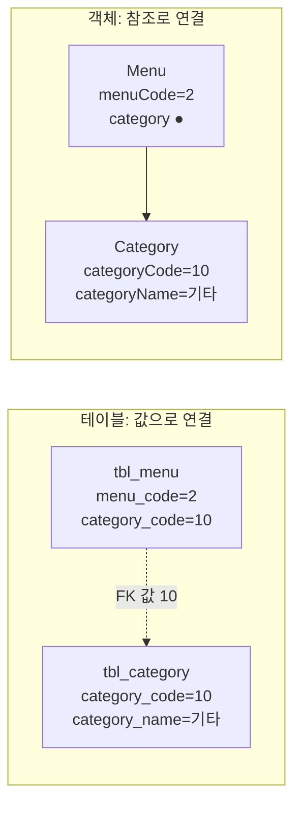
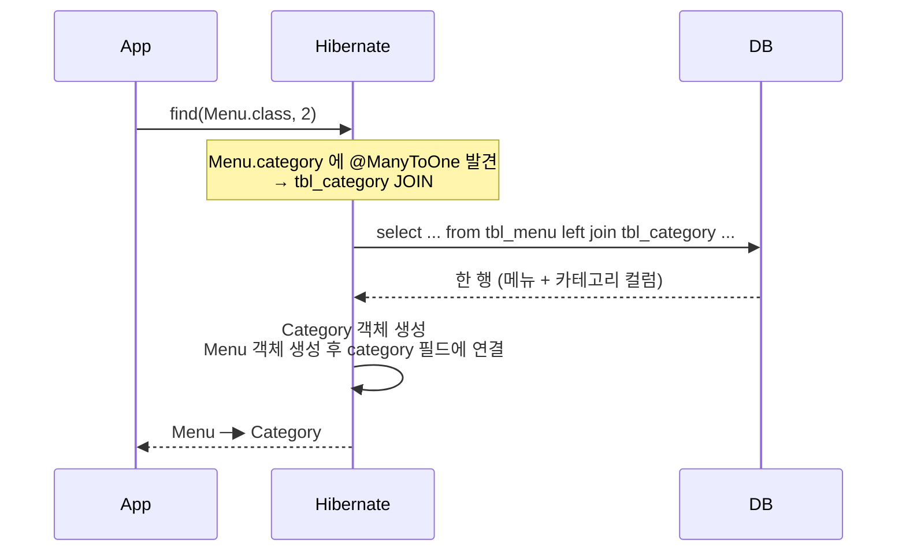

## 들어가며 (Situation)

`chap01-jpa-intro`의 메뉴 데이터는 두 테이블에 나뉘어 있다. 메뉴는 `tbl_menu`, 카테고리는 `tbl_category`이고, `tbl_menu.category_code`가 `tbl_category`를 가리키는 외래 키(FK)다.

```sql
CONSTRAINT `fk_category_code` FOREIGN KEY (`category_code`)
    REFERENCES `tbl_category` (`category_code`)
```

카테고리 하나에 메뉴 여러 개가 속하는 **1:N 관계**다. 수업 요구사항은 이렇다.

> 2번 메뉴 조회 시 해당 메뉴의 모든 정보와 카테고리 정보를 조회.
> ex) 2, 파스타, 2000, Y, Category( 1, 양식, 식사 )

## 문제 상황 (Task)

`JdbcProblem` 주석은 이 상황에서 생기는 문제를 **패러다임 불일치**라고 부른다.

> - SQL 관점에서 1:N -> 엔티티 간 연관성을 FK 로 가지고 있는다.
> - Java 관점에서 1:N -> 연관있는 객체를 자신의 멤버(필드)로 가지게 된다.

같은 1:N 관계를 테이블은 **값**(FK 번호)으로, 객체는 **참조**(필드)로 표현한다. 두 방식이 다르다는 것이 문제의 핵심이다.



확인할 것을 정했다.

1. 테이블 구조를 그대로 따라 만든 JDBC 버전은 카테고리를 어떻게 가져올까?
2. JPA의 `@ManyToOne`을 쓰면 SQL과 코드는 어떻게 달라질까?

## 해결 과정 (Action)

### 1. JDBC: 값으로 다시 조회하고 직접 조립

JDBC 버전 `Menu`는 테이블 모양을 그대로 따라 만들었다.

```java
/* tbl_menu 테이블의 한 행을 담기 위한 클래스
 * - 테이블 구조에 맞춰서 만들었기 때문에
 * - 카테고리를 객체(Category)가 아닌 categoryCode 값(FK)으로 가지고 있다. */
public class Menu {
    private int menuCode;
    private String menuName;
    private int menuPrice;
    private int categoryCode;   // ← 객체가 아니라 번호
    private String orderableStatus;
}
```

그래서 `menu.getCategory()` 같은 메서드는 없다. 카테고리가 필요하면 번호를 꺼내 **SQL을 한 번 더** 실행해야 한다.

```java
Menu menu = findMenuByMenuCode(menuCode);

// menu.getCategory() 처럼 객체를 탐색할 수 없다.
// categoryCode 값으로 카테고리를 다시 조회해야 한다.
Category category = findCategoryByCategoryCode(menu.getCategoryCode());
```

2번 메뉴로 실행한 결과다.

```text
실행 SQL : SELECT menu_code, menu_name, menu_price, category_code, orderable_status FROM tbl_menu WHERE menu_code = ?
조회한 메뉴 = Menu(menuCode=2, menuName=쉬림프스무디, menuPrice=5000, categoryCode=10, orderableStatus=Y)
실행 SQL : SELECT category_code, category_name, ref_category_code FROM tbl_category WHERE category_code = ?
메뉴의 카테고리 = Category(categoryCode=10, categoryName=기타, refCategoryCode=2)
```

SQL이 2번 실행됐고, 결과는 `Menu`와 `Category` 두 개의 **따로 떨어진 객체**로 나왔다. 둘을 묶는 것은 `categoryCode=10`이라는 숫자 하나다. 이 메서드를 위해 `findCategoryByCategoryCode()`라는 JDBC 메서드(약 25줄)도 하나 더 만들어야 했다.

JOIN 한 번으로 가져올 수도 있다. 하지만 그러면 [앞 글]()의 `MenuCategoryDTO`처럼 JOIN 결과를 담을 새 클래스가 필요하다. 어느 쪽을 택해도 **객체 구조가 SQL에 맞춰진다.**

### 2. JPA: 필드로 Category를 가진다

`section02.Menu`는 번호 대신 `Category` **객체**를 필드로 가진다.

```java
/* categoryCode 필드는 실제로는 Category 테이블의 fk 를 지칭한다.
 * Java 객체로 해당 연관관계를 표현하는 방법은
 * Category 엔티티를 Menu 엔티티에서 필드로 가지고 있으면 된다. */
@ManyToOne
@JoinColumn(name = "category_code")
private Category category;
```

| 어노테이션 | 의미 |
|-----------|------|
| `@ManyToOne` | 메뉴(Many) 여러 개가 카테고리(One) 하나를 참조한다 |
| `@JoinColumn(name = "category_code")` | 이 연관관계에 쓰이는 FK 컬럼 이름 |

`Category`도 `@Entity`로 매핑되어 있어야 한다.

```java
@Entity
@Table(name = "tbl_category")
public class Category {
    @Id
    @Column(name = "category_code")
    private String categoryCode;
    ...
}
```

조회 코드는 [엔티티 매핑 글]()의 `findMenu()`와 똑같다.

```java
public void findMenuAndCategory(int menuCode) {
    Menu foundMenu = manager.find(Menu.class, menuCode);
    System.out.println(foundMenu);
}
```

### 3. 실행 결과: SQL 1번, 객체 그래프 완성

```text
Hibernate:
    select
        m1_0.menu_code,
        c1_0.category_code,
        c1_0.category_name,
        c1_0.ref_category_code,
        m1_0.menu_name,
        m1_0.menu_price,
        m1_0.orderable_status
    from
        tbl_menu m1_0
    left join
        tbl_category c1_0
            on c1_0.category_code=m1_0.category_code
    where
        m1_0.menu_code=?
Menu(menuCode=2, menuName=쉬림프스무디, menuPrice=5000, category=Category(categoryCode=10, categoryName=기타, refCategoryCode=2), orderableStatus=Y)
```

Hibernate가 `@ManyToOne` 정보를 보고 **JOIN을 직접 만들었다.** 결과도 `Menu` 안에 `Category`가 들어 있는 형태다. 이제 `foundMenu.getCategory().getCategoryName()`처럼 점(`.`)으로 따라가며 꺼낼 수 있다. 이것을 **객체 그래프 탐색**이라고 한다.



### 4. 왜 JOIN일까, 왜 LEFT JOIN일까

로그를 보며 두 가지가 궁금했다.

**왜 메뉴를 조회했는데 카테고리까지 같이 가져왔을까?** JPA 명세에서 `@ManyToOne`의 기본 조회 방식(fetch)은 **즉시 로딩(EAGER)**이다. 메뉴를 가져올 때 연관된 카테고리도 바로 함께 가져온다. 그래서 Hibernate는 쿼리를 두 번 보내는 대신 JOIN 한 번으로 처리했다.

**왜 INNER JOIN이 아니라 LEFT JOIN일까?** `@ManyToOne`의 `optional` 속성 기본값이 `true`이기 때문이다. Hibernate 입장에서는 "카테고리가 없는 메뉴도 있을 수 있다"고 보고, 카테고리가 없어도 메뉴는 조회되도록 LEFT JOIN을 썼다. [JOIN 글]()에서 본 차이가 여기서 쓰인다. 실제 테이블은 `category_code`가 `NOT NULL`이므로 결과는 같다.

### 5. 비교

| 항목 | JDBC (section01) | JPA (section02) |
|------|------------------|-----------------|
| `Menu`의 카테고리 표현 | `int categoryCode` (값) | `Category category` (참조) |
| 실행된 SQL | 2번 (메뉴 → 카테고리) | 1번 (LEFT JOIN) |
| 추가로 작성한 코드 | `findCategoryByCategoryCode()` 약 25줄 | `@ManyToOne`, `@JoinColumn` 2줄 |
| 카테고리 이름 꺼내기 | 따로 받은 `category.getCategoryName()` | `menu.getCategory().getCategoryName()` |
| 객체 구조를 정하는 기준 | 테이블 구조 | 객체 관계 |

## 결과 (Result)

- 카테고리 조회 SQL: **2번 → 1번**
- 연관 객체를 가져오는 코드: 별도 JDBC 메서드 **약 25줄 → 어노테이션 2줄**
- `Menu`가 `Category`를 참조로 갖게 되어, 객체 그래프 탐색이 가능해졌다.

배운 점은 다음과 같다.

- 패러다임 불일치란 같은 관계를 테이블은 FK **값**으로, 객체는 **참조**로 표현하는 차이다.
- `@ManyToOne` + `@JoinColumn`은 "이 필드는 이 FK로 연결된 엔티티"라는 선언이다. JOIN은 Hibernate가 만든다.
- 기본값(EAGER, optional=true)이 실제 SQL 모양을 결정한다. 어노테이션 하나도 기본값까지 알아야 SQL을 예측할 수 있다.

## 더 학습하면 좋은 개념

- **지연 로딩(LAZY)과 프록시** — `@ManyToOne(fetch = FetchType.LAZY)`로 바꾸면 카테고리를 실제로 쓸 때 조회한다. 실무에서는 LAZY를 기본으로 권장하는 경우가 많다.
- **N+1 문제** — 메뉴 목록 N개를 조회할 때 카테고리 조회 쿼리가 N번 더 나가는 문제. EAGER/LAZY와 깊게 연결된다.
- **양방향 연관관계와 `@OneToMany(mappedBy)`** — 카테고리에서 메뉴 목록으로 거꾸로 탐색하는 방법과 연관관계의 주인 개념.
- **fetch join (JPQL)** — 필요한 순간에만 연관 엔티티를 JOIN으로 함께 가져오는 방법.

## 참고 자료

- [Jakarta Persistence 3.2 Specification](https://jakarta.ee/specifications/persistence/3.2/jakarta-persistence-spec-3.2.html) — `ManyToOne` 어노테이션의 `fetch`, `optional` 기본값
- [Hibernate ORM 7.4 User Guide - Associations](https://docs.hibernate.org/orm/7.4/userguide/html_single/#associations)
- [Jakarta Persistence 3.2 API - EntityManager](https://jakarta.ee/specifications/persistence/3.2/apidocs/jakarta.persistence/jakarta/persistence/EntityManager.html)

---

**요약**
1. 테이블은 메뉴와 카테고리를 FK 값(`category_code=10`)으로, 객체는 필드 참조로 연결한다. 이 차이가 패러다임 불일치다.
2. 테이블 모양을 따른 JDBC 버전은 SQL을 2번 실행하고 `Menu`와 `Category`를 따로 받았다.
3. `@ManyToOne` + `@JoinColumn`을 쓰자 Hibernate가 LEFT JOIN 1번으로 `Menu` 안에 `Category`가 든 객체를 돌려줬다. JOIN 방식은 기본값인 EAGER와 `optional=true`에서 나왔다.
