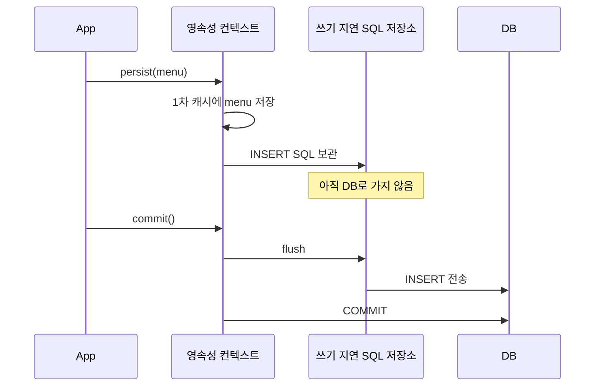
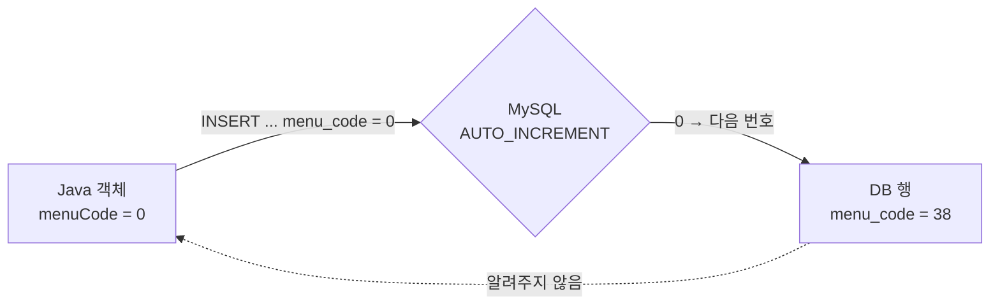

## 들어가며 (Situation)

`chap02-persistence-context`의 2번 기능은 신규 메뉴 등록이다. 콘솔에서 이름, 가격, 카테고리, 주문 가능 여부를 입력받아 `Menu` 객체를 만들고 `registMenu()`에 넘긴다.

```java
public void registMenu(Menu menu) {
    EntityManager manager = factory.createEntityManager();
    EntityTransaction transaction = manager.getTransaction();
    transaction.begin();

    try {
        // 엔티티 매니저는 CUD 작업 시 SQL 을 DB 에 바로 반영하지 않는다.
        // "쓰기 지연 SQL 저장소" 에 SQL 을 모아두었다가
        // flush() 시점에 DB 로 SQL 을 보내준다.
        manager.persist(menu);
        // commit() 메서드가 호출되면 flush 가 자동 실행된다.
        transaction.commit();
        System.out.println("등록 된 메뉴 : " + menu);
    } catch (Exception e) {
        transaction.rollback();
    } finally {
        manager.close();
    }
}
```

주석에 처음 보는 개념이 두 개 있다. **쓰기 지연 SQL 저장소**와 **flush**다.

## 문제 상황 (Task)

등록 기능을 실행하고 출력을 보다가 이상한 점을 발견했다.

```text
Hibernate: insert into tbl_menu (category_code,menu_name,menu_price,orderable_status,menu_code) values (?,?,?,?,?)
등록 된 메뉴 : Menu(menuCode=0, menuName=블로그테스트메뉴, menuPrice=5000, categoryCode=4, orderableStatus=Y)
```

`menuCode=0`으로 출력됐다. 그런데 바로 다음에 수정 기능으로 조회해 보니 DB에는 **38번**으로 들어가 있었다.

```text
수정 전 메뉴 : Menu(menuCode=38, menuName=블로그테스트메뉴, menuPrice=5000, categoryCode=4, orderableStatus=Y)
```

확인할 것을 정했다.

1. `persist()`를 부르면 INSERT가 바로 나갈까, 정말 `commit()`까지 미뤄질까?
2. 객체는 0번, DB는 38번이 된 이유는 무엇일까?
3. 어떻게 하면 DB가 만든 번호를 객체도 알 수 있을까?

## 해결 과정 (Action)

### 1. persist()의 의미: 영속성 컨텍스트에 등록

`persist()`는 이름 그대로 엔티티를 **영속(persistent) 상태**로 만든다. 새로 만든 객체를 영속성 컨텍스트가 관리하도록 등록하는 것이다. 수업 주석의 설명은 "Create : 엔티티 객체를 Persistence Context 에 등록"이다.

등록된 엔티티의 INSERT SQL은 바로 DB로 가지 않는다. 영속성 컨텍스트 안의 **쓰기 지연 SQL 저장소**에 쌓였다가, **flush** 때 한꺼번에 DB로 간다. flush는 "영속성 컨텍스트의 변경 내용을 DB에 반영하는 것"이고, `commit()`이 호출되면 자동으로 먼저 실행된다.



### 2. 실험 A: INSERT는 언제 나가는가

수업 코드는 `persist()`와 `commit()`이 붙어 있어서 INSERT가 어느 쪽에서 나갔는지 구분할 수 없다. 수업 `Menu`와 같은 매핑(`@Id`만 있음)의 엔티티로 사이에 출력을 끼워 넣어 실험했다. (확인용 **예시 코드**)

```java
tx.begin();
System.out.println("persist 호출");
em.persist(a);
System.out.println("persist 끝, commit 직전");
tx.commit();
System.out.println("commit 끝 -> " + a);
```

```text
persist 호출
persist 끝, commit 직전
Hibernate: insert into tbl_menu (category_code,menu_name,menu_price,orderable_status,menu_code) values (?,?,?,?,?)
commit 끝 -> AssignedMenu(menuCode=0, menuName=실험A)
```

**INSERT는 `commit 직전` 출력 뒤에 나갔다.** `persist()`는 SQL을 보관만 했고, `commit()`이 flush를 일으켜 그때 전송됐다. 주석 설명 그대로다.

### 3. 0번과 38번의 정체

INSERT 문을 다시 보면 `menu_code` 컬럼이 **포함되어 있다.**

```sql
insert into tbl_menu (category_code,menu_name,menu_price,orderable_status,menu_code) values (?,?,?,?,?)
```

수업 `Menu`의 PK 필드는 이렇다.

```java
@Id
@Column(name = "menu_code")
private int menuCode;
```

`@Id`만 있으면 JPA는 **PK 값을 개발자가 직접 넣는다**고 판단한다. 콘솔 입력에서는 `menuCode`를 받지 않았으므로 `int`의 기본값 **0**이 그대로 INSERT됐다.

그런데 DB에는 왜 38번이 들어갔을까? 테이블 정의와 MySQL 설정을 확인했다.

```sql
`menu_code` int NOT NULL AUTO_INCREMENT
```

```text
@@sql_mode = ONLY_FULL_GROUP_BY,STRICT_TRANS_TABLES,NO_ZERO_IN_DATE,NO_ZERO_DATE,ERROR_FOR_DIVISION_BY_ZERO,NO_ENGINE_SUBSTITUTION
```

MySQL 공식 문서에 따르면 `AUTO_INCREMENT` 컬럼에 **0이나 NULL을 넣으면 다음 번호가 자동 생성된다.** `sql_mode`에 `NO_AUTO_VALUE_ON_ZERO`가 있으면 0이 그대로 저장되지만, 이 환경에는 없다. 그래서 MySQL이 0을 무시하고 38을 붙였다.



Hibernate는 "PK는 내가 넣은 0"이라고 믿고 있고, DB가 38을 만들었다는 사실은 모른다. 그래서 커밋 후에도 객체는 0번이다. **객체와 DB가 서로 다른 PK를 갖게 된 것이다.** 이 상태에서 같은 영속성 컨텍스트로 이 객체를 계속 쓰면, Hibernate는 0번 메뉴를 다루고 있다고 생각한다.

`sql_mode`에 `NO_AUTO_VALUE_ON_ZERO`가 켜진 DB였다면, 첫 등록은 0번으로 저장되고 두 번째 등록부터는 PK 중복 오류가 났을 것이다. 지금 동작은 MySQL 설정 덕분에 우연히 된 것이다.

### 4. 실험 B: @GeneratedValue(strategy = IDENTITY)

PK를 DB가 만든다는 사실을 JPA에 알려 주는 어노테이션이 `@GeneratedValue`다. `AUTO_INCREMENT`에 대응하는 전략은 `IDENTITY`다. 같은 테이블에 매핑한 엔티티를 하나 더 만들어 실험했다. (확인용 **예시 코드**)

```java
@Id
@GeneratedValue(strategy = GenerationType.IDENTITY)
@Column(name = "menu_code")
public int menuCode;
```

```text
persist 호출
Hibernate: insert into tbl_menu (category_code,menu_name,menu_price,orderable_status) values (?,?,?,?)
persist 끝, commit 직전 -> IdentityMenu(menuCode=40, menuName=실험B)
commit 끝 -> IdentityMenu(menuCode=40, menuName=실험B)
```

두 가지가 달라졌다.

1. INSERT에서 **`menu_code` 컬럼이 빠졌다.** PK는 DB가 만든다.
2. **INSERT가 `persist()` 안에서 바로 나갔다.** `commit 직전`보다 먼저 찍혔다. 그리고 그 시점에 이미 `menuCode=40`이 채워져 있었다.

2번은 쓰기 지연의 예외다. 영속성 컨텍스트는 1차 캐시에 엔티티를 **PK로** 저장한다. 그런데 `IDENTITY` 전략에서는 INSERT를 실행해 봐야 PK를 알 수 있다. 그래서 Hibernate는 `persist()` 시점에 INSERT를 즉시 실행하고, DB가 만든 번호를 받아 객체에 채운다.

| 항목 | `@Id`만 (수업 코드) | `@Id` + `@GeneratedValue(IDENTITY)` |
|------|---------------------|-------------------------------------|
| INSERT 컬럼 | `menu_code` 포함 (값 0) | `menu_code` 제외 |
| INSERT 시점 | `commit()` (flush) | `persist()` 즉시 |
| 등록 후 객체의 PK | 0 (DB와 불일치) | 40 (DB와 일치) |
| 쓰기 지연 | 적용 | PK를 얻기 위해 적용 안 됨 |

(실험으로 넣은 39, 40번 행은 실험 후 삭제했다.)

## 결과 (Result)

| 확인 항목 | 결과 |
|-----------|------|
| `persist()` 직후 SQL | 없음 (쓰기 지연 SQL 저장소에 보관) |
| INSERT 전송 시점 | `commit()` → 자동 flush |
| 수업 코드 등록 결과 | 객체 `menuCode=0`, DB `menu_code=38` |
| 원인 | `@Id`만 있어 0을 INSERT → MySQL `AUTO_INCREMENT`가 0을 다음 번호로 대체 |
| `IDENTITY` 적용 시 | INSERT에서 PK 제외, `persist()` 즉시 실행, 객체 PK = DB PK |

배운 점은 다음과 같다.

- `persist()`는 "DB에 저장"이 아니라 "영속성 컨텍스트에 등록"이다. SQL은 flush 때 나간다.
- PK를 DB가 만드는 테이블이면 반드시 `@GeneratedValue`로 알려야 한다. 안 그러면 객체와 DB의 PK가 어긋날 수 있다.
- `IDENTITY` 전략은 PK를 얻기 위해 쓰기 지연을 포기한다. "SQL은 commit 때 나간다"는 규칙에도 예외가 있다.

## 더 학습하면 좋은 개념

- **기본 키 생성 전략(IDENTITY, SEQUENCE, TABLE, AUTO)** — DB마다 어떤 전략이 맞는지, `SEQUENCE`는 왜 쓰기 지연을 유지할 수 있는지.
- **JDBC 배치 INSERT** — 쓰기 지연으로 모은 SQL을 한 번에 보내는 최적화. Hibernate 문서에 따르면 `IDENTITY`를 쓰면 INSERT 배치를 할 수 없다.
- **flush 모드(AUTO, COMMIT)** — commit 말고 언제 flush가 일어나는지(예: JPQL 실행 직전).
- **엔티티 생명주기(비영속·영속·준영속·삭제)** — `persist()`, `remove()`, `close()`가 엔티티 상태를 어떻게 바꾸는지.

## 참고 자료

- [Jakarta Persistence 3.2 API - EntityManager](https://jakarta.ee/specifications/persistence/3.2/apidocs/jakarta.persistence/jakarta/persistence/EntityManager.html)
- [Hibernate ORM 7.4 User Guide - Identifiers / Flushing](https://docs.hibernate.org/orm/7.4/userguide/html_single/)
- [MySQL 8.0 Reference Manual - Using AUTO_INCREMENT](https://dev.mysql.com/doc/refman/8.0/en/example-auto-increment.html)
- [Jakarta Persistence 3.2 Specification](https://jakarta.ee/specifications/persistence/3.2/jakarta-persistence-spec-3.2.html)

---

**요약**
1. `persist()`는 엔티티를 영속성 컨텍스트에 등록하고 INSERT를 쓰기 지연 SQL 저장소에 보관한다. 실험해 보니 INSERT는 `commit()`이 일으킨 flush 시점에 나갔다.
2. 수업 `Menu`는 `@Id`만 있어서 `menu_code=0`을 INSERT했고, MySQL `AUTO_INCREMENT`가 이를 38로 바꿔 객체(0)와 DB(38)의 PK가 어긋났다.
3. `@GeneratedValue(strategy = IDENTITY)`를 붙이자 INSERT에서 PK가 빠졌다. INSERT는 `persist()` 즉시 실행됐고, 객체에 DB가 만든 번호(40)가 채워졌다.
