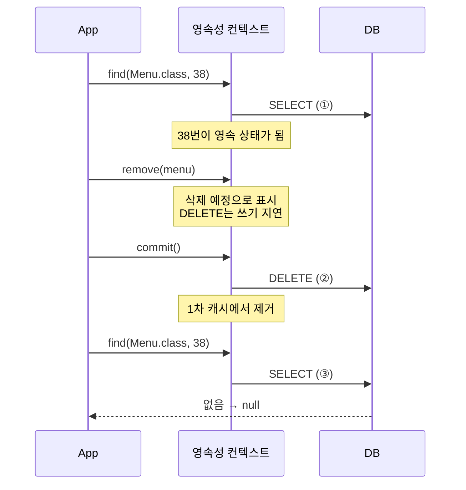

## 들어가며 (Situation)

`chap02-persistence-context` CRUD 실습의 마지막은 삭제다. `EntityManagerCRUD.removeMenu()`는 이렇게 생겼다.

```java
public void removeMenu(int menuCode) {

    EntityManager manager = factory.createEntityManager();

    // 삭제 할 엔티티 객체 find
    Menu removeMenu = manager.find(Menu.class, menuCode);

    // DML 수행 전 트랜젝션 시작!
    EntityTransaction transaction = manager.getTransaction();
    transaction.begin();

    try {
        manager.remove(removeMenu);
        transaction.commit();
    } catch (Exception e) {
        transaction.rollback();
    }

    // 삭제 여부 확인
    Menu removedMenu = manager.find(Menu.class, menuCode);
    System.out.println("removedMenu = " + removedMenu);

    manager.close();
}
```

수업 주석이 정리한 규칙은 두 가지다.

> - 삭제할 엔티티는 먼저 조회 후 영속성 컨텍스트가 관리하고 있는 상태에서 삭제가 가능하다.
> - remove(); 메서드를 호출해도 commit() 이 되는 시점에 delete 쿼리문이 DB 로 전송된다.

## 문제 상황 (Task)

JDBC라면 `DELETE FROM tbl_menu WHERE menu_code = ?` 한 번이면 된다. JPA는 왜 굳이 먼저 조회할까? 확인할 것을 정했다.

1. `remove()` 전에 `find()`를 하지 않으면 어떻게 될까?
2. DELETE는 정말 `commit()` 때 나갈까? 삭제 후 `find()`는 어떤 결과를 낼까?
3. **없는 메뉴 번호**를 넣으면 어떻게 될까?

## 해결 과정 (Action)

### 1. 정상 삭제: 38번 메뉴

[persist 글]()에서 등록하고 [변경 감지 글]()에서 이름을 바꾼 38번 메뉴를 삭제했다.

```text
삭제할 메뉴 코드 : Hibernate: select m1_0.menu_code, ... from tbl_menu m1_0 where m1_0.menu_code=?
Hibernate: delete from tbl_menu where menu_code=?
Hibernate: select m1_0.menu_code, ... from tbl_menu m1_0 where m1_0.menu_code=?
removedMenu = null
```

SQL이 세 번 나갔다.



1. **SELECT**: 삭제할 엔티티를 먼저 조회해서 영속 상태로 만든다.
2. **DELETE**: `remove()`는 삭제를 예약만 하고, `commit()` 때 DELETE가 전송된다.
3. **SELECT**: 삭제 확인용 `find()`. 1차 캐시에서 엔티티가 빠졌으므로 다시 DB에 물어봤고, 결과는 `null`이다.

[변경 감지 글]()에서는 커밋 후 `find()`에 SELECT가 없었다. 여기서는 SELECT가 나갔다. 삭제된 엔티티는 캐시에 남지 않는다는 것을 알 수 있다.

### 2. 없는 메뉴(999번)를 삭제하면

999번처럼 없는 번호를 넣었다.

```text
삭제할 메뉴 코드 : Hibernate: select m1_0.menu_code, ... from tbl_menu m1_0 where m1_0.menu_code=?
Hibernate: select m1_0.menu_code, ... from tbl_menu m1_0 where m1_0.menu_code=?
removedMenu = null
```

DELETE가 없다. 그런데 **아무 오류 메시지도 없이** `removedMenu = null`이 찍혔다. 화면만 보면 삭제에 성공한 것처럼 보인다.

무슨 일이 있었는지 추적했다.

1. `find(Menu.class, 999)` → 행이 없으니 `null`
2. `manager.remove(null)` → **예외 발생**
3. `catch (Exception e)` → `rollback()`만 하고 끝. 예외 내용은 출력하지 않는다.
4. 확인용 `find()` → 역시 `null` → `removedMenu = null`

어떤 예외였는지 확인하려고 같은 상황을 재현했다. (확인용 **예시 코드**)

```java
try {
    em.remove(em.find(AssignedMenu.class, 999));
} catch (Exception e) {
    System.out.println("예외: " + e.getClass().getName() + " / " + e.getMessage());
    tx.rollback();
}
```

```text
예외: java.lang.IllegalArgumentException / Entity may not be null
```

`remove(null)`은 `IllegalArgumentException`을 던진다. 수업 코드에서는 이 예외를 `catch`가 **삼켜 버려서** 사용자도 개발자도 실패를 알 수 없었다. "삭제 실패"와 "삭제 성공"이 화면에서 똑같이 `removedMenu = null`로 보인다.

이 문제는 `registMenu()`, `modifyMenuName()`에도 똑같이 있다. 예를 들어 없는 메뉴 번호로 수정하면 `foundMenu.setMenuName()`에서 `NullPointerException`이 나고, 역시 조용히 롤백된다. 최소한 아래처럼 바꾸는 편이 좋다. (**예시 코드**)

```java
Menu removeMenu = manager.find(Menu.class, menuCode);
if (removeMenu == null) {
    System.out.println(menuCode + "번 메뉴가 존재하지 않습니다.");
    manager.close();
    return;
}
...
} catch (Exception e) {
    transaction.rollback();
    System.out.println("삭제 실패 : " + e.getMessage());
}
```

### 3. 조회 없이 new 객체로 삭제하면

주석의 "먼저 조회 후 영속성 컨텍스트가 관리하고 있는 상태에서"라는 조건도 확인했다. PK만 채운 `new` 객체를 바로 `remove()`했다. (확인용 **예시 코드**)

```java
AssignedMenu detached = new AssignedMenu();
detached.menuCode = 40;   // DB 에 존재하는 번호
em.remove(detached);
tx.commit();
```

```text
예외: java.lang.IllegalArgumentException / org.hibernate.DetachedObjectException: Given entity is not associated with the persistence context
```

DB에 40번 행이 있어도 **삭제되지 않았다.** Hibernate는 "이 객체는 영속성 컨텍스트가 관리하는 객체가 아니다"라며 거부했다. `remove()`는 PK 값을 받아 지우는 메서드가 아니라, **영속성 컨텍스트가 관리하는 엔티티**를 삭제 상태로 바꾸는 메서드다. 그래서 먼저 `find()`로 영속 상태를 만들어야 한다.

| 넘긴 객체 | 결과 |
|-----------|------|
| `find()`로 가져온 영속 엔티티 | commit 때 DELETE |
| `null` (없는 PK를 `find()`한 결과) | `IllegalArgumentException: Entity may not be null` |
| PK만 채운 `new` 객체 | `IllegalArgumentException` (`DetachedObjectException`) |

### 4. CRUD 정리

`chap02` section01의 네 메서드를 표로 정리했다.

| 작업 | EntityManager 호출 | 트랜잭션 | SQL 전송 시점 |
|------|--------------------|----------|---------------|
| 조회 | `find(타입, PK)` | 불필요 | 즉시 (1차 캐시에 없을 때) |
| 등록 | `persist(엔티티)` | 필요 | commit (IDENTITY면 즉시) |
| 수정 | 없음 (값 변경) | 필요 | commit (변경 감지) |
| 삭제 | `remove(영속 엔티티)` | 필요 | commit |

## 결과 (Result)

| 확인 항목 | 결과 |
|-----------|------|
| 정상 삭제 SQL | SELECT → DELETE(commit 시) → SELECT, 결과 `null` |
| 삭제 후 `find()` | 1차 캐시에서 빠져 다시 SELECT |
| 없는 번호 삭제 | `IllegalArgumentException`이 catch에서 삼켜짐 → 화면은 성공과 똑같이 `removedMenu = null` |
| `new` 객체로 삭제 | `DetachedObjectException`, DB 행은 그대로 |

배운 점은 다음과 같다.

- `remove()`는 영속 상태의 엔티티만 받는다. 그래서 "조회 후 삭제"가 기본 패턴이다.
- DELETE도 쓰기 지연이 적용되어 commit 때 전송된다.
- `catch`에서 예외를 출력하지 않고 롤백만 하면, 실패가 성공처럼 보인다. `find()` 결과의 `null` 확인과 실패 메시지가 필요하다.

## 더 학습하면 좋은 개념

- **엔티티 생명주기(비영속·영속·준영속·삭제)** — `new`, `persist`, `remove`, `close`가 엔티티 상태를 어떻게 바꾸는지 한 그림으로 정리하기.
- **`getReference()`** — SELECT 없이 프록시만 얻어서 `remove()`에 넘기는 방법과 주의점.
- **JPQL 벌크 DELETE** — 여러 행을 한 번에 지울 때 쓰는 `DELETE FROM Menu m WHERE ...`와, 이 방식이 영속성 컨텍스트를 거치지 않는다는 점.
- **예외 처리 원칙** — [예외 처리 글]()에서 다룬 "예외를 삼키지 말 것"이 JPA 트랜잭션 코드에서 왜 더 중요한지.

## 참고 자료

- [Jakarta Persistence 3.2 API - EntityManager (remove)](https://jakarta.ee/specifications/persistence/3.2/apidocs/jakarta.persistence/jakarta/persistence/EntityManager.html)
- [Jakarta Persistence 3.2 Specification - Entity Instance's Life Cycle](https://jakarta.ee/specifications/persistence/3.2/jakarta-persistence-spec-3.2.html)
- [Hibernate ORM 7.4 User Guide - Persistence Context](https://docs.hibernate.org/orm/7.4/userguide/html_single/#pc)

---

**요약**
1. `remove()`는 `find()`로 영속 상태가 된 엔티티를 삭제 예정으로 표시하고, DELETE는 commit 때 전송됐다. 삭제 후 `find()`는 1차 캐시에서 빠져 다시 SELECT한 뒤 `null`을 반환했다.
2. 없는 번호를 삭제하면 `remove(null)`이 `IllegalArgumentException`을 던졌다. 수업 코드는 이를 catch에서 삼켜 성공과 똑같은 `removedMenu = null`만 출력했다.
3. PK만 채운 `new` 객체를 `remove()`하면 `DetachedObjectException`으로 거부됐다. 삭제는 반드시 영속 엔티티로 해야 한다.
