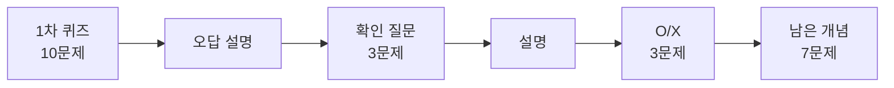
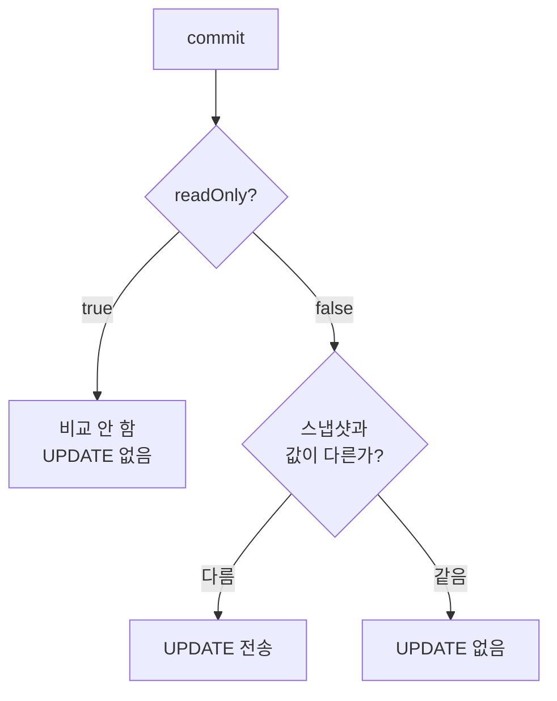
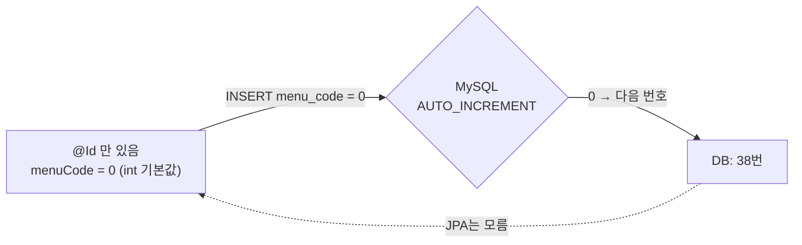

## 들어가며 (Situation)

JPA 첫날 실습(`chap01-jpa-intro`, `chap02-persistence-context`)을 개념별 글 8개로 정리했다. 글을 쓰고 나니 다 이해한 것 같았다. 그래서 정말 이해했는지 **복습 퀴즈 10문제**를 풀어 봤다. 문제는 오늘 실습 코드와 실행 결과에서 냈다.

## 문제 상황 (Task)

목표는 단순했다. 퀴즈로 **모르는 것을 찾고**, 모르는 것이 없어질 때까지 다시 묻는다.

1차 퀴즈 결과는 생각보다 나빴다.

| 결과 | 문항 수 | 문항 |
|------|---------|------|
| 거의 정답 | 2 | 쓰기 지연·flush(7), 없는 메뉴 삭제(10) |
| 부분 정답 | 2 | JDBC 요구사항 변경(1), 패러다임 불일치(2) |
| 오답 | 2 | 1차 캐시(3), `ddl-auto`(5) |
| 모름 | 4 | `readOnly`(4), EMF/EM(6), `menuCode=0`(8), 변경 감지(9) |

글을 8개나 썼는데 10문제 중 2개만 맞혔다. **"읽어서 아는 것"과 "설명할 수 있는 것"은 달랐다.**

## 해결 과정 (Action)

틀린 문제마다 설명을 듣고, 같은 개념을 다른 형태로 다시 물어보는 방식으로 3번 더 확인했다.



### 1. 오답 ①: 1차 캐시 — "2번"이라고 답했다

> Q. `@Transactional` 안에서 같은 메뉴를 `find()`로 두 번 조회하면 SELECT는 몇 번 나갈까?
>
> 내 답: 2번. 트랜잭션을 할 수 없어.

정답은 **1번**이다. 실습 로그에서도 `2번째 조회` 아래에 SQL이 없었다.

```text
=========1번째 조회=========
Hibernate: select ... where m1_0.menu_code=?
=========2번째 조회=========
menu1 == menu2 : true
```

`EntityManager` 안에는 조회한 객체를 보관하는 **영속성 컨텍스트**가 있다. 그 안의 1차 캐시는 "엔티티 타입 + PK → 객체"를 저장한다. 두 번째 `find()`는 DB에 가기 전에 여기서 같은 객체를 꺼낸다.

내가 말한 "2번"은 `@Transactional`이 **없을 때**의 답이었다. 트랜잭션이 없으면 `find()`마다 영속성 컨텍스트가 새로 만들어졌다가 버려진다. 그래서 SELECT가 2번 나가고 `==`도 `false`다.

| 조건 | SELECT | `menu1 == menu2` |
|------|--------|------------------|
| `@Transactional` 있음 | 1번 | true |
| 트랜잭션 없음 | 2번 | false |

확인 질문에서 "같은 트랜잭션에서 `find()`를 3번 하면?"이라는 문제에는 **1번**이라고 답했다. 몇 번을 조회해도 처음 한 번만 DB에 간다.

### 2. 모름: `readOnly`와 변경 감지 — "UPDATE 메서드도 없는데?"

이 두 문제는 결국 같은 개념이었다.

> Q4. `readOnly = true` 트랜잭션에서 이름을 바꿨는데 DB가 그대로인 이유는?
> Q9. 같은 이름으로 다시 수정하면 UPDATE가 나갈까?
>
> 내 답: 아직 모르겠어. / 몰라.

JPA에는 `update()` 메서드가 없다. 수정은 **변경 감지(Dirty Checking)**로 일어난다.

```java
Menu menu = manager.find(Menu.class, 38);   // ① SELECT + 조회 당시 값(스냅샷) 저장
menu.setMenuName("수정된메뉴");               // ② 자바 객체만 바뀜, SQL 없음
transaction.commit();                        // ③ 스냅샷과 비교 → 다르면 UPDATE
```



이 그림 하나로 두 문제가 풀렸다.

- Q4: `readOnly = true`라서 비교 자체를 하지 않았다. 객체만 바뀌고 DB는 그대로였다.
- Q9: 같은 값이면 스냅샷과 같으므로 UPDATE가 없다. 실제로 실행해도 SQL이 나가지 않았다.

확인 질문 "`readOnly = false`에서 이름을 바꾸고 커밋하면 무슨 SQL이 나갈까?"에는 처음에 "몰라!"라고 답했다. 설명을 들은 뒤 O/X 문제를 풀었다.

| 문제 | 내 답 | 결과 |
|------|-------|------|
| `setMenuName()`을 호출하는 순간 UPDATE가 나간다 | X | 정답 — UPDATE는 commit 때 |
| 같은 이름으로 다시 수정하면 UPDATE가 없다 | O | 정답 — 스냅샷과 같음 |

판단 기준은 **"setter를 불렀는가"가 아니라 "조회 당시와 값이 다른가"**다.

### 3. 오답 ②: `ddl-auto: create` — "메뉴가 추가된다"

> Q. `ddl-auto`를 `create`로 바꾼 채 `menudb`에 연결하면?
>
> 내 답: menudb에 메뉴들이 추가돼.

가장 위험한 오해였다. `create`는 **기존 테이블을 지우고(DROP) 다시 만든다(CREATE).** 메뉴 36개가 모두 사라진다.

| 값 | 기존 데이터 |
|----|-------------|
| `none` | 그대로 (수업 설정) |
| `validate` | 그대로 (구조 검사만) |
| `update` | 그대로 (바뀐 구조만 반영) |
| `create` | **삭제** |
| `create-drop` | **삭제** (종료 때도 삭제) |

다시 낸 O/X 문제 "`update`로 실행하면 기존 데이터가 지워진다"에는 **X**로 정답을 맞혔다. 이름이 "만든다"여도 동작은 "지우고 다시 만든다"라는 점을 기억해 두기로 했다.

### 4. 모름: EntityManagerFactory와 EntityManager — "정확히 모르겠어"

식당에 비유한 설명이 이해하기 쉬웠다.

| 객체 | 비유 | 개수 | 이유 |
|------|------|------|------|
| `EntityManagerFactory` | 주방 | 앱당 1개, 공유 | 만드는 비용이 크고 thread-safe |
| `EntityManager` | 손님별 주문서 | 요청마다 1개, `close()` | 안에 영속성 컨텍스트가 있어서 공유하면 섞임 |

확인 문제 결과는 이렇다.

| 문제 | 내 답 | 결과 |
|------|-------|------|
| `EntityManagerFactory`는 요청마다 새로 만든다 | X | 정답 |
| `EntityManager` 하나를 여러 요청이 써도 된다 | X | 정답 |
| 다 쓴 `EntityManager`에 호출하는 메서드 | `close()` | 정답 |
| `@PersistenceContext` 필드에 들어 있던 것은? | 몰라 | **오답** |

마지막 문제의 답은 **프록시(대리 객체)**다. 실습 중에 실제 클래스를 출력하면 `jdk.proxy2.$Proxy94`로 나왔다. 이 프록시는 호출될 때마다 **지금 트랜잭션 전용의 진짜 `EntityManager`**를 찾아 일을 넘긴다. 그래서 싱글톤 빈의 필드 하나에 들어 있어도 안전하다. [AOP 수업]()에서 본 `$$SpringCGLIB$$` 프록시와 같은 아이디어다.

### 5. 모름: 등록했는데 `menuCode=0` — "auto 머시기"

> Q. 등록한 메뉴가 출력에는 `menuCode=0`, DB에는 38번으로 들어간 이유는?
>
> 내 답: 아직 모르겠어.

조각으로 나눠 다시 물었다.

| 문제 | 내 답 | 결과 |
|------|-------|------|
| `@Id`만 있으면 JPA는 PK를 개발자가 넣는다고 본다 | O | 정답 |
| 입력받지 않았는데 0이 들어간 이유 | 기본값 0이 들어갔다 | 정답 (`int` 기본값) |
| DB가 만든 번호를 객체에도 채우려면? | auto 머시기일 거 같아 | 절반 정답 |

흐름을 이어 보면 이렇다.



해결책은 PK를 DB가 만든다고 JPA에 알려 주는 것이다.

```java
@Id
@GeneratedValue(strategy = GenerationType.IDENTITY)
@Column(name = "menu_code")
private int menuCode;
```

"auto"라는 답은 테이블의 `AUTO_INCREMENT`에서 떠올린 것이었다. JPA에는 `GenerationType.AUTO`라는 값도 따로 있어서 헷갈리기 쉽다. `AUTO`는 "Hibernate가 DB에 맞는 방식을 고른다"는 뜻이고, MySQL에서는 번호 관리용 테이블을 쓰는 방식이 선택될 수 있다. **`AUTO_INCREMENT` 컬럼에는 `IDENTITY`**로 외워 두기로 했다.

### 6. 맞힌 문제도 다듬기

맞힌 두 문제도 설명을 들으며 한 단계 더 정확해졌다.

- **쓰기 지연과 flush (7번)**: 내 답은 "SQL을 모아 두는 곳 / 몰아서 보내는 것"이었다. 여기에 **flush는 전송이고, 확정은 commit**이라는 점을 더했다. flush 후 rollback하면 DB 값이 원래대로 돌아온다.
- **없는 메뉴 삭제 (10번)**: "null 때문에 예외 → rollback"이라고 답했다. 실제 예외는 NPE가 아니라 `IllegalArgumentException: Entity may not be null`이었다. catch가 예외를 출력하지 않아서 **실패가 성공처럼 보인다**는 점이 진짜 문제였다.

## 결과 (Result)

| 단계 | 문항 | 정답 | 비고 |
|------|------|------|------|
| 1차 퀴즈 | 10 | 2 (+부분 2) | 모름 4, 오답 2 |
| 확인 질문 | 3 | 1 | 1차 캐시만 정답 |
| O/X | 3 | **3** | 변경 감지, `ddl-auto` 정리 |
| 남은 개념 | 7 | 5 (+절반 1) | 프록시만 모름 |

| 개념 | 처음 | 지금 |
|------|------|------|
| 1차 캐시와 동일성 보장 | 오답 | 이해 |
| `readOnly`와 변경 감지 | 모름 | 이해 |
| `ddl-auto` | 오답 | 이해 |
| EMF와 EM | 모름 | 프록시만 다시 보기 |
| `@GeneratedValue` | 모름 | `IDENTITY` 이름 외우기 |

배운 점은 다음과 같다.

- 오늘 모른다고 답한 문제 대부분은 한 문장으로 연결된다. **JPA는 영속성 컨텍스트에 객체를 넣어 두고 관리하다가, 커밋할 때 바뀐 것만 SQL로 보낸다.**
- 글을 쓰는 것과 문제를 푸는 것은 다르다. 퀴즈 10문제 중 2개만 맞히고 나서야 빈틈이 보였다.
- 크게 묻지 말고 잘게 쪼개 물으면 "모름"이 "부분 정답"으로 바뀐다. `menuCode=0` 문제는 세 조각으로 나누자 3개 중 2.5개를 맞혔다.

## 더 학습하면 좋은 개념

- **엔티티 생명주기(비영속·영속·준영속·삭제)** — 오늘 헷갈린 문제는 대부분 "이 객체가 지금 영속 상태인가"로 설명된다.
- **기본 키 생성 전략(IDENTITY, SEQUENCE, TABLE, AUTO)** — `AUTO`와 `IDENTITY`를 다시 헷갈리지 않기 위해.
- **트랜잭션 범위 영속성 컨텍스트** — `@PersistenceContext` 프록시가 트랜잭션마다 다른 매니저를 쓰는 원리.
- **인출 연습(retrieval practice)** — 읽기보다 떠올리기가 기억에 더 남는다는 학습법. 이번 퀴즈 방식이 바로 이것이다.

## 참고 자료

- [Jakarta Persistence 3.2 API - EntityManager](https://jakarta.ee/specifications/persistence/3.2/apidocs/jakarta.persistence/jakarta/persistence/EntityManager.html)
- [Hibernate ORM 7.4 User Guide - Persistence Context](https://docs.hibernate.org/orm/7.4/userguide/html_single/#pc)
- [Spring Framework Reference - JPA (Shared EntityManager)](https://docs.spring.io/spring-framework/reference/data-access/orm/jpa.html)
- [Spring Framework Reference - Using @Transactional](https://docs.spring.io/spring-framework/reference/data-access/transaction/declarative/annotations.html)
- [Spring Boot How-to - Database Initialization (ddl-auto)](https://docs.spring.io/spring-boot/how-to/data-initialization.html)

오늘 실습을 개념별로 정리한 글은 아래에 있다.

- [동일성 보장과 1차 캐시]()
- [변경 감지]()
- [EntityManagerFactory와 EntityManager]()
- [persist와 @GeneratedValue]()

---

**요약**
1. JPA 1일차 복습 퀴즈 10문제 중 2개만 맞혔고, 1차 캐시·`readOnly`·변경 감지·`ddl-auto`·EMF/EM·`@GeneratedValue`에서 빈틈이 드러났다.
2. 오답을 설명 듣고 잘게 쪼개 다시 풀자 O/X 3/3, 마지막 7문제 중 5.5개를 맞혔다. 남은 것은 `@PersistenceContext` = 프록시, `AUTO_INCREMENT` = `IDENTITY` 두 가지다.
3. 헷갈린 개념 대부분은 "영속성 컨텍스트가 객체를 관리하다가 커밋 때 바뀐 것만 SQL로 보낸다"는 한 문장으로 연결됐다.
