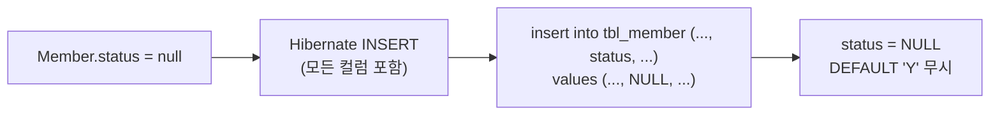

## 들어가며 (Situation)

JPA 2일차(`chap03-entity-mapping`)에서는 엔티티 클래스의 어노테이션으로 **테이블을 만드는** 실습을 했다. `application.yaml`의 `ddl-auto: create` 덕분에 앱을 실행하면 Hibernate가 `tbl_member`를 새로 만든다.

```java
@Entity
@Table(name = "tbl_member")
public class Member {

    @Id
    @Column(name = "member_no")
    @GeneratedValue(strategy = GenerationType.IDENTITY)
    private int memberNo;

    @Column(name = "member_id", nullable = false,
            unique = true, columnDefinition = "varchar(10)")
    private String memberId;

    @Column(name = "member_pwd", nullable = false)
    private String memberPwd;

    @Column(name = "member_name")
    private String memberName;

    @Column(name = "phone", unique = true)
    private String phone;

    @Column(name = "address", length = 900)
    private String address;

    @Column(name = "enroll_date")
    private LocalDateTime enrollDate;

    @Column(name = "member_role")
    @Enumerated(EnumType.STRING)
    private MemberRole memberRole;          // ROLE_MEMBER, ROLE_ADMIN

    @Column(name = "status", columnDefinition = "char(1) default 'Y'")
    private String status;
}
```

계층도 처음으로 Controller → Service → Repository로 나눴다. Repository는 `@PersistenceContext`로 `EntityManager`를 받아 `persist()`와 `find()`를 부르고, Service는 `@Transactional`로 트랜잭션을 연다. [1일차에 직접 `begin()`/`commit()`을 부르던 코드]()가 어노테이션 하나로 바뀌었다.

## 문제 상황 (Task)

어노테이션의 속성이 DDL로 바뀐다고 배웠지만, 어떤 SQL이 나왔는지는 콘솔 로그가 지나가 버려서 제대로 보지 못했다. 그래서 실습 때 만들어진 `tbl_member`를 MySQL에서 직접 열어 보기로 했다.

특히 두 가지가 궁금했다.

1. `@Enumerated(EnumType.STRING)`은 컬럼을 무슨 타입으로 만들까?
2. `status`의 `default 'Y'`는 언제 적용될까? 엔티티의 `status`가 `null`이면 `'Y'`가 들어갈까?

## 해결 과정 (Action)

### 1. 실습이 만든 테이블 그대로 보기

실습할 때 만들어진 테이블이 `menudb`에 남아 있었다. 앱을 다시 실행하면 `ddl-auto: create`가 테이블을 지우고 새로 만들므로, 실행하지 않고 그대로 조회했다.

```sql
SHOW CREATE TABLE tbl_member;
```

```sql
CREATE TABLE `tbl_member` (
  `member_no` int NOT NULL AUTO_INCREMENT,
  `enroll_date` datetime(6) DEFAULT NULL,
  `address` varchar(900) DEFAULT NULL,
  `member_id` varchar(10) NOT NULL,
  `member_name` varchar(255) DEFAULT NULL,
  `member_pwd` varchar(255) NOT NULL,
  `phone` varchar(255) DEFAULT NULL,
  `status` char(1) DEFAULT 'Y',
  `member_role` enum('ROLE_ADMIN','ROLE_MEMBER') DEFAULT NULL,
  PRIMARY KEY (`member_no`),
  UNIQUE KEY `UK35ypgkanb6sdhg3w2vm7a3hth` (`member_id`),
  UNIQUE KEY `UKpjk14ciouogycw4l00u28rjuo` (`phone`)
)
```

어노테이션과 결과를 나란히 놓았다.

| 필드 | 어노테이션 | 만들어진 컬럼 |
|------|-----------|---------------|
| `memberNo` | `@Id` + `IDENTITY` | `int NOT NULL AUTO_INCREMENT`, PK |
| `memberId` | `nullable=false, unique=true, columnDefinition="varchar(10)"` | `varchar(10) NOT NULL` + UNIQUE |
| `memberName` | `@Column(name=...)`만 | `varchar(255)` (기본 길이 255) |
| `address` | `length = 900` | `varchar(900)` |
| `enrollDate` | `LocalDateTime` | `datetime(6)` (마이크로초까지) |
| `memberRole` | `@Enumerated(STRING)` | **`enum('ROLE_ADMIN','ROLE_MEMBER')`** |
| `status` | `columnDefinition="char(1) default 'Y'"` | `char(1) DEFAULT 'Y'` |

몇 가지가 눈에 띄었다.

- 컬럼 순서가 필드 선언 순서와 다르다. PK가 맨 앞이고, 나머지는 Hibernate가 자체 규칙으로 순서를 정했다. DDL을 자동 생성하면 컬럼 순서까지 내 뜻대로 되지는 않는다.
- `unique = true`는 `UK35ypgk...`처럼 사람이 읽기 어려운 이름의 제약 조건을 만든다. 에러 로그에서 어떤 컬럼이 중복됐는지 바로 알기 어렵다. `@Table(uniqueConstraints = @UniqueConstraint(name = "uk_member_id", ...))`로 이름을 정해 줄 수 있다.
- `@Enumerated(STRING)`은 `varchar`가 아니라 MySQL의 `enum` 타입이 됐다. 수업 주석에 적힌 "Hibernate 6 + MySQL에서는 enum 타입으로 생성된다"는 내용이 실제로 확인됐다.

### 2. `enum` 컬럼은 DB도 값을 검사한다

`member_role`이 MySQL `enum`이므로, 목록에 없는 값은 DB가 거부한다. 다른 데이터에 영향을 주지 않도록 트랜잭션 안에서 넣어 보고 롤백했다.

```sql
START TRANSACTION;
INSERT INTO tbl_member(member_id, member_pwd, member_role) VALUES ('badrole', 'p', 'ROLE_GUEST');
-- ERROR 1265 (01000): Data truncated for column 'member_role' at row 1
ROLLBACK;
```

`sql_mode`에 `STRICT_TRANS_TABLES`가 켜져 있어서 에러로 막혔다. 장점도 있지만, 나중에 Java enum에 `ROLE_GUEST`를 추가하면 `ddl-auto: none` 환경에서는 **DB 컬럼 정의도 함께 바꿔야** 한다. 이 때문에 `columnDefinition = "varchar(20)"`으로 일반 문자열 컬럼을 쓰는 팀도 많다.

`ORDINAL`과 `STRING`의 차이도 다시 정리했다.

| | `EnumType.ORDINAL` | `EnumType.STRING` |
|---|---|---|
| 저장 값 | 0, 1 (선언 순서) | `'ROLE_MEMBER'` (이름) |
| enum 순서를 바꾸면 | **기존 데이터의 의미가 바뀜** | 영향 없음 |
| 이름을 바꾸면 | 영향 없음 | 기존 데이터와 불일치 |
| 실무 | 거의 안 씀 | 권장 |

### 3. `DEFAULT 'Y'`는 "값을 안 보냈을 때"만 동작한다

MySQL의 `DEFAULT`는 INSERT 문에 그 컬럼이 **아예 없을 때** 쓰인다. 컬럼을 적고 `NULL`을 넣으면 `NULL`이 들어간다. 롤백할 트랜잭션에서 확인했다.

```sql
START TRANSACTION;
INSERT INTO tbl_member(member_id, member_pwd)         VALUES ('omit', 'p');
INSERT INTO tbl_member(member_id, member_pwd, status) VALUES ('explnull', 'p', NULL);
SELECT member_id, status FROM tbl_member WHERE member_id IN ('omit', 'explnull');
ROLLBACK;
```

```text
member_id   status
explnull    NULL
omit        Y
```

문제는 Hibernate가 만드는 INSERT 문이다. Hibernate는 기본적으로 엔티티의 **모든 컬럼을 INSERT 문에 넣는다.** 엔티티의 `status`가 `null`이면 `status = NULL`을 명시해서 보낸다. 그러면 `DEFAULT 'Y'`는 쓰이지 않는다.



수업 코드에서 이 문제가 드러나지 않은 이유는 `Section01Application.inputMember()`가 `newMember.setStatus("Y")`로 **항상 값을 넣었기** 때문이다. 실습 때 저장된 회원(`abc`)도 `status`가 `Y`였다.

그래서 기본값은 DB가 아니라 엔티티에서 정하는 편이 확실하다. (**예시 코드**)

```java
@Column(name = "status", columnDefinition = "char(1) default 'Y'")
private String status = "Y";      // 객체를 만들 때부터 'Y'
```

아니면 객체를 만드는 정적 메서드 안에서 상태를 정해 두는 방법도 있다. 어느 쪽이든 "값을 비워 두면 DB가 알아서 채운다"에 기대지 않는다.

### 4. `@Transactional(readOnly = true)`와 `IDENTITY`

`findByMemberNo()`에는 `@Transactional(readOnly = true)`를 붙였다. 조회만 하는 메서드라서 Hibernate가 [변경 감지용 스냅샷]()을 비교하지 않아도 된다. `registMember()`는 `IDENTITY` 전략이라 `persist()` 시점에 바로 INSERT가 나가고, 그래서 `return member.getMemberNo()`가 DB가 만든 번호를 돌려줄 수 있다([쓰기 지연과 IDENTITY]()).

## 결과 (Result)

| 확인 항목 | 결과 |
|-----------|------|
| `@Enumerated(STRING)` 컬럼 타입 | MySQL `enum('ROLE_ADMIN','ROLE_MEMBER')` |
| enum에 없는 값 INSERT | `ERROR 1265 Data truncated` |
| `unique = true` 제약 조건 이름 | `UK35ypgkanb6sdhg3w2vm7a3hth` (자동 생성) |
| `DEFAULT 'Y'` + 컬럼 생략 | `Y` |
| `DEFAULT 'Y'` + `NULL` 명시 | `NULL` |
| 환경 | Spring Boot 4.1.2, MySQL 8.0, `ddl-auto: create` |

배운 점은 다음과 같다.

- `@Column`의 속성은 **테이블을 만들 때(DDL)** 쓰인다. 이미 있는 테이블(`ddl-auto: none`)에는 아무 영향이 없다.
- DB의 `DEFAULT`는 컬럼을 생략할 때만 쓰인다. Hibernate는 모든 컬럼을 보내므로 기본값은 엔티티 필드나 생성 메서드에서 정한다.
- 생성된 DDL은 짐작하지 말고 `SHOW CREATE TABLE`로 확인한다.

## 더 학습하면 좋은 개념

- **`@DynamicInsert`** — `null`인 컬럼을 INSERT 문에서 빼서 DB 기본값이 쓰이게 하는 Hibernate 어노테이션. 동작 원리와 단점을 함께 보자.
- **`@PrePersist`** — 저장 직전에 기본값을 채우는 엔티티 생명주기 콜백.
- **`ddl-auto`와 Flyway/Liquibase** — 운영 환경에서 스키마를 코드로 관리하는 방법.
- **`AttributeConverter`** — enum을 `'Y'`/`'N'`처럼 원하는 값으로 저장하는 방법.

## 참고 자료

- [Jakarta Persistence 3.2 - @Column](https://jakarta.ee/specifications/persistence/3.2/apidocs/jakarta.persistence/jakarta/persistence/column)
- [Jakarta Persistence 3.2 - @Enumerated](https://jakarta.ee/specifications/persistence/3.2/apidocs/jakarta.persistence/jakarta/persistence/enumerated)
- [Hibernate ORM User Guide - Enums / @DynamicInsert](https://docs.jboss.org/hibernate/orm/6.6/userguide/html_single/Hibernate_User_Guide.html)
- [MySQL 8.0 Reference - Data Type Default Values](https://dev.mysql.com/doc/refman/8.0/en/data-type-defaults.html)
- [MySQL 8.0 Reference - The ENUM Type](https://dev.mysql.com/doc/refman/8.0/en/enum.html)

---

**요약**
1. 실습이 만든 `tbl_member`를 `SHOW CREATE TABLE`로 보니 `@Enumerated(STRING)`은 MySQL `enum` 타입, `unique = true`는 `UK35ypgk...` 같은 자동 이름의 제약 조건이 됐다.
2. `DEFAULT 'Y'`는 INSERT에서 컬럼을 생략할 때만 쓰이고, `NULL`을 명시하면 `NULL`이 저장됐다. Hibernate는 모든 컬럼을 보내므로 엔티티의 `status`가 `null`이면 기본값이 무시된다.
3. 수업 코드는 `setStatus("Y")`로 항상 값을 넣어서 문제가 드러나지 않았다. 기본값은 엔티티 필드나 생성 메서드에서 정하는 편이 확실하다.
