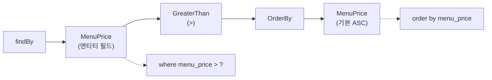
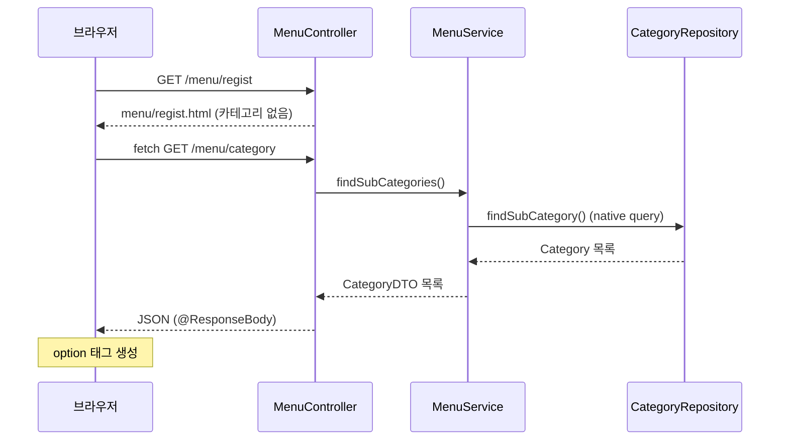

## 들어가며 (Situation)

JPA 단원 마지막 실습은 메뉴 관리 웹 서비스를 만드는 미니 프로젝트(`module07-jpa-mini-project`)였다. 강사님이 PRD(제품 요구사항 문서)와 빈 TODO가 있는 코드를 주고, 하나씩 채우는 방식이다. 둘째 날에는 조회 기능을 만들었다.

1일차 실습과 가장 크게 달라진 점은 Repository다. `EntityManager`를 직접 쓰지 않고 **인터페이스만** 만든다.

```java
@Repository
public interface MenuRepository extends JpaRepository<Menu, Integer> {

    List<Menu> findByMenuPriceGreaterThanOrderByMenuPrice(int menuPrice);
}
```

```java
@Repository
public interface CategoryRepository extends JpaRepository<Category, Integer> {

    @Query(value = "select * from tbl_category m where ref_category_code is not null order by category_code",
           nativeQuery = true)
    List<Category> findSubCategory();
}
```

구현 클래스는 한 줄도 쓰지 않았다. Spring Data JPA가 실행 시점에 구현체를 만든다.

## 문제 상황 (Task)

가격 검색 기능은 PRD에 이렇게 정의돼 있었다.

> F-03 가격으로 메뉴 검색 (입력 가격 **초과**, 가격 오름차순)

그런데 내가 Service에 적은 주석은 이랬다.

```java
public List<MenuDTO> findByMenuPrice(int menuPrice) {
    // 사용자가 입력한 menuPrice 이상인 메뉴 엔티티를 조회
    // 가격별 오름차순 정렬
    List<Menu> menuList = menuRepository.findByMenuPriceGreaterThanOrderByMenuPrice(menuPrice);
    ...
}
```

"이상"과 "초과"는 경계값(입력한 가격과 **같은** 메뉴)에서 결과가 달라진다. 메서드 이름만 보고는 실제 SQL이 `>`인지 `>=`인지 확신할 수 없었다.

또 하나, 메뉴 등록 화면의 카테고리 목록은 화면을 만들 때 Model로 넘기지 않고, 페이지가 열린 뒤 JavaScript의 `fetch`로 따로 받아 온다. 컨트롤러가 화면이 아니라 **데이터**를 돌려줘야 했다.

## 해결 과정 (Action)

### 1. `show-sql`로 메서드 이름이 만든 SQL 보기

`application.yaml`에 `show-sql: true`, `format_sql: true`가 켜져 있어서 실행한 SQL이 콘솔에 찍힌다. `/menu/search?menuPrice=10000`을 요청하자 WHERE 절이 이렇게 나왔다.

```sql
where
    m1_0.menu_price>? 
order by
    m1_0.menu_price
```

`GreaterThan`은 `>`, 즉 **초과**다. PRD와 쿼리는 맞고, 내 주석이 틀렸다. 화면 제목도 "💰 10000원 초과 메뉴 목록"이었다. 주석은 실행되지 않으니 틀려도 아무도 알려 주지 않는다. 그래서 주석을 고쳐야 할 대상으로 남겨 두었다.

Spring Data JPA는 메서드 이름을 **문법에 맞춰 잘라서** 쿼리를 만든다.



| 키워드 | SQL | 이번 프로젝트 |
|--------|-----|---------------|
| `GreaterThan` | `>` | 가격 초과 검색 |
| `GreaterThanEqual` | `>=` | "이상"이 필요하면 이것 |
| `OrderBy...Desc` | `order by ... desc` | 내림차순 |
| `existsBy` | 있는지만 확인해 boolean 반환 | 다음 날 이름 중복 확인에 사용 |

필드 이름은 **DB 컬럼명이 아니라 엔티티 필드명**(`menuPrice`)이다. `findByMenu_price`처럼 컬럼명을 쓰면 앱이 시작할 때 "No property found" 에러가 난다.

### 2. 쿼리 메서드로 쓰기 힘든 조건은 `@Query`

하위 카테고리는 "`ref_category_code`가 `NULL`이 아닌 것"이다. `findByRefCategoryCodeIsNotNullOrderByCategoryCode()`처럼 쓸 수도 있지만 이름이 너무 길다. 그래서 `@Query`로 SQL을 직접 적었다.

| 방식 | 대상 | 특징 |
|------|------|------|
| 쿼리 메서드 | 엔티티 필드 | 조건이 단순할 때 편함, 이름이 길어짐 |
| `@Query` (JPQL, 기본) | 엔티티와 필드 | DB 종류에 덜 묶임 |
| `@Query(nativeQuery = true)` | 실제 테이블과 컬럼 | MySQL 문법 그대로, DB를 바꾸면 고쳐야 함 |

native query는 문자열이라 오타가 있어도 컴파일이 된다. 쿼리 메서드는 필드명이 틀리면 **앱 시작 시점**에 에러가 나므로 실수를 더 빨리 잡는다.

### 3. `@ResponseBody`로 화면 대신 JSON 돌려주기

```java
@GetMapping("/category")
@ResponseBody
public List<CategoryDTO> findCategoryList() {
    return menuService.findSubCategories();
}
```

`@ResponseBody`가 붙으면 반환값을 View 이름으로 보지 않는다. Spring이 `List<CategoryDTO>`를 Jackson으로 **JSON 문자열로 바꿔** 응답 본문에 쓴다. curl로 확인했다.

```bash
curl -s localhost:8080/menu/category
```

```json
[{"categoryCode":4,"categoryName":"한식","refCategoryCode":1},
 {"categoryCode":5,"categoryName":"중식","refCategoryCode":1},
 {"categoryCode":6,"categoryName":"일식","refCategoryCode":1}, ...]
```

JSON의 키는 `CategoryDTO`의 **getter 이름**에서 나왔다(`getCategoryCode()` → `categoryCode`). 엔티티가 아니라 DTO를 돌려주므로 엔티티 구조를 바꿔도 이 JSON 모양은 유지된다.

등록 화면(`regist.html`)은 이 데이터를 받아 `<option>`을 만든다.

```javascript
fetch('/menu/category')
    .then(res => res.json())          // 문자열 JSON → JavaScript 객체
    .then(data => {
        const $categoryCode = document.getElementById("categoryCode");
        for (let index in data) {
            const $option = document.createElement("option");
            $option.value = data[index].categoryCode;
            $option.textContent = data[index].categoryName;
            $categoryCode.appendChild($option);
        }
    });
```



수업 주석이 `@ResponseBody`의 등장 이유를 이렇게 설명했다. 컨트롤러의 마지막 책임이 "View 반환"이면, 메인 화면에 메뉴·주문·회원 목록을 함께 보여 줄 때 각 화면 코드를 반복해야 한다. 데이터만 돌려주면 어느 화면이든 필요한 데이터를 따로 가져다 쓸 수 있다.

### 4. `findAll(Sort.by("menuCode"))`와 Entity → DTO

전체 목록은 `JpaRepository`가 이미 가진 `findAll()`에 정렬을 넘겼다. 엔티티는 Service 밖으로 내보내지 않고 `stream().map(MenuDTO::from).toList()`로 DTO로 바꿨다.

```java
return menuRepository.findAll(Sort.by("menuCode")).stream()
        .map(MenuDTO::from)
        .toList();
```

## 결과 (Result)

| 확인 항목 | 결과 |
|-----------|------|
| `findByMenuPriceGreaterThan...` WHERE 절 | `menu_price > ?` (초과) |
| 내 주석 | "이상" → 틀림 (PRD는 "초과") |
| `/menu/category` | 하위 카테고리 JSON 배열 (`categoryCode` 4부터) |
| JSON 키 | DTO getter 이름 |
| 환경 | Spring Boot 3.5.13, Hibernate 6.6.45, MySQL 8.0 |

배운 점은 다음과 같다.

- 쿼리 메서드는 이름이 곧 SQL이다. 경계값이 중요한 조건은 `show-sql`로 실제 SQL을 확인한다. 주석은 검증되지 않는다.
- `@ResponseBody`는 컨트롤러의 반환값을 View가 아닌 데이터(JSON)로 바꾼다. 화면과 데이터를 따로 받을 수 있게 된다.

## 더 학습하면 좋은 개념

- **`@RestController`** — 클래스의 모든 메서드에 `@ResponseBody`를 붙인 것과 같다. JSON API를 만들 때 쓴다.
- **JPQL** — 테이블이 아니라 엔티티를 대상으로 쓰는 쿼리 언어. native query와 비교해 보자.
- **`Pageable`과 페이징** — `findAll(Pageable)`로 목록을 나눠 가져오는 방법.
- **Jackson 직렬화** — 객체가 JSON이 되는 규칙(getter, `@JsonIgnore`), 엔티티를 그대로 반환하면 생기는 문제.

## 참고 자료

- [Spring Data JPA Reference - Query Methods](https://docs.spring.io/spring-data/jpa/reference/jpa/query-methods.html)
- [Spring Data JPA Reference - Repository query keywords](https://docs.spring.io/spring-data/jpa/reference/repositories/query-keywords-reference.html)
- [Spring Framework Reference - @ResponseBody](https://docs.spring.io/spring-framework/reference/web/webmvc/mvc-controller/ann-methods/responsebody.html)
- [MDN - Using the Fetch API](https://developer.mozilla.org/en-US/docs/Web/API/Fetch_API/Using_Fetch)

---

**요약**
1. `findByMenuPriceGreaterThanOrderByMenuPrice`는 `show-sql` 로그에서 `menu_price > ?`로 확인됐다. PRD의 "초과"와 맞고, "이상"이라고 적은 내 주석이 틀렸다.
2. 쿼리 메서드는 엔티티 필드명으로 SQL을 만들고, 이름이 길어지는 조건은 `@Query`(native query)로 직접 SQL을 적었다.
3. `@ResponseBody`를 붙인 `/menu/category`는 `CategoryDTO` 목록을 JSON으로 돌려줬고, 등록 화면은 `fetch`로 받아 `<option>`을 만들었다.
