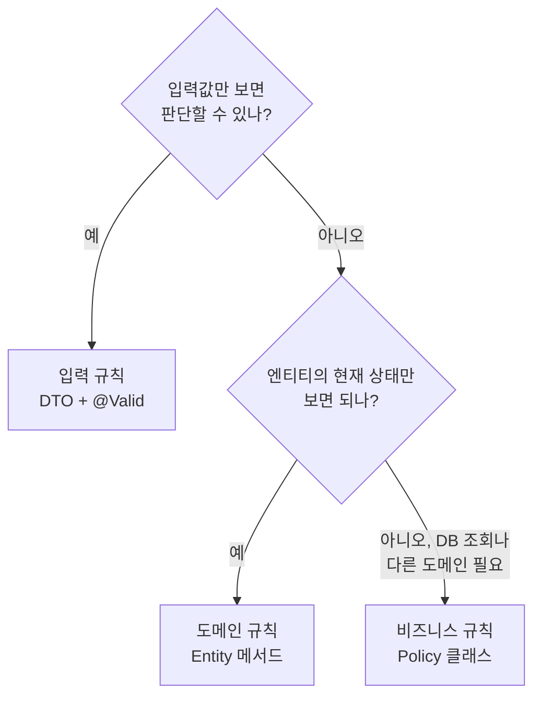
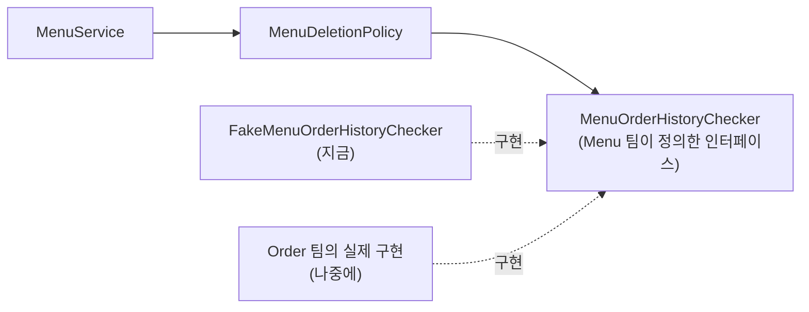

## 들어가며 (Situation)

JPA 미니 프로젝트의 등록·수정·삭제 기능을 만들자 규칙이 쏟아졌다.

- 메뉴 이름은 비어 있으면 안 되고 30자 이하다.
- 같은 이름의 메뉴가 이미 있으면 안 된다.
- 상위 카테고리(식사, 음료…)에는 메뉴를 등록할 수 없다.
- 판매 중인 메뉴는 삭제할 수 없다.
- 주문된 적 있는 메뉴는 삭제할 수 없다.

처음 떠오른 방법은 Service 메서드 안에 `if`를 차례로 쓰는 것이었다. 수업 코드의 주석에 바로 그 "Before" 코드가 있었다.

```java
@Transactional
public int registNewMenu(MenuDTO registMenu) {
    // ① 이름 중복 금지 (다른 메뉴를 조회해야 판단 가능)
    if (menuRepository.existsByMenuName(registMenu.getMenuName())) {
        throw new BusinessException(ErrorCode.DUPLICATE_MENU_NAME);
    }
    // ② 하위 카테고리에만 등록 (카테고리를 조회해야 판단 가능)
    Category category = categoryRepository.findById(registMenu.getCategoryCode())
            .orElseThrow(() -> new BusinessException(ErrorCode.CATEGORY_NOT_FOUND));
    if (category.getRefCategoryCode() == null) {
        throw new BusinessException(ErrorCode.NOT_SUB_CATEGORY);
    }
    // ③ 흐름 : 생성 -> 저장 -> 반환  (정작 이 메서드의 "할 일" 은 여기 3줄뿐이다)
    Menu menu = Menu.create(registMenu.getMenuName(), registMenu.getMenuPrice(), registMenu.getCategoryCode());
    menuRepository.save(menu);
    return menu.getMenuCode();
}
```

## 문제 상황 (Task)

이 코드는 동작한다. 하지만 수업 주석이 지적한 문제가 있었다.

1. 이름 중복 규칙은 이름 **수정**에도 필요하다. 복사하면 한쪽만 고쳤을 때 등록과 수정의 규칙이 달라진다.
2. Service가 "`refCategoryCode`가 `null`이면 상위 카테고리"라는 `Category`의 **내부 사정**을 알아야 한다.
3. 규칙이 늘수록 `if`가 쌓여 ③ 흐름이 묻힌다.
4. 삭제 규칙 "주문된 메뉴는 삭제 불가"는 **다른 팀(Order 팀)**의 데이터가 필요하다.

규칙마다 "어디에 둘지"를 정하는 기준이 필요했다.

## 해결 과정 (Action)

### 1. 질문 세 개로 규칙을 분류하기

수업에서 정한 기준은 "그 규칙을 판단하려면 무엇이 필요한가"였다.



| 규칙 | 판단에 필요한 것 | 종류 | 위치 |
|------|-----------------|------|------|
| 이름 필수, 30자 이하 / 가격 0원 이상 | 입력값 | 입력 | `MenuDTO` (`@NotBlank`, `@Size`, `@Min`) |
| 신규 메뉴는 판매 중(`Y`)으로 시작 | 없음 | 도메인 | `Menu.create()` |
| 판매 중인 메뉴는 삭제 불가 | 메뉴의 현재 상태 | 도메인 | `Menu.validateDeletable()` |
| 이름 중복 금지 | 다른 메뉴들 (DB 조회) | 비즈니스 | `MenuNamePolicy` |
| 하위 카테고리에만 등록 | 카테고리 (DB 조회) | 비즈니스 | `MenuCategoryPolicy` |
| 주문된 메뉴 삭제 불가 | 다른 팀의 주문 데이터 | 비즈니스 | `MenuDeletionPolicy` |

"판매 중인 메뉴 삭제 불가"를 DTO로 검사할 수 없는 이유도 분명해졌다. 삭제 요청에는 `menuCode` 하나만 온다. 그 메뉴가 지금 판매 중인지는 DB에 저장된 **현재 상태**를 봐야 안다.

### 2. Entity: setter 대신 이름 있는 메서드

`Menu`에서 `@Setter`를 빼고, 전체 생성자는 `private`으로 막았다. 메뉴를 만들거나 바꾸는 길은 이름 있는 메서드뿐이다.

```java
@NoArgsConstructor
@AllArgsConstructor(access = AccessLevel.PRIVATE)
@Getter
@Entity
@Table(name = "tbl_menu")
public class Menu {
    private static final String ON_SALE = "Y";
    private static final String STOPPED = "N";
    ...
    public static Menu create(String menuName, int menuPrice, int categoryCode) {
        return new Menu(0, menuName, menuPrice, categoryCode, ON_SALE);   // 항상 판매 중으로 시작
    }

    public void changeMenuName(String newMenuName) {
        this.menuName = newMenuName;
    }

    public void validateDeletable() {
        if (this.orderableStatus.equals(ON_SALE)) {
            throw new BusinessException(ErrorCode.ON_SALE_MENU_CANNOT_DELETE);
        }
    }
}
```

`"Y"`에 `ON_SALE`이라는 이름을 붙이자, 바깥 코드는 `"Y"`가 무슨 뜻인지 알 필요가 없어졌다. `Category`도 같은 방식으로 스스로 답하게 했다.

```java
public boolean isSubCategory() {
    return refCategoryCode != null;    // 최상위 카테고리는 NULL → int가 아닌 Integer
}
```

`category.getRefCategoryCode() == null`을 바깥에서 해석하던 코드가 `!category.isSubCategory()`가 됐다. 나중에 "하위 카테고리"의 정의가 바뀌어도 `Category` 한 곳만 고치면 된다.

### 3. Policy: DB를 봐야 하는 규칙

```java
@Component
@RequiredArgsConstructor
public class MenuNamePolicy {
    private final MenuRepository menuRepository;

    public void validateNewName(String menuName) {
        if (menuRepository.existsByMenuName(menuName)) {
            throw new BusinessException(ErrorCode.DUPLICATE_MENU_NAME);
        }
    }
}
```

Policy는 "된다/안 된다"만 판단하고, 안 되면 예외를 던진다. Entity는 Repository를 주입받지 않으므로 DB 조회가 필요한 규칙은 Policy의 몫이다.

### 4. 다른 팀 데이터: 인터페이스 계약 + Fake

"주문된 메뉴 삭제 불가"를 위해 Order 팀의 Repository를 직접 주입하면, Menu 팀 코드가 Order 팀의 테이블 구조에 묶인다. 그래서 **필요한 쪽(Menu 팀)이 인터페이스를 정의**하고, **가진 쪽(Order 팀)이 구현**하도록 했다.

```java
// Menu 팀이 정의 (domain/menu/model/policy)
public interface MenuOrderHistoryChecker {
    boolean hasOrdered(int menuCode);
}
```

```java
// Order 팀이 구현하기 전까지 쓰는 가짜 구현 (domain/order)
@Component
public class FakeMenuOrderHistoryChecker implements MenuOrderHistoryChecker {
    private static final Set<Integer> ORDERED_MENU_CODES = Set.of(1, 2, 3);

    @Override
    public boolean hasOrdered(int menuCode) {
        return ORDERED_MENU_CODES.contains(menuCode);
    }
}
```



Order 팀이 진짜 구현을 만들면 Fake를 빼고 그 Bean을 넣으면 된다. `MenuDeletionPolicy`와 `MenuService`는 한 줄도 바뀌지 않는다.

### 5. 남은 Service: 흐름만

```java
@Transactional
public int registNewMenu(MenuDTO registMenu) {
    menuNamePolicy.validateNewName(registMenu.getMenuName());              // 비즈니스 규칙
    menuCategoryPolicy.validateRegistrable(registMenu.getCategoryCode());  // 비즈니스 규칙

    Menu menu = Menu.create(registMenu.getMenuName(), registMenu.getMenuPrice(), registMenu.getCategoryCode());
    menuRepository.save(menu);
    return menu.getMenuCode();
}

@Transactional
public void deleteMenu(int menuCode) {
    Menu found = menuRepository.findById(menuCode)
            .orElseThrow(() -> new BusinessException(ErrorCode.MENU_NOT_FOUND));
    found.validateDeletable();                       // 도메인 규칙 (Y/N)
    menuDeletionPolicy.validateDeletable(menuCode);  // 비즈니스 규칙 (주문 이력)
    menuRepository.delete(found);
}
```

메서드를 위에서 아래로 읽으면 "규칙 확인 → 생성/변경 → 저장"이 그대로 보인다.

### 6. 실제로 막히는지 확인

DB를 바꾸지 않는 요청만 골라 보냈다. 규칙에 걸리면 저장 전에 예외가 나므로 데이터는 그대로다.

| 요청 | 걸린 규칙 | 응답 |
|------|-----------|------|
| 기존 메뉴(2번 "쉬림프스무디")와 같은 이름으로 등록 | `MenuNamePolicy` | 409 이미 존재하는 메뉴 이름입니다. |
| 상위 카테고리(1번)로 등록 | `MenuCategoryPolicy` | 400 메뉴는 하위 카테고리에만 등록할 수 있습니다. |
| 2번 메뉴 삭제 (판매 중, 주문 이력 있음) | `Menu.validateDeletable()` (먼저 걸림) | 409 판매중인 메뉴는 삭제할 수 없습니다. |
| 없는 999번 삭제 | `findById().orElseThrow` | 404 메뉴를 찾을 수 없습니다. |

`existsByMenuName`이 실행한 SQL은 `where m1_0.menu_name=? ... limit`이었다. 개수를 세지 않고 하나만 찾으면 멈춘다.

### 7. 한계: 동시에 같은 이름을 등록하면

`MenuNamePolicy`의 주석이 한계도 적어 두었다. 두 사람이 동시에 같은 이름을 등록하면 둘 다 "없음"을 확인한 뒤 둘 다 저장할 수 있다. 조회와 저장 사이에 틈이 있기 때문이다. `tbl_menu`의 인덱스를 확인해 보니 `menu_name`에는 UNIQUE 제약이 없었다.

```text
Key_name          Column_name
PRIMARY           menu_code
fk_category_code  category_code
```

마지막 방어선은 DB 제약이다. 운영 환경이라면 `menu_name`에 UNIQUE를 걸고, 그때 나는 `DataIntegrityViolationException`을 같은 에러 코드로 바꿔 주는 처리가 필요하다(전역 핸들러의 TODO 5가 그 자리다).

## 결과 (Result)

| | Before | After |
|---|---|---|
| `registNewMenu()`의 `if` | 2개 + Category 내부 해석 | 0개 (Policy 2줄) |
| 이름 중복 규칙 위치 | 등록·수정에 복사될 예정 | `MenuNamePolicy` 한 곳 |
| `"Y"`의 의미를 아는 곳 | Service | `Menu`만 |
| Order 팀 의존 | Repository 직접 주입 | 인터페이스 + Fake |
| 환경 | Spring Boot 3.5.13, Hibernate 6.6.45, MySQL 8.0 | |

배운 점은 다음과 같다.

- 규칙의 위치는 "그 규칙을 판단하는 데 무엇이 필요한가"로 정한다. 입력값만이면 DTO, 엔티티 상태면 Entity, DB나 다른 도메인이면 Policy다.
- Service에 `if`가 늘어나면 옮길 대상이라는 신호다. Service에는 흐름과 트랜잭션만 남긴다.
- 애플리케이션의 중복 검사는 동시 요청을 막지 못한다. 최종 보장은 DB 제약이 한다.

## 더 학습하면 좋은 개념

- **"묻지 말고 시켜라(Tell, Don't Ask)"** — `getRefCategoryCode() == null` 대신 `isSubCategory()`를 만든 원칙.
- **의존성 역전 원칙(DIP)** — Menu 팀이 인터페이스를 소유하고 Order 팀이 구현하는 구조의 이름.
- **테스트 더블(Fake, Stub, Mock)** — `FakeMenuOrderHistoryChecker` 같은 가짜 구현의 종류와 쓰임.
- **낙관적 락과 UNIQUE 제약** — 동시성 문제를 DB 수준에서 막는 방법.

## 참고 자료

- [Spring Data JPA Reference - Query Methods (exists projection)](https://docs.spring.io/spring-data/jpa/reference/jpa/query-methods.html)
- [Spring Framework Reference - Dependency Injection](https://docs.spring.io/spring-framework/reference/core/beans/dependencies/factory-collaborators.html)
- [Spring Framework Reference - Declarative Transaction Management](https://docs.spring.io/spring-framework/reference/data-access/transaction/declarative.html)
- [MySQL 8.0 Reference - Unique Indexes](https://dev.mysql.com/doc/refman/8.0/en/create-index.html#create-index-unique)

---

**요약**
1. 규칙을 "판단에 무엇이 필요한가"로 나눠 입력 규칙은 DTO(`@Valid`), 상태 규칙은 Entity(`validateDeletable()`), DB·다른 도메인이 필요한 규칙은 Policy 클래스로 옮겼다.
2. 다른 팀 데이터는 Menu 팀이 정의한 `MenuOrderHistoryChecker` 인터페이스와 Fake 구현으로 받아, Service는 흐름과 트랜잭션만 남았다.
3. 중복 이름(409), 상위 카테고리(400), 판매 중 삭제(409)가 저장 전에 막히는 것을 확인했고, `menu_name`에 UNIQUE가 없어 동시 등록은 여전히 열려 있다.
