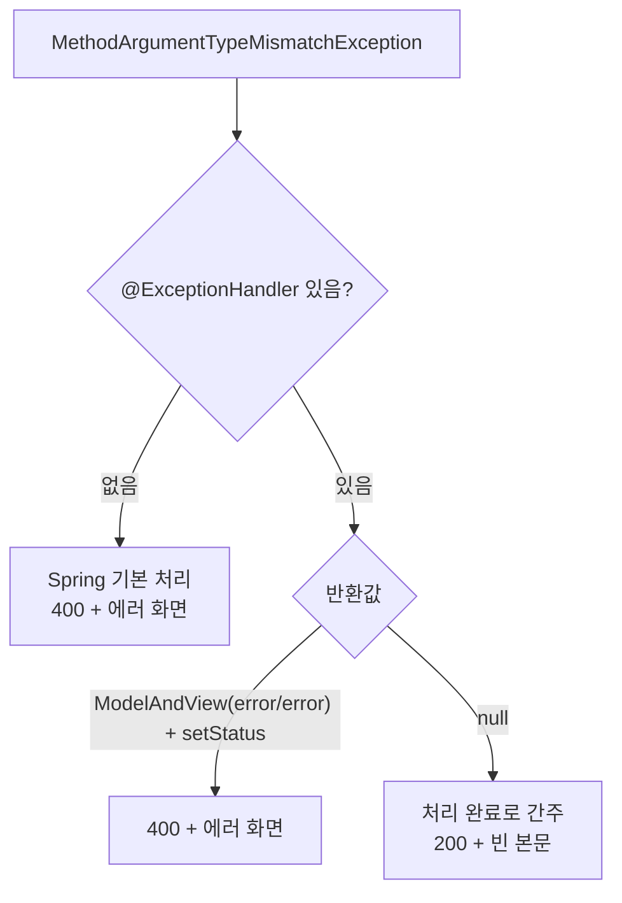

## 들어가며 (Situation)

JPA 미니 프로젝트 셋째 날에는 메뉴를 **바꾸는** 기능(등록·수정·삭제)을 만들었다. 데이터를 바꾸는 기능이 생기자 "이건 막아야 하는데?" 하는 입력이 쏟아졌다. 그래서 두 가지를 함께 만들었다.

1. **입력 검증** — DTO 필드에 규칙을 적고 `@Valid`로 검사
2. **전역 예외 처리** — 컨트롤러에는 `try-catch`를 쓰지 않고 `@ControllerAdvice` 한 곳에서 에러 화면을 만든다

```java
public class MenuDTO {
    @NotBlank(message = "메뉴 이름은 필수입니다!")
    @Size(max = 30, message = "메뉴 이름은 30자 이하입니다")
    private String menuName;

    @Min(value = 0, message = "메뉴 가격은 0원 이상 입력")
    private int menuPrice;

    @Positive(message = "카테고리를 선택 해주세요")
    private int categoryCode;
    ...
}
```

```java
@PostMapping("/regist")
public ModelAndView registMenu(@Valid @ModelAttribute MenuDTO registMenu, ModelAndView mv) { ... }

@GetMapping("/search")
public ModelAndView findByMenuPrice(@RequestParam @Min(value = 0, message = "가격은 0원 이상 입력!") int menuPrice,
                                    ModelAndView mv) { ... }
```

## 문제 상황 (Task)

`GlobalExceptionHandler`에는 핸들러가 7개 있었다. 수업 시간에는 TODO 1~3(비즈니스 예외, `@Valid` 실패, 파라미터 검증 실패)만 채웠고, 4~7은 `return null;`인 채로 남았다.

```java
@ExceptionHandler({MissingServletRequestParameterException.class, MethodArgumentTypeMismatchException.class})
public ModelAndView handleBadRequest(Exception e) {
    // TODO 4
    return null;
}

@ExceptionHandler(NoResourceFoundException.class)
public ModelAndView handleNoResource(NoResourceFoundException e) {
    // TODO 6
    return null;
}

@ExceptionHandler(Exception.class)
public ModelAndView handleException(Exception e) {
    // TODO 7
    return null;
}
```

확인하고 싶은 점은 두 가지였다.

1. 채운 핸들러들은 사용자에게 **내가 적은 메시지**를 보여 줄까?
2. 아직 `null`을 반환하는 핸들러에 걸리는 요청은 어떻게 될까? 기본 에러 화면이 뜰까?

## 해결 과정 (Action)

### 1. 잘못된 요청을 종류별로 보내기

앱을 띄우고 curl로 요청을 보냈다. 쓰기 요청은 검증에서 막히는 것만 골랐다.

```bash
curl -s "localhost:8080/menu/search?menuPrice=-1"
curl -s -d menuName= -d menuPrice=1000 -d categoryCode=4 localhost:8080/menu/regist
curl -s "localhost:8080/menu/abc"
```

| 요청 | 걸린 예외 → 핸들러 | 상태 | 화면 메시지 |
|------|--------------------|------|-------------|
| `/menu/999` (없는 메뉴) | `BusinessException` → TODO 1 | 404 | 메뉴를 찾을 수 없습니다. |
| 등록, 이름 빈칸 | `MethodArgumentNotValidException` → TODO 2 | 400 | 메뉴 이름은 필수입니다! |
| 등록, `menuPrice=abc` | `MethodArgumentNotValidException` → TODO 2 | 400 | menuPrice의 형식이 올바르지 않습니다 |
| 등록, 상위 카테고리(1번) | `BusinessException` → TODO 1 | 400 | 메뉴는 하위 카테고리에만 등록할 수 있습니다. |
| `/menu/search?menuPrice=-1` | `HandlerMethodValidationException` → TODO 3 | 400 | **400 BAD_REQUEST "Validation failure"** |
| `/menu/search?menuPrice=abc` | `MethodArgumentTypeMismatchException` → TODO 4 | **200** | **(빈 화면, 0바이트)** |
| `/menu/search` (가격 없음) | `MissingServletRequestParameterException` → TODO 4 | **200** | **(빈 화면)** |
| `/menu/abc` | `MethodArgumentTypeMismatchException` → TODO 4 | **200** | **(빈 화면)** |
| `/nothing` (없는 주소) | `NoResourceFoundException` → TODO 6 | **200** | **(빈 화면)** |
| `POST /menu/stop` | 컨트롤러 TODO 8이 `null` 반환 | **200** | **(빈 화면)** |

### 2. `@Valid` 실패: 형식 오류와 규칙 위반을 나눈다

TODO 2는 `BindException`을 받는다. `@Valid @ModelAttribute` 실패 예외인 `MethodArgumentNotValidException`이 `BindException`의 자식이기 때문이다.

```java
@ExceptionHandler(BindException.class)
public ModelAndView handleBindException(BindException e) {
    FieldError fieldError = e.getFieldError();
    String message = fieldError.isBindingFailure()
            ? fieldError.getField() + "의 형식이 올바르지 않습니다"   // "abc" → int 변환 실패
            : fieldError.getDefaultMessage();                         // @NotBlank의 message
    return errorPage(HttpStatus.BAD_REQUEST, message);
}
```

`menuPrice=abc`는 `@Min`을 검사하기도 전에 **형 변환**에서 실패한다. 이때 `getDefaultMessage()`는 `Failed to convert property value of type 'java.lang.String'...` 같은 개발자용 문장이다. `isBindingFailure()`로 나눠서 사용자에게는 짧은 문장을 보여 줬다. 결과 화면에서 둘 다 의도대로 나왔다.

### 3. `HandlerMethodValidationException.getMessage()`의 함정

`@RequestParam`에 직접 붙인 `@Min`이 실패하면 `HandlerMethodValidationException`이 난다(Spring 6.1부터는 `@Validated` 없이도 동작). TODO 3은 `e.getMessage()`를 화면에 넘겼다. 그런데 화면에 나온 것은 `@Min`에 적은 "가격은 0원 이상 입력!"이 아니라 **`400 BAD_REQUEST "Validation failure"`**였다.

`getMessage()`는 예외 자체의 요약 문장이다. 내가 적은 메시지는 검증 결과 안에 있다.

```java
String message = e.getAllErrors().get(0).getDefaultMessage();   // "가격은 0원 이상 입력!"
```

| 검증 위치 | 실패 예외 | 내 메시지를 꺼내는 곳 |
|-----------|-----------|----------------------|
| `@Valid @ModelAttribute DTO` | `MethodArgumentNotValidException` (`BindException` 자식) | `getFieldError().getDefaultMessage()` |
| `@RequestParam @Min ...` | `HandlerMethodValidationException` | `getAllErrors().get(0).getDefaultMessage()` |

### 4. `null`을 반환한 핸들러: 200 + 0바이트

예상은 "핸들러가 아무것도 안 하니 Spring 기본 에러 화면(Whitelabel)이 뜬다"였다. 결과는 **200 OK에 본문 0바이트**였다. 브라우저에는 하얀 빈 페이지만 보인다.

`@ExceptionHandler` 메서드가 호출됐다는 것은 Spring 입장에서 "예외가 처리됐다"는 뜻이다. 그 핸들러가 `ModelAndView`로 `null`을 돌려주면 Spring은 "응답은 핸들러가 알아서 다 썼다"고 보고 더 이상 아무것도 하지 않는다. 상태 코드도 바꾸지 않았으니 기본값 200이 나갔다.



핸들러가 **없을 때**보다 **있는데 비어 있을 때**가 더 나빴다. 핸들러가 없으면 Spring의 기본 처리라도 동작해서 `MethodArgumentTypeMismatchException`은 400이 된다([Spring MVC 1일차 실험]()에서 확인했다). 컨트롤러의 TODO 8(`stopSelling()`)도 `return null;`이라 같은 결과였다.

빈 칸을 채울 때는 이미 만들어 둔 `errorPage()`를 쓰면 된다. (**예시 코드**)

```java
@ExceptionHandler({MissingServletRequestParameterException.class, MethodArgumentTypeMismatchException.class})
public ModelAndView handleBadRequest(Exception e) {
    return errorPage(HttpStatus.BAD_REQUEST, "요청 값이 올바르지 않습니다.");
}

@ExceptionHandler(NoResourceFoundException.class)
public ModelAndView handleNoResource(NoResourceFoundException e) {
    return errorPage(HttpStatus.NOT_FOUND, "페이지를 찾을 수 없습니다.");
}
```

`errorPage()`는 `mv.setStatus(status)`로 상태 코드까지 맞춘다. 실제로 TODO 1~3에 걸린 요청은 404·400으로 응답했다.

### 5. 정리: 예외 하나 + 에러 코드 목록

규칙 위반마다 예외 클래스를 만들지 않고, `BusinessException` 하나에 `ErrorCode` enum을 담았다.

```java
public enum ErrorCode {
    MENU_NOT_FOUND(HttpStatus.NOT_FOUND, "메뉴를 찾을 수 없습니다."),
    DUPLICATE_MENU_NAME(HttpStatus.CONFLICT, "이미 존재하는 메뉴 이름입니다."),
    NOT_SUB_CATEGORY(HttpStatus.BAD_REQUEST, "메뉴는 하위 카테고리에만 등록할 수 있습니다."),
    ...
}
```

`BusinessException`은 `RuntimeException`이므로 `throws` 없이 전파되고, `@Transactional` 메서드 안에서 터지면 롤백된다. 상태 코드와 메시지가 enum 한곳에 모여 있어서 문구를 바꿀 때 한 줄만 고치면 된다.

## 결과 (Result)

| 확인 항목 | 결과 |
|-----------|------|
| `@Valid` 실패 메시지 | DTO에 적은 문구 표시, 형식 오류는 별도 문구 |
| `@RequestParam @Min` 실패 + `getMessage()` | "Validation failure" (내 문구 아님) |
| `null` 반환 핸들러 4종 + 컨트롤러 TODO 8 | 200, 본문 0바이트 |
| `errorPage()`를 쓴 핸들러 | 404 / 400 + 에러 화면 |
| 환경 | Spring Boot 3.5.13, spring-webmvc 6.2.17 |

배운 점은 다음과 같다.

- 예외 핸들러는 "잡았다"로 끝이 아니라 **무엇을 응답할지**까지 책임진다. `null`은 "아무 응답도 하지 않음"이 되어 200 빈 화면이 된다.
- 검증 예외는 종류마다 내 메시지가 들어 있는 위치가 다르다. `getMessage()`를 그대로 보여 주기 전에 실제 화면을 확인한다.

## 더 학습하면 좋은 개념

- **`BindingResult`로 폼에 에러 다시 보여 주기** — 에러 페이지로 보내지 않고 입력 폼에 필드별 메시지를 표시하는 방법.
- **`@Validated`와 검증 그룹** — 등록과 수정에서 다른 규칙을 적용하는 방법.
- **`ProblemDetail` (RFC 9457)** — JSON API에서 에러 응답 형식을 표준화하는 방법.
- **`@Transactional`의 롤백 규칙** — unchecked 예외만 기본 롤백되는 이유와 `rollbackFor`.

## 참고 자료

- [Spring Framework Reference - Validation (Spring MVC)](https://docs.spring.io/spring-framework/reference/web/webmvc/mvc-controller/ann-validation.html)
- [Spring Framework Reference - Exceptions (@ExceptionHandler return values)](https://docs.spring.io/spring-framework/reference/web/webmvc/mvc-controller/ann-exceptionhandler.html)
- [Spring Framework Javadoc - HandlerMethodValidationException](https://docs.spring.io/spring-framework/docs/current/javadoc-api/org/springframework/web/method/annotation/HandlerMethodValidationException.html)
- [Jakarta Bean Validation 3.0 - Built-in constraints](https://jakarta.ee/specifications/bean-validation/3.0/jakarta-bean-validation-spec-3.0.html#builtinconstraints)

---

**요약**
1. `@Valid` 실패는 `isBindingFailure()`로 형식 오류와 규칙 위반을 나눠 DTO의 메시지를 보여 줬지만, `@RequestParam @Min` 실패를 `getMessage()`로 보여 주면 "Validation failure"만 나왔다.
2. `return null;`로 남은 핸들러에 걸린 요청(`menuPrice=abc`, 없는 주소 등)은 Spring 기본 에러 화면 대신 200 + 0바이트 빈 화면이 됐다.
3. 핸들러가 없으면 Spring 기본 처리로 400이 되지만, 있는데 비어 있으면 "처리 완료"로 간주된다. 이미 만든 `errorPage()`로 상태 코드와 화면을 함께 정해야 한다.
