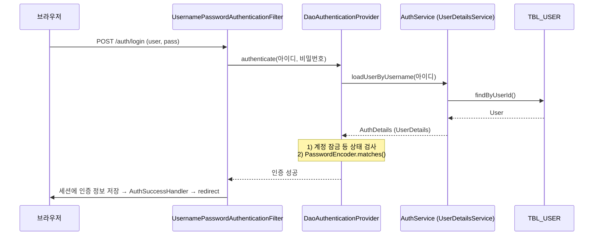

## 들어가며 (Situation)

[Servlet 단원에서는 로그인 필터를 직접 만들었다](). 세션에 사용자 정보가 있는지 확인하고, 없으면 로그인 페이지로 보내는 코드를 손으로 썼다. Spring Security 1일차(`module01-security-session`)에서는 같은 일을 설정으로 했다.

가장 낯설었던 점은 **`POST /auth/login`을 처리하는 컨트롤러가 없다**는 것이었다. `AuthController`에는 로그인 화면을 보여 주는 `GET /auth/login`만 있다.

```java
@Bean
public SecurityFilterChain configure(HttpSecurity http, AuthFailHandler authFailHandler,
                                     AuthSuccessHandler authSuccessHandler,
                                     SessionRegistry sessionRegistry) throws Exception {
    http.authorizeHttpRequests(auth -> {
        auth.requestMatchers("/auth/login", "/user/signup", "/auth/fail", "/").permitAll();
        auth.requestMatchers("/admin/*").hasAnyAuthority("ADMIN");
        auth.requestMatchers("/user/*").hasAnyAuthority("USER", "ADMIN");
        auth.anyRequest().authenticated();
    })
    .formLogin(login -> {
        login.loginPage("/auth/login");
        login.usernameParameter("user");     // login.html의 input name
        login.passwordParameter("pass");
        login.successHandler(authSuccessHandler);
        login.failureHandler(authFailHandler);
    })
    .logout(logout -> { ... })
    .sessionManagement(session -> { ... })
    .csrf(csrf -> csrf.disable());
    return http.build();
}
```

## 문제 상황 (Task)

설정은 다 채웠지만 머릿속에 그림이 없었다. 확인하고 싶은 것은 이랬다.

1. 컨트롤러 없이 누가 아이디와 비밀번호를 확인할까? 내가 만든 `AuthService`, `AuthDetails`는 그 과정 어디에 끼어드나?
2. 비밀번호는 DB에 어떻게 저장될까?
3. 권한 규칙이 실제로 USER와 ADMIN을 다르게 막을까?

## 해결 과정 (Action)

### 1. 로그인 요청은 필터가 가로챈다

`formLogin()`을 켜면 `UsernamePasswordAuthenticationFilter`가 필터 체인에 들어간다. 이 필터가 `POST /auth/login`을 컨트롤러보다 먼저 받아서 `user`, `pass` 파라미터를 꺼낸다. 그 뒤 과정은 이렇다.



내가 만든 부분은 두 개다.

- `AuthService implements UserDetailsService` : 아이디로 회원을 찾아 돌려준다. **비밀번호는 비교하지 않는다.**
- `AuthDetails implements UserDetails` : 찾은 회원 정보를 Security가 아는 모양으로 감싼다.

```java
public class AuthDetails implements UserDetails {
    private LoginUserDTO loginUserDTO;

    @Override
    public Collection<? extends GrantedAuthority> getAuthorities() {
        Collection<GrantedAuthority> authorities = new ArrayList<>();
        loginUserDTO.getRole().forEach(role -> authorities.add(() -> role));   // "USER" → 권한
        return authorities;
    }

    @Override public String getPassword() { return loginUserDTO.getPassword(); }
    @Override public String getUsername() { return loginUserDTO.getUserId(); }
    @Override public boolean isAccountNonLocked() { return !loginUserDTO.isAccountLocked(); }
    ...
}
```

비밀번호 비교와 잠금 검사는 Security(`DaoAuthenticationProvider`)가 한다. 나는 "이 사람의 정보는 이렇다"만 알려 주면 된다. Servlet 때 직접 짠 로그인 로직을 역할별로 쪼개서 프레임워크에 맡긴 셈이다.

`GrantedAuthority`는 메서드가 `getAuthority()` 하나뿐인 인터페이스라서 `() -> role` 람다로 만들 수 있었다. `getRole()`이 `"USER,ADMIN"`을 쉼표로 나누므로 한 사람이 여러 권한을 가질 수 있다. 반환 타입이 `Collection`인 이유다.

### 2. 비밀번호는 BCrypt 해시로 저장된다

테스트 계정을 가입시키고 DB를 확인했다.

```text
USER_ID       USER_ROLE  PASSWORD
zz_blogtest   ADMIN      $2a$10$7bH7b/K/npLNmZACF1epFufSoslQO37Gu4BwW/Y5uzCiEyAu4hwWW
```

평문 `pw1234`는 어디에도 없다. `$2a$`는 BCrypt, `$10$`은 비용(2¹⁰번 반복), 그다음 22글자는 무작위 솔트, 나머지가 해시다. 솔트가 매번 다르므로 같은 비밀번호도 매번 다른 값이 저장된다. 그래서 로그인할 때는 다시 해시를 만들어 문자열을 비교하지 않고, `matches(입력값, 저장값)`로 저장값 안의 솔트를 꺼내 검증한다.

### 3. 권한 규칙 확인과, 가입 화면의 구멍

USER 계정과 ADMIN 계정을 하나씩 만들고 로그인한 쿠키로 요청했다.

| 요청 | 비로그인 | USER | ADMIN |
|------|----------|------|-------|
| `/user/page` | 302 → `/auth/login` | 200 | 200 |
| `/admin/logs` | 302 → `/auth/login` | **403** | 200 |
| `/method/admin` | 302 → `/auth/login` | **200** | 200 |

`/admin/*` 규칙은 USER를 403으로 막았다. 그런데 두 가지가 눈에 걸렸다.

**첫째, `/method/admin`을 USER가 통과했다.** 응답 본문은 "ADMIN 권한 확인 완료! (@PreAuthorize 통과)"였다. 이 메서드에는 아직 `@PreAuthorize`가 없고, 설정 클래스에도 `@EnableMethodSecurity`가 없다(둘 다 TODO로 남아 있다). 그러면 `anyRequest().authenticated()`만 적용되어 로그인만 하면 누구나 들어간다. 메서드 수준 보안은 **켜야** 동작한다.

**둘째, ADMIN 계정을 만드는 데 아무 권한도 필요 없었다.** 가입 화면에 권한 선택 `<select name="role">`이 있고, 서버는 `signupDTO.getRole()`을 그대로 저장한다. 그래서 다음 요청 하나로 관리자가 됐다.

```bash
curl -d userId=zz_blogadm -d userName=a -d userPass=pw1234 -d role=ADMIN localhost:8080/user/signup
```

수업용으로 권한을 바꿔 가며 실험하기에는 편하지만, 실제 서비스라면 권한은 **서버가 정하는 값**이어야 한다. 가입은 항상 `USER`로 하고, ADMIN 부여는 관리자 기능으로 분리한다. `UserController`의 주석이 말하는 내용("작성자는 클라이언트가 보낸 값이 아니라 로그인한 사용자 기준으로 정한다")과 같은 원칙이다.

### 4. `requestMatchers`는 순서가 중요하다

`/user/signup`은 `/user/*` 패턴에도 맞는다. 그런데도 로그인 없이 가입이 됐다. `permitAll()` 규칙이 먼저 적혀 있기 때문이다. Security는 위에서부터 처음 맞는 규칙 **하나만** 적용한다. `/user/*`를 먼저 적었다면 가입 화면부터 로그인을 요구했을 것이다.

실험이 끝난 뒤 테스트 계정과 로그는 DB에서 지웠다.

## 결과 (Result)

| 확인 항목 | 결과 |
|-----------|------|
| `POST /auth/login` 처리 | 컨트롤러 없이 Security 필터가 처리 |
| 저장된 비밀번호 | `$2a$10$...` BCrypt 해시 (60자) |
| USER로 `/admin/logs` | 403 |
| USER로 `/method/admin` | 200 (`@EnableMethodSecurity`·`@PreAuthorize` 미적용) |
| 가입 시 `role=ADMIN` | 그대로 ADMIN 계정 생성 |
| 환경 | Spring Boot 3.5.13, Spring Security 6.5.9 |

배운 점은 다음과 같다.

- 내가 구현하는 것은 "회원 정보 찾기(`UserDetailsService`)"와 "정보 감싸기(`UserDetails`)"뿐이다. 비밀번호 비교와 잠금 검사는 Security가 한다.
- 권한처럼 보안에 중요한 값은 클라이언트가 보낸 값을 믿지 않는다.
- 메서드 보안은 `@EnableMethodSecurity`를 켜야 동작한다. 어노테이션을 붙이기 전, 붙인 뒤를 요청으로 확인한다.

## 더 학습하면 좋은 개념

- **`SecurityContextHolder`와 `Authentication`** — 로그인 후 "현재 사용자"가 어디에 저장되고 어떻게 꺼내지는지.
- **CSRF** — 이번 실습에서 `csrf.disable()`로 끈 보호 기능. 세션 로그인에서 왜 필요한지.
- **`hasRole` vs `hasAuthority`** — `ROLE_` 접두사 규칙의 차이.
- **JWT 기반 인증** — 세션 대신 토큰으로 로그인 상태를 유지하는 다음 단원의 방식.

## 참고 자료

- [Spring Security Reference - Form Login](https://docs.spring.io/spring-security/reference/servlet/authentication/passwords/form.html)
- [Spring Security Reference - DaoAuthenticationProvider](https://docs.spring.io/spring-security/reference/servlet/authentication/passwords/dao-authentication-provider.html)
- [Spring Security Reference - Authorize HttpServletRequests](https://docs.spring.io/spring-security/reference/servlet/authorization/authorize-http-requests.html)
- [Spring Security Reference - Method Security](https://docs.spring.io/spring-security/reference/servlet/authorization/method-security.html)
- [Spring Security Reference - Password Storage (BCrypt)](https://docs.spring.io/spring-security/reference/features/authentication/password-storage.html)

---

**요약**
1. `formLogin()`을 켜면 Security 필터가 `POST /auth/login`을 가로채고, 내가 만든 `AuthService`는 회원 조회만, 비밀번호 비교와 잠금 검사는 `DaoAuthenticationProvider`가 맡았다.
2. 비밀번호는 `$2a$10$...` 형태의 BCrypt 해시로 저장됐고, `/admin/*`는 USER를 403으로 막았지만 `@EnableMethodSecurity`가 없는 `/method/admin`은 USER도 200이었다.
3. 가입 폼의 `role` 값을 서버가 그대로 저장해서 요청 하나로 ADMIN 계정이 만들어졌다. 권한처럼 중요한 값은 서버가 정해야 한다.
