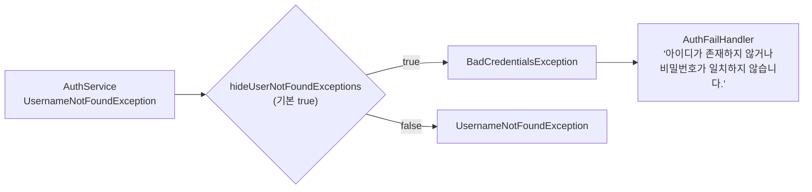

## 들어가며 (Situation)

[formLogin 흐름]()을 만든 뒤, 로그인 성공·실패 때 할 일을 핸들러로 붙였다.

- 성공(`AuthSuccessHandler`) : 실패 횟수 초기화, 성공 로그 저장
- 실패(`AuthFailHandler`) : 실패 횟수 증가(5회면 잠금), 실패 로그 저장, 예외 종류별 메시지를 `/auth/fail`로 전달

```java
@Override
public void onAuthenticationFailure(HttpServletRequest request, HttpServletResponse response,
                                    AuthenticationException exception) throws IOException, ServletException {
    String errorMessage;
    String username = request.getParameter("user");

    if (exception instanceof BadCredentialsException) {
        errorMessage = "아이디가 존재하지 않거나 비밀번호가 일치하지 않습니다.";
        if (username != null && !username.isEmpty()) {
            memberService.incrementLoginFailCount(username);
            errorMessage += " (실패 횟수: 누적)";
        }
    } else if (exception instanceof LockedException) {
        errorMessage = "계정이 잠겨있습니다. 관리자에게 문의하세요.";
    } else if (exception instanceof InternalAuthenticationServiceException) {
        errorMessage = "서버에서 오류가 발생되었습니다.";
    } else if (exception instanceof UsernameNotFoundException) {
        errorMessage = "존재하지 않는 아이디입니다.";
    } else ...

    loginLogRepository.save(LoginLog.create(username, false, request.getRemoteAddr()));
    setDefaultFailureUrl("/auth/fail?message=" + URLEncoder.encode(errorMessage, "UTF-8"));
    super.onAuthenticationFailure(request, response, exception);
}
```

잠금 규칙은 엔티티에 있다.

```java
public void increaseLoginFailCount() {
    this.loginFailCount++;
    if (this.loginFailCount >= 5) {
        this.isAccountLocked = true;
    }
}

public void resetLoginFailCount() {
    this.loginFailCount = 0;
}
```

## 문제 상황 (Task)

`AuthService`는 회원이 없으면 `UsernameNotFoundException("회원정보가 존재하지 않습니다!")`를 던진다. 그러니 없는 아이디로 로그인하면 "존재하지 않는 아이디입니다."가 떠야 한다. 그리고 비밀번호를 5번 틀리면 잠기고, 잠긴 뒤에는 맞는 비밀번호로도 못 들어가야 한다.

각 분기가 정말 동작하는지 확인하고 싶었다.

## 해결 과정 (Action)

### 1. 테스트 계정으로 실패를 만들어 보기

실습 DB(`login`)에 테스트 계정 `zz_blogtest`를 가입시킨 뒤, curl로 로그인 요청을 보내고 `/auth/fail`로 가는 redirect 주소의 메시지를 읽었다.

```bash
curl -s -o /dev/null -w '%{redirect_url}' -d user=zz_nobody -d pass=x localhost:8080/auth/login
```

| 시도 | 실패 메시지 | `LOGIN_FAIL_COUNT` | 잠금 |
|------|-------------|--------------------|------|
| 없는 아이디 `zz_nobody` | 아이디가 존재하지 않거나 비밀번호가 일치하지 않습니다. (실패 횟수: 누적) | — | — |
| `zz_blogtest` 틀린 비밀번호 1~5회 | 위와 같음 | 1 → 5 | 5회째 `1` |
| 잠긴 뒤 **맞는** 비밀번호 | 계정이 잠겨있습니다. 관리자에게 문의하세요. | 5 | 1 |

잠금은 의도대로 동작했다. 그런데 없는 아이디도 `BadCredentialsException` 분기로 갔다. "존재하지 않는 아이디입니다."는 한 번도 나오지 않았다.

### 2. Security가 `UsernameNotFoundException`을 바꿔 던진다

`DaoAuthenticationProvider`(정확히는 부모 클래스 `AbstractUserDetailsAuthenticationProvider`)에는 `hideUserNotFoundExceptions`라는 설정이 있고 기본값이 `true`다. 사용자를 찾지 못하면 `UsernameNotFoundException`을 **`BadCredentialsException`으로 바꿔서** 던진다.



이유는 보안이다. "없는 아이디"와 "비밀번호 틀림"을 다르게 알려 주면, 공격자는 메시지만 보고 **어떤 아이디가 가입돼 있는지** 알아낼 수 있다(계정 열거 공격). 그래서 Security는 기본으로 둘을 같은 예외로 합친다. 수업 코드의 첫 분기 메시지가 "아이디가 존재하지 않거나 비밀번호가 일치하지 않습니다"인 것도 같은 이유다. 결국 `UsernameNotFoundException` 분기는 기본 설정에서는 실행되지 않는 코드다.

없는 아이디일 때도 `incrementLoginFailCount("zz_nobody")`가 불렸지만, `findByUserId().ifPresent(...)`라서 아무 일도 일어나지 않았다. 실패 로그(`tbl_login_log`)에는 `zz_nobody`로 한 줄이 남았다.

### 3. 잠금은 비밀번호 검사보다 먼저 일어난다

잠긴 계정에 **맞는** 비밀번호를 넣었는데 "계정이 잠겨있습니다"가 나왔다. `DaoAuthenticationProvider`는 비밀번호를 확인하기 **전에** `UserDetails`의 상태(`isAccountNonLocked()` 등)를 먼저 검사한다. `AuthDetails.isAccountNonLocked()`가 `false`를 돌려주니 `LockedException`이 났다. 그래서 잠긴 계정은 비밀번호가 맞는지조차 알려 주지 않는다.

### 4. 한 번 잠기면 풀 방법이 없다

잠긴 뒤 DB 값은 `LOGIN_FAIL_COUNT = 5`, `IS_ACCOUNT_LOCKED = 1`이었다. 코드에서 잠금을 푸는 곳을 찾아봤다.

- `resetLoginFailCount()`는 **로그인에 성공해야** 불린다. 잠긴 계정은 성공할 수 없다.
- 그리고 이 메서드는 `loginFailCount`만 0으로 만들고 `isAccountLocked`는 건드리지 않는다.

즉 지금 코드에서는 잠긴 계정을 되돌리는 길이 DB를 직접 수정하는 것뿐이다. 실제 서비스라면 다음 중 하나가 필요하다.

| 방법 | 예 |
|------|----|
| 시간 기반 해제 | 잠긴 시각을 저장하고 30분 뒤 자동 해제 |
| 관리자 해제 | 관리자 화면에서 잠금 해제 버튼 |
| 본인 확인 후 해제 | 이메일·휴대폰 인증 후 비밀번호 재설정 |

### 5. 실패 횟수 증가와 잠금은 엔티티의 일

`MemberService.incrementLoginFailCount()`는 `@Transactional` 안에서 `User::increaseLoginFailCount`만 부른다. `save()`는 없다. 조회한 엔티티의 값이 바뀌면 커밋 시점에 [변경 감지]()로 UPDATE가 나간다. "5회면 잠금"이라는 규칙도 엔티티 안에 있어서, Service는 횟수가 몇이면 잠그는지 모른다. JPA 미니 프로젝트에서 정리한 [규칙 배치 기준]()과 같다.

실험이 끝난 뒤 테스트 계정과 내가 만든 로그 행은 DB에서 지우고, AUTO_INCREMENT도 원래 값으로 돌려놓았다.

## 결과 (Result)

| 확인 항목 | 결과 |
|-----------|------|
| 없는 아이디로 로그인 | `BadCredentialsException` 메시지 (UsernameNotFound 분기 미실행) |
| 틀린 비밀번호 5회 | `LOGIN_FAIL_COUNT=5`, `IS_ACCOUNT_LOCKED=1` |
| 잠긴 뒤 맞는 비밀번호 | `LockedException` → "계정이 잠겨있습니다" |
| 잠금 해제 경로 | 없음 (성공해야 초기화, 초기화도 잠금 플래그는 그대로) |
| 환경 | Spring Boot 3.5.13, Spring Security 6.5.9, MySQL 8.0 |

배운 점은 다음과 같다.

- 같은 "로그인 실패"라도 Security가 일부러 예외를 합친다. 메시지를 자세히 나누는 것이 항상 좋은 것은 아니다.
- 상태 검사(잠금)는 비밀번호 검사보다 먼저 일어난다.
- 잠금 기능을 만들 때는 **잠금 해제**까지 함께 설계해야 한다. 그렇지 않으면 사용자가 영구히 갇힌다.

## 더 학습하면 좋은 개념

- **계정 열거(User Enumeration) 공격** — 로그인·회원가입·비밀번호 찾기 메시지로 가입 여부를 알아내는 공격.
- **`AuthenticationEventPublisher`** — 성공·실패 이벤트를 핸들러 대신 이벤트로 받아 처리하는 방법.
- **Rate Limiting** — 아이디가 아니라 IP 단위로 시도 횟수를 제한해 무차별 대입을 막는 방법.
- **`UserDetailsChecker` (pre/post authentication checks)** — 잠금·만료 검사가 어디서 일어나는지.

## 참고 자료

- [Spring Security Reference - DaoAuthenticationProvider](https://docs.spring.io/spring-security/reference/servlet/authentication/passwords/dao-authentication-provider.html)
- [Spring Security Javadoc - AbstractUserDetailsAuthenticationProvider (setHideUserNotFoundExceptions)](https://docs.spring.io/spring-security/site/docs/current/api/org/springframework/security/authentication/dao/AbstractUserDetailsAuthenticationProvider.html)
- [Spring Security Reference - Handling Authentication Failure (Form Login)](https://docs.spring.io/spring-security/reference/servlet/authentication/passwords/form.html)
- [OWASP - Authentication Cheat Sheet (Authentication Responses)](https://cheatsheetseries.owasp.org/cheatsheets/Authentication_Cheat_Sheet.html)

---

**요약**
1. 없는 아이디로 로그인해도 Security의 `hideUserNotFoundExceptions`(기본 true)가 `UsernameNotFoundException`을 `BadCredentialsException`으로 바꿔서, "존재하지 않는 아이디입니다." 분기는 실행되지 않았다.
2. 비밀번호를 5번 틀리자 계정이 잠겼고, 잠금 검사가 비밀번호 검사보다 먼저 일어나서 맞는 비밀번호로도 "계정이 잠겨있습니다"가 나왔다.
3. 실패 횟수 초기화는 로그인 성공 때만 일어나고 잠금 플래그는 그대로라서, 지금 코드에는 잠금을 풀 방법이 없었다.
