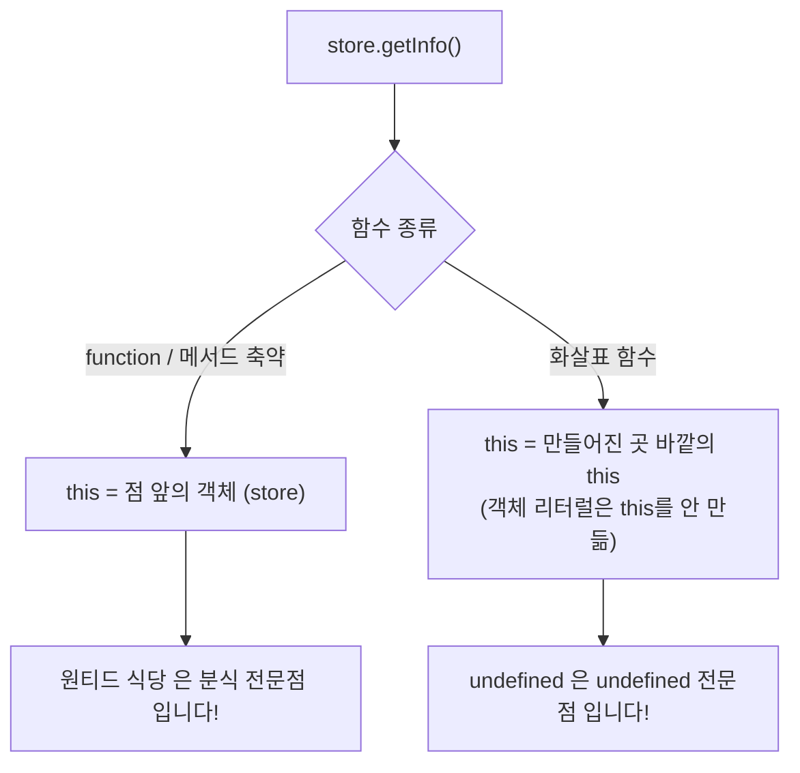

## 들어가며 (Situation)

JavaScript 첫날에는 객체(`02_object.js`)와 화살표 함수(`04_arrow-function.js`)를 연달아 배웠다. 객체는 Java의 클래스처럼 설명됐다.

```javascript
// Java 로 치면
// Store : 클래스
// name, category : 클래스의 필드 (변수)
// getInfo : 클래스의 메서드
const store = {
  name : '원티드 식당',
  category : '분식',
  getInfo : function() {
      return `${this.name} 은 ${this.category} 전문점 입니다!`
  }
}
console.log(store.getInfo());   // 원티드 식당 은 분식 전문점 입니다!
```

화살표 함수는 `function` 키워드, 중괄호, `return`을 생략하는 짧은 문법이라고 배웠다.

```javascript
message = () => '주문 접수 OK! 👌🏻'
message = (menuName, menuPrice) => `${menuName} 의 가격 ${menuPrice}`
message = menuName => `${menuName} !!`

const menuPriceList = [4000, 5000, 140000];
console.log(menuPriceList.map( price => price * 0.9 ));   // [ 3600, 4500, 126000 ]
```

## 문제 상황 (Task)

화살표 함수가 `function`의 "짧은 버전"이라면, `getInfo`도 화살표 함수로 바꿔도 같아야 한다. 그런데 바꿔 보니 결과가 달랐다.

```javascript
getInfoArrow: () => `${this?.name} 은 ${this?.category} 전문점 입니다!`
```

```text
undefined 은 undefined 전문점 입니다!
```

`this.name`이 사라졌다. "짧게 쓰는 문법"일 뿐이라면 이런 일이 없어야 한다. 화살표 함수와 일반 함수는 무엇이 다를까?

## 해결 과정 (Action)

### 1. 같은 객체에 세 가지 방식으로 메서드 만들기

```javascript
const store = {
  name: '원티드 식당', category: '분식',
  getInfo: function () { return `${this.name} 은 ${this.category} 전문점 입니다!`; },
  getInfoArrow: () => `${this?.name} 은 ${this?.category} 전문점 입니다!`,
  getInfoShort() { return `${this.name} (메서드 축약)`; },
};
console.log('function    :', store.getInfo());
console.log('arrow       :', store.getInfoArrow());
console.log('shorthand   :', store.getInfoShort());

const detached = store.getInfo;
console.log('꺼내서 호출 :', detached());
```

```text
function    : 원티드 식당 은 분식 전문점 입니다!
arrow       : undefined 은 undefined 전문점 입니다!
shorthand   : 원티드 식당 (메서드 축약)
꺼내서 호출 : undefined 은 undefined 전문점 입니다!
```

| 작성 방식 | `store.메서드()` 결과 | `this` |
|-----------|----------------------|--------|
| `function() {}` | 정상 | `store` |
| 메서드 축약 `getInfoShort() {}` | 정상 | `store` |
| 화살표 함수 `() => ...` | `undefined` | `store`가 아님 |
| 일반 함수를 변수로 꺼내서 `detached()` | `undefined` | `store`가 아님 |

### 2. 일반 함수의 `this`는 "어떻게 불렸나"로 정해진다

Java의 `this`는 항상 "그 메서드를 가진 객체"다. JavaScript 일반 함수의 `this`는 **호출하는 방식**으로 정해진다.

- `store.getInfo()`처럼 점(`.`) 앞에 객체를 두고 부르면, `this`는 그 객체다.
- 같은 함수를 `const detached = store.getInfo`로 꺼내서 `detached()`로 부르면, 점 앞에 아무것도 없다. 그래서 `this`는 `store`가 아니다.

함수는 객체에 붙어 있는 것이 아니라, 객체의 프로퍼티가 함수를 **가리키고** 있을 뿐이다. 그래서 꺼내서 부르면 연결이 끊긴다.

### 3. 화살표 함수에는 자기 `this`가 없다

화살표 함수는 `this`를 만들지 않는다. 대신 **자기가 만들어진 곳 바깥**의 `this`를 그대로 쓴다. 객체 리터럴 `{ ... }`는 함수가 아니라서 새 `this`를 만들지 않으므로, `getInfoArrow` 안의 `this`는 객체 바깥(모듈의 최상위)의 `this`다. `store`가 아니다.



MDN도 화살표 함수를 메서드로 쓰지 말라고 한다.

> Arrow function expressions should only be used for non-method functions because they do not have their own `this`.

### 4. 그럼 화살표 함수는 언제 쓰나

`this`가 필요 없는 짧은 함수, 특히 다른 함수에 넘기는 **콜백**에 쓴다. 수업에서 본 `map(price => price * 0.9)`가 대표적이다. 수업 주석대로 Java의 람다 표현식(`price -> price * 0.9`)과 모양도 쓰임도 비슷하다.

| 쓰임 | 추천 |
|------|------|
| 객체의 메서드 | 메서드 축약 `getInfo() {}` 또는 `function` |
| `map`, `filter` 같은 콜백 | 화살표 함수 |
| 이벤트 리스너에서 `this`로 요소를 쓰고 싶을 때 | `function` (화살표 함수면 `event.currentTarget` 사용) |

## 결과 (Result)

| 확인 항목 | 결과 |
|-----------|------|
| `function` 메서드 | `원티드 식당 은 분식 전문점 입니다!` |
| 화살표 함수 메서드 | `undefined 은 undefined 전문점 입니다!` |
| 메서드를 꺼내서 호출 | `undefined ...` (점 앞 객체가 없음) |
| 화살표 함수 콜백 `map` | `[ 3600, 4500, 126000 ]` |
| 실행 환경 | Node.js v24.22.1 |

배운 점은 다음과 같다.

- 화살표 함수는 짧은 문법이면서 동시에 **`this`를 갖지 않는 함수**다. 그래서 객체 메서드에는 맞지 않는다.
- 일반 함수의 `this`는 정의한 곳이 아니라 **부르는 방식**으로 정해진다. Java의 `this`와 가장 다른 점이다.

## 더 학습하면 좋은 개념

- **`call`, `apply`, `bind`** — 일반 함수의 `this`를 직접 정해 주는 방법.
- **클래스 문법 (`class`)** — Java와 비슷한 모양의 JavaScript 클래스와 그 안의 `this`.
- **렉시컬 스코프** — 화살표 함수가 바깥 `this`를 쓰는 원리와 같은 규칙.
- **이벤트 핸들러의 `this`** — DOM 이벤트에서 `this`가 무엇이 되는지. 다음 날 실습과 이어진다.

## 참고 자료

- [MDN - Arrow function expressions](https://developer.mozilla.org/en-US/docs/Web/JavaScript/Reference/Functions/Arrow_functions)
- [MDN - this](https://developer.mozilla.org/en-US/docs/Web/JavaScript/Reference/Operators/this)
- [MDN - Method definitions](https://developer.mozilla.org/en-US/docs/Web/JavaScript/Reference/Functions/Method_definitions)
- [MDN - Working with objects](https://developer.mozilla.org/en-US/docs/Web/JavaScript/Guide/Working_with_objects)

---

**요약**
1. `getInfo`를 화살표 함수로 바꾸자 `this.name`이 사라져 "undefined 은 undefined 전문점 입니다!"가 나왔다.
2. 일반 함수의 `this`는 점 앞의 객체로 정해지고, 화살표 함수는 자기 `this` 없이 바깥의 `this`를 쓰기 때문에 객체 리터럴 안에서도 `store`를 가리키지 않는다.
3. 메서드는 `function`이나 메서드 축약으로 쓰고, 화살표 함수는 `map(price => price * 0.9)` 같은 콜백에 쓴다.
