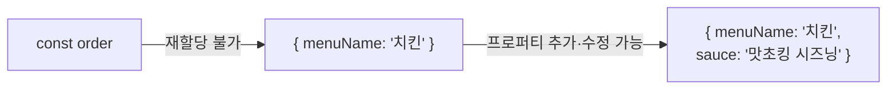

## 들어가며 (Situation)

Spring과 JPA까지 끝내고 JavaScript 단원을 시작했다. 지금까지는 Java만 써 왔기 때문에, 첫 시간(`01_variable.js`)에 수업 주석도 Java와 비교하는 말로 시작했다.

```javascript
// Java : 자료형 변수명 = 리터럴;
// JavaScript : 변수표현식 변수명 = 리터럴;

// const 변수 표현식은 상수의 의미를 가지고 있다.
// 즉 java 에서의 final
const shop = "원티드 식당";
// shop = 1;

let test = 1;
test = "문자열";
```

Java에서 `String str = "문자열"; str = 1;`은 컴파일 에러다. JavaScript에서는 `let test = 1;` 뒤에 `test = "문자열";`이 아무 문제 없이 실행된다.

## 문제 상황 (Task)

수업에서는 `typeof`로 값의 타입을 찍어 봤다. 그런데 결과 몇 개가 직관과 달랐다.

```javascript
let test1;
test1 = true;          console.log(typeof test1);
test1 = null;          console.log(typeof test1);
test1 = {};            console.log(typeof test1);
test1 = [];            console.log(typeof test1);
test1 = function() {}; console.log(typeof test1);
```

`null`과 배열이 `object`로 나왔다. 동적 타입 언어에서 "지금 이 값이 무엇인지" 확인하는 도구가 `typeof`인데, 그 도구가 배열과 `null`을 구분하지 못한다면 어떻게 확인해야 할까?

## 해결 과정 (Action)

### 1. node로 직접 실행하기

```bash
node 01_variable.js
```

```text
원티드 식당
문자열
boolean
object
object
object
function
```

| 값 | `typeof` 결과 | 기대 |
|----|---------------|------|
| `true` | `boolean` | 맞음 |
| `null` | **`object`** | `null`이 아닐까? |
| `{}` | `object` | 맞음 |
| `[]` | **`object`** | `array`가 아닐까? |
| `function() {}` | `function` | 함수도 객체인데 따로 나옴 |

### 2. `typeof null === "object"`는 언어 초기의 버그다

MDN의 `typeof` 문서는 이 결과를 이렇게 설명한다. 초기 JavaScript 구현에서 값은 "타입 태그 + 값"으로 저장됐고, 객체의 타입 태그가 0이었다. `null`은 널 포인터(0x00)로 표현됐기 때문에 타입 태그도 0으로 읽혀 `object`가 됐다. 이후 고치자는 제안이 있었지만, 이미 이 결과에 기대는 코드가 많아 거절됐다.

그래서 `null`인지 확인할 때는 `typeof`를 쓰지 않고 값과 직접 비교한다.

```javascript
value === null
```

### 3. 배열은 `Array.isArray()`로 확인한다

JavaScript에서 배열은 특별한 객체다. 인덱스를 키로 가진 객체에 `length`와 배열 메서드가 붙은 것이다. 그래서 `typeof`는 `object`라고만 답한다. 배열인지 알고 싶으면 전용 함수를 쓴다.

```javascript
console.log('typeof null:', typeof null, '| Array.isArray([]):', Array.isArray([]), '| typeof []:', typeof []);
```

```text
typeof null: object | Array.isArray([]): true | typeof []: object
```

| 확인하고 싶은 것 | 쓸 방법 |
|-----------------|---------|
| 기본 타입 (`string`, `number`, `boolean`, `undefined`) | `typeof` |
| 함수인가 | `typeof x === 'function'` |
| `null`인가 | `x === null` |
| 배열인가 | `Array.isArray(x)` |

### 4. `const`는 Java의 `final`과 무엇이 같고 다른가

수업 주석대로 `const`는 **다시 할당**할 수 없다. 이 점은 `final`과 같다. 하지만 `const`로 선언한 객체의 **내용**은 바꿀 수 있다. 같은 날 `02_object.js`에서 바로 확인됐다.

```javascript
const order = { menuName : '치킨' };
order.sauce = "뿌링클 시즈닝";     // 프로퍼티 추가
order.sauce = '맛초킹 시즈닝';     // 프로퍼티 수정
console.log(order);
```

```text
{ menuName: '치킨', sauce: '맛초킹 시즈닝' }
```

`order`가 가리키는 대상(주소)은 그대로이고, 그 객체 안의 프로퍼티만 바뀌었다. Java의 `final List<String> list`에 `list.add()`를 할 수 있는 것과 같다. `const`는 "값이 변하지 않는다"가 아니라 "**변수가 다른 것을 가리키지 않는다**"는 뜻이다.



### 5. Java와 나란히 놓기

| | Java | JavaScript |
|---|---|---|
| 타입이 정해지는 때 | 선언(컴파일) 시점 | 값이 할당되는 실행 시점 |
| 다른 타입 재할당 | 컴파일 에러 | 가능 |
| 재할당 금지 | `final` | `const` |
| 객체 내용 변경 | `final`이어도 가능 | `const`여도 가능 |
| 타입 확인 | 컴파일러가 해 줌 | `typeof`, `Array.isArray()` 등으로 직접 |

수업 주석이 말한 동적 타입의 단점이 이것이다. `let test = "문자열"`이던 변수가 어느 순간 `10`이 되면, `test.length`를 쓰는 코드는 실행해 보기 전까지 깨지는지 알 수 없다. Java에서는 컴파일러가 하던 확인을 이제 내가 해야 한다.

## 결과 (Result)

| 확인 항목 | 결과 |
|-----------|------|
| `typeof null` | `object` (언어 초기 버그, 호환성 때문에 유지) |
| `typeof []` | `object` → `Array.isArray([])`는 `true` |
| `typeof function(){}` | `function` |
| `const` 객체에 프로퍼티 추가·수정 | 가능 |
| 실행 환경 | Node.js v24.22.1 |

배운 점은 다음과 같다.

- `typeof`는 기본 타입을 구분하는 도구다. `null`과 배열은 각각 `=== null`, `Array.isArray()`로 확인한다.
- `const`는 재할당만 막는다. 객체 안의 값은 바뀔 수 있다.
- 동적 타입 언어에서는 타입 확인이 실행 시점의 내 책임이 된다.

## 더 학습하면 좋은 개념

- **원시 타입과 참조 타입** — `const`인데 내용이 바뀌는 이유. 다음 시간의 스프레드 복사와 이어진다.
- **`Object.freeze()`** — 객체 내용까지 바꾸지 못하게 막는 방법과 그 한계(얕은 동결).
- **TypeScript** — JavaScript에 정적 타입을 더해 Java처럼 미리 오류를 잡는 언어.
- **`==`와 `===`** — 동적 타입 때문에 생기는 암묵적 타입 변환.

## 참고 자료

- [MDN - typeof (typeof null)](https://developer.mozilla.org/en-US/docs/Web/JavaScript/Reference/Operators/typeof)
- [MDN - Array.isArray()](https://developer.mozilla.org/en-US/docs/Web/JavaScript/Reference/Global_Objects/Array/isArray)
- [MDN - const](https://developer.mozilla.org/en-US/docs/Web/JavaScript/Reference/Statements/const)
- [MDN - JavaScript data types and data structures](https://developer.mozilla.org/en-US/docs/Web/JavaScript/Data_structures)

---

**요약**
1. node로 실행해 보니 `typeof null`과 `typeof []`가 모두 `object`였다. `null`은 언어 초기 버그가 호환성 때문에 남은 결과다.
2. `null`은 `=== null`, 배열은 `Array.isArray()`로 확인해야 하고, `typeof`는 기본 타입과 함수를 구분하는 데 쓴다.
3. `const`는 Java의 `final`처럼 재할당만 막고, 같은 객체에 프로퍼티를 추가·수정하는 것은 그대로 가능했다.
