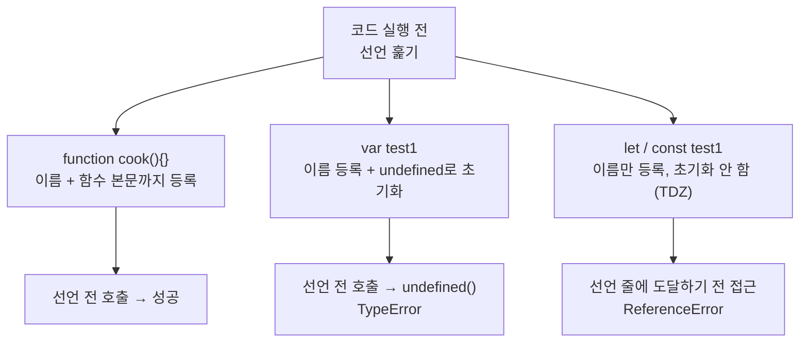

## 들어가며 (Situation)

JavaScript 첫날 두 번째 시간(`03_function.js`)에는 함수를 만드는 두 가지 방법을 배웠다.

```javascript
// 함수 선언문
function welcome(name) {
  return `${name} 님, 반갑습니다~~!`;
}

// 함수 표현식
const welcome2 = function(name) {
  return `${name} 님, 반갑습니다~~!`;
}
```

그리고 오늘의 미션이 주석으로 적혀 있었다.

```javascript
/*
  오늘의 미션
  - Java 언어의 동작 원리와
  - JavaScript 언어의 동작 원리를 비교하고
  서로에게 이해시킬 수 있는 자료를 구성하기
*/
```

파일 끝에는 호이스팅 예제가 있다.

```javascript
console.log(cook('떡볶이'));

function cook(menuName) {
  return `${menuName} 조리 시~작~!`;
}

console.log(test1("떡볶이"));

const test1 = function (menuName) {
  return `${menuName} 조리 시~작~!`;
}
```

## 문제 상황 (Task)

파일을 node로 실행하자 마지막 줄에서 프로그램이 멈췄다.

```text
홍길동 님, 반갑습니다~~!
홍길동 님, 반갑습니다~~!
홍길동 님, 반갑습니다~~!
떡볶이 조리 시~작~!
C:\Lecture\11_JavaScript\01_Core\03_function.js:54
console.log(test1("떡볶이"));
            ^

ReferenceError: Cannot access 'test1' before initialization
```

`cook()`은 선언보다 먼저 불렀는데 동작했고, `test1()`은 에러가 났다. 둘 다 "아래에 정의된 함수를 위에서 부른" 코드다. 무엇이 다를까? 그리고 이 차이를 Java와 비교해 설명할 수 있을까? 그게 미션이었다.

## 해결 과정 (Action)

### 1. 같은 코드를 `var`, `let`, `const`로 바꿔 실행하기

`test1`의 선언 키워드만 바꿔 가며 같은 코드를 실행했다.

```javascript
console.log(typeof test1);
try { console.log(test1("떡볶이")); } catch (e) { console.log(e.name + ": " + e.message); }
var test1 = function (m) { return m + " 조리 시~작~!"; };   // var / let / const로 바꿔 가며
console.log(test1("떡볶이"));
```

| 선언 | 선언 전 `typeof test1` | 선언 전 `test1()` 호출 | 선언 후 호출 |
|------|------------------------|------------------------|--------------|
| `function test1(){}` (선언문) | `function` | 성공 | 성공 |
| `var test1 = function(){}` | `undefined` | `TypeError: test1 is not a function` | 성공 |
| `let test1 = function(){}` | **ReferenceError** | ReferenceError | 성공 |
| `const test1 = function(){}` | **ReferenceError** | `ReferenceError: Cannot access 'test1' before initialization` | 성공 |

세 가지 결과가 모두 달랐다. 특히 `let`/`const`는 `typeof`조차 에러를 냈다. 선언되지 않은 변수에 `typeof`를 쓰면 `undefined`가 나오는 것과 대조적이다.

### 2. 호이스팅: 실행 전에 "선언"을 먼저 훑는다

JavaScript 엔진은 코드를 실행하기 전에 그 범위의 **선언**을 먼저 등록한다. 무엇을 어떻게 등록하느냐가 키워드마다 다르다.



- **함수 선언문**은 함수 본문까지 통째로 올라간다. 그래서 `cook()`을 위에서 불러도 된다.
- **`var`** 는 이름만 올라가고 값은 `undefined`다. 함수를 대입하는 줄은 아직 실행되지 않았으므로 `undefined("떡볶이")`를 부른 셈이 되어 `TypeError`가 난다.
- **`let`/`const`** 도 이름은 등록되지만 **초기화되지 않은 상태**로 남는다. 선언 줄에 도달하기 전까지의 구간을 TDZ(Temporal Dead Zone, 일시적 사각지대)라고 부른다. 이 구간에서 접근하면 `ReferenceError`다.

수업 파일이 멈춘 이유는 `const test1`을 TDZ 안에서 불렀기 때문이다. 수업 예제는 "함수 표현식은 호이스팅되지 않는다"를 보여 주려는 것이었으니, 에러가 나는 것이 의도된 결과다. 다만 에러 메시지가 "정의되지 않음"이 아니라 "**초기화 전에** 접근할 수 없음"이라는 점이 핵심이었다. 이름은 이미 알고 있다는 뜻이다.

### 3. 이름 있는 함수 표현식의 이름은 어디에 있나

수업에서 주석 처리된 줄도 확인했다.

```javascript
const welcome3 = function hello(name) { ... }
// console.log(hello("홍길동"));
```

```javascript
console.log(typeof hello);                            // undefined
const welcome3 = function hello(n){ return typeof hello; };
console.log(welcome3("x"));                           // function
```

`hello`라는 이름은 **함수 안에서만** 보인다(재귀 호출용). 바깥에서는 `welcome3`으로만 부를 수 있다.

### 4. 미션: Java와 비교하기

| | Java | JavaScript |
|---|---|---|
| 실행 방식 | 컴파일(바이트코드) 후 JVM 실행 | 엔진이 소스를 읽어 바로 실행 (JIT 포함) |
| 메서드 호출 순서 | 클래스 안 메서드는 선언 위치와 무관하게 호출 가능 | 함수 선언문은 호이스팅으로 가능, 표현식은 불가 |
| 지역 변수 선언 전 사용 | **컴파일 에러** | `var`: `undefined`, `let`/`const`: 실행 중 `ReferenceError` |
| 함수의 위치 | 반드시 클래스 안의 메서드 | 값처럼 변수에 담고 전달 가능 (일급 객체) |
| 오류 발견 시점 | 대부분 컴파일 시점 | 대부분 실행 시점 |

Java에서 메서드를 아래에 정의하고 위에서 불러도 되는 이유는 컴파일러가 **클래스 전체**를 먼저 읽기 때문이다. JavaScript 함수 선언문의 호이스팅도 결과는 비슷하다. 하지만 Java에서 지역 변수를 선언 전에 쓰면 실행조차 되지 않는 반면, JavaScript는 **실행하다가** 그 줄에서 멈춘다. 이번 실습 파일이 앞부분은 다 출력하고 마지막에서 멈춘 것이 그 차이를 그대로 보여 줬다.

## 결과 (Result)

| 확인 항목 | 결과 |
|-----------|------|
| 함수 선언문 선언 전 호출 | 성공 (`떡볶이 조리 시~작~!`) |
| `var` 함수 표현식 선언 전 호출 | `TypeError: test1 is not a function` |
| `const`/`let` 선언 전 접근 | `ReferenceError: Cannot access 'test1' before initialization` |
| TDZ 안에서 `typeof` | 역시 `ReferenceError` |
| 실행 환경 | Node.js v24.22.1 |

배운 점은 다음과 같다.

- 호이스팅은 "코드가 위로 옮겨진다"가 아니라, 실행 전에 **선언을 등록**하는 과정이다. 키워드마다 등록 방식이 다르다.
- `let`/`const`의 TDZ 덕분에 "선언 전 사용" 실수가 `undefined`로 숨지 않고 에러로 드러난다. 그래서 `var` 대신 `let`/`const`를 쓴다.

## 더 학습하면 좋은 개념

- **실행 컨텍스트(Execution Context)** — 호이스팅과 스코프가 실제로 만들어지는 구조.
- **스코프와 클로저** — 함수가 선언된 위치의 변수를 기억하는 방식.
- **함수는 일급 객체** — 변수에 담고, 인자로 넘기고, 반환할 수 있다는 뜻. 고차 함수의 바탕이다.
- **`"use strict"`** — 엄격 모드에서 바뀌는 동작들.

## 참고 자료

- [MDN - Hoisting (Glossary)](https://developer.mozilla.org/en-US/docs/Glossary/Hoisting)
- [MDN - let (Temporal dead zone)](https://developer.mozilla.org/en-US/docs/Web/JavaScript/Reference/Statements/let#temporal_dead_zone_tdz)
- [MDN - function declaration](https://developer.mozilla.org/en-US/docs/Web/JavaScript/Reference/Statements/function)
- [MDN - function expression](https://developer.mozilla.org/en-US/docs/Web/JavaScript/Reference/Operators/function)

---

**요약**
1. 수업 파일은 `const test1` 함수 표현식을 선언 전에 불러 `ReferenceError: Cannot access 'test1' before initialization`으로 멈췄고, 함수 선언문 `cook()`은 선언 전 호출이 성공했다.
2. 같은 코드를 바꿔 보니 함수 선언문은 본문까지, `var`는 `undefined`로, `let`/`const`는 초기화 없이(TDZ) 등록되어 결과가 각각 성공, `TypeError`, `ReferenceError`였다.
3. Java는 선언 전 사용을 컴파일 시점에 막지만 JavaScript는 실행하다 그 줄에서 멈춘다. 이 차이가 미션에서 정리한 두 언어의 핵심이었다.
