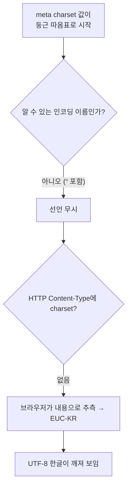

## 들어가며 (Situation)

JavaScript 둘째 날 오후에는 브라우저의 문서(DOM)를 다뤘다. 첫 실습(`01_get_element.html`)은 요소를 가져오는 방법 네 가지였다.

| 방법 | 반환 |
|------|------|
| `document.getElementById('store')` | 요소 1개 |
| `document.getElementsByTagName('li')` | `HTMLCollection` |
| `document.getElementsByClassName('menu')` | `HTMLCollection` |
| `document.querySelector('.box')` / `querySelectorAll('.box')` | 요소 1개 / `NodeList` |

```html
<div id="store" class="area">
    냠냠분식 본점
    <p id="notice">오늘의 공지 : 떡볶이 1+1</p>
</div>
<div id="store" class="area">
    냠냠분식 2호점 (id 중복!)
</div>
```

```javascript
const $store = document.getElementById('store');
$store.style.backgroundColor = 'yellow';

const $snackLiList = $snack.getElementsByTagName('li');
// HTMLCollection 은 배열이 아니므로 Array.from 으로 변환
const liList = Array.from($snackLiList);
liList.forEach( li => li.style.color = 'red' );

const $box = document.querySelectorAll(".box");
$box.forEach( $box => { $box.style.backgroundColor = 'green'; });
```

## 문제 상황 (Task)

실습 내용을 다시 확인하려고 파일을 로컬 서버로 띄워 Chromium에서 열었다. 그런데 화면의 한글이 전부 `냠냠분식` 대신 `�좊깲遺꾩떇` 같은 글자로 깨져 있었다. 노란 배경과 빨간 글씨는 적용됐으니 스크립트는 동작했다. 글자만 깨졌다.

또 하나 궁금했던 점은 이랬다. 수업에서는 `HTMLCollection`은 `Array.from`으로 바꿔야 `forEach`를 쓸 수 있다고 했는데, `querySelectorAll`의 결과에는 바로 `forEach`를 썼다. 둘은 무엇이 다를까?

## 해결 과정 (Action)

### 1. 브라우저가 문서를 어떤 인코딩으로 읽었나

Playwright로 페이지를 열고 `document.characterSet`을 찍었다.

```javascript
document.characterSet          // "EUC-KR"
document.documentElement.lang  // "�쐊o��" (깨짐)
```

파일은 UTF-8로 저장돼 있는데 브라우저는 **EUC-KR**로 읽고 있었다. `lang` 속성 값까지 깨진 것이 단서였다. 파일 첫 부분을 바이트로 열어 봤다.

```bash
sed -n 2,5p 01_get_element.html | od -c
```

```text
<   h   t   m   l       l   a   n   g   = 342 200 234   k   o   342 200 235   >
<   m   e   t   a       c   h   a   r   s   e   t   = 342 200 ...
```

`lang=` 뒤에 있어야 할 큰따옴표(`"`, 1바이트)가 아니라 `342 200 234`(UTF-8 3바이트)가 있었다. 유니코드 **왼쪽 둥근 따옴표 `“`(U+201C)** 다. 소스를 다시 보니 이랬다.

```html
<html lang=“ko”>
<head>
    <meta charset=“UTF-8">
    <meta name=“viewport” content=“width=device-width, initial-scale=1.0">
```

메모장이나 메신저에서 코드를 옮길 때 따옴표가 "예쁜 따옴표"로 바뀐 것 같다. HTML 파서에게 `“`는 따옴표가 아니라 **일반 글자**다. 그래서 `charset` 값은 `UTF-8`이 아니라 `“UTF-8"`이라는 알 수 없는 이름이 됐다. 브라우저는 이 선언을 무시했고, 서버도 `Content-Type`에 charset을 보내지 않았다. 결국 브라우저는 내용을 보고 인코딩을 **추측**했고, 그 추측이 EUC-KR이었다.



### 2. 따옴표만 고쳐서 확인

원본은 두고, 둥근 따옴표를 곧은 따옴표로 바꾼 사본을 만들어 열었다.

```text
UTF-8 | ko | 냠냠분식 본점
```

인코딩도 `lang`도 한글도 모두 정상이었다. 같은 날 만든 다른 실습 파일(`01_event-handler.html` 등)은 처음부터 곧은 따옴표라서 문제가 없었다. 수업 중에는 IDE의 미리보기나 Live Server가 다른 방식으로 열어 줘서 못 봤을 수 있다. 하지만 브라우저나 서버 환경이 바뀌면 언제든 깨질 수 있는 코드였다.

### 3. `id`가 중복되면 첫 번째만

`getElementById('store')`는 첫 번째 `div`(본점)만 돌려줬고, 노란 배경도 본점에만 칠해졌다. `querySelectorAll('#store')`는 2개를 찾았다. `id`는 문서에 하나만 있어야 한다는 규칙을 어기면 `getElementById`는 첫 번째 것만 본다.

### 4. `HTMLCollection`은 살아 있고, `NodeList`는 찍어 둔 사진이다

두 목록을 만들어 두고, 그 뒤에 `<li>`를 하나 추가했다.

```javascript
const live = document.getElementsByTagName('li');   // HTMLCollection
const stat = document.querySelectorAll('li');        // NodeList
// before: HTMLCollection=16 NodeList=16
document.getElementById('snack').appendChild(document.createElement('li')).textContent = '어묵';
// after append: HTMLCollection=17 NodeList=16
```

| | `HTMLCollection` (`getElementsBy...`) | `NodeList` (`querySelectorAll`) |
|---|---|---|
| 문서가 바뀌면 | **자동 반영** (live) | 그대로 (static) |
| `forEach` | 없음 (`undefined`) | 있음 |
| `map`, `filter` | 없음 | 없음 |
| 배열로 바꾸기 | `Array.from()` | `Array.from()` |

수업에서 `HTMLCollection`에 `Array.from`이 필요했던 이유는 `forEach`가 없어서다. `NodeList`는 `forEach`는 있지만 `map`과 `filter`는 없다. 배열 메서드를 모두 쓰려면 둘 다 `Array.from()`으로 바꾼다. 실제로 새로 추가한 `어묵`은 이미 빨간색 처리가 끝난 뒤라 색이 없었다.

## 결과 (Result)

| 확인 항목 | 결과 |
|-----------|------|
| 원본 파일의 `document.characterSet` | `EUC-KR` (한글 깨짐) |
| 원인 | `charset=“UTF-8"`의 둥근 따옴표(U+201C) |
| 따옴표 수정 후 | `UTF-8`, 한글 정상 |
| 중복 `id` | `getElementById`는 첫 번째만 |
| 요소 추가 후 길이 | `HTMLCollection` 16 → 17, `NodeList` 16 → 16 |
| 실행 환경 | Playwright Chromium, Python `http.server` |

배운 점은 다음과 같다.

- 화면이 "일부만" 이상하면 그 부분만 거치는 경로를 의심한다. 이번에는 스크립트는 정상이고 글자만 깨졌으니 인코딩이었다.
- 코드를 옮길 때 따옴표가 바뀌지 않았는지 조심한다. HTML은 둥근 따옴표를 따옴표로 보지 않는다.
- `getElementsBy...`는 문서 변화를 따라가는 live 목록, `querySelectorAll`은 그 순간의 static 목록이다.

## 더 학습하면 좋은 개념

- **문자 인코딩(UTF-8, EUC-KR)** — 같은 바이트가 다른 글자로 보이는 이유.
- **HTTP `Content-Type` 헤더의 charset** — 서버가 인코딩을 알려 주는 방법. [Servlet 응답 인코딩]()과 같은 이야기다.
- **이벤트 위임** — live 목록 대신 부모 요소 하나에 이벤트를 거는 방법.
- **`textContent` vs `innerHTML`** — 요소 내용을 바꿀 때의 차이와 XSS 위험.

## 참고 자료

- [MDN - &lt;meta&gt; charset](https://developer.mozilla.org/en-US/docs/Web/HTML/Element/meta#charset)
- [MDN - Document.characterSet](https://developer.mozilla.org/en-US/docs/Web/API/Document/characterSet)
- [MDN - HTMLCollection](https://developer.mozilla.org/en-US/docs/Web/API/HTMLCollection)
- [MDN - NodeList (live vs static)](https://developer.mozilla.org/en-US/docs/Web/API/NodeList)
- [MDN - Document.getElementById()](https://developer.mozilla.org/en-US/docs/Web/API/Document/getElementById)

---

**요약**
1. DOM 실습 파일의 한글이 깨진 원인은 `<meta charset=“UTF-8">`의 둥근 따옴표였다. HTML이 이를 따옴표로 보지 않아 charset 선언이 무시되고 브라우저가 EUC-KR로 추측했다.
2. 둥근 따옴표를 곧은 따옴표로 바꾸자 `document.characterSet`이 `UTF-8`이 되고 한글이 정상으로 보였다.
3. `<li>`를 추가하자 `getElementsByTagName`의 `HTMLCollection`은 16→17로 따라 늘었지만 `querySelectorAll`의 `NodeList`는 16 그대로였다.
