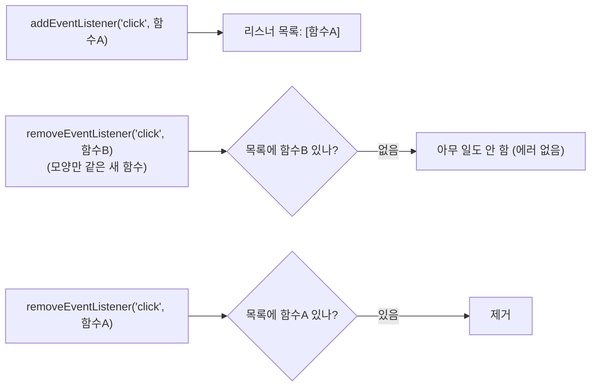

## 들어가며 (Situation)

DOM 다음은 이벤트였다. 이벤트 핸들러는 "이벤트가 일어나면 브라우저가 대신 불러 주도록 맡겨 둔 함수"다. 수업(`01_event-handler.html`)에서는 등록 방법 세 가지와 제거 방법을 실습했다.

```html
<!-- (1) 어트리뷰트 방식 : 함수 "호출문"을 문자열로 -->
<button onclick="alert('주문 완료!'); console.log('주문 완료!');">주문하기</button>
```

```javascript
// (2) 프로퍼티 방식 : 하나만 등록됨, 다시 넣으면 덮어씀
$btnProp.onclick = function() { alert("프로퍼티 방식으로 이벤트 핸들러 등록!!"); }
$btnProp.onclick = () => { alert("두번째 이벤트 핸들러 등록!!"); alert("ㅇㅅㅇ") };

// (3) addEventListener 방식 (권장) : 여러 개 등록 가능
$btnListener.addEventListener('click', function() { alert('결제 완료!') });
$btnListener.addEventListener('click', function() { alert('2번째 addEvent 동작!') });

// (4) 제거 : 외부에 정의한 함수를 참조
const handleMouseOver = () => alert('결제 버튼에 마우스 호버!');
$btnRemove.addEventListener('mouseover', handleMouseOver);
$btnRemove.removeEventListener('mouseover', handleMouseOver);
```

이어서 `02_event-object.html`에서는 이벤트 객체와 핸들러 안의 `this`를 다뤘다.

## 문제 상황 (Task)

수업 주석에 "외부에 정의한 함수를 참조"라고 적혀 있었다. 왜 꼭 바깥에 변수로 만들어야 할까? 똑같은 코드의 화살표 함수를 `removeEventListener`에 넣으면 안 될까?

그리고 `02_event-object.html`에는 이런 줄이 있었다.

```javascript
function showMapCoords(e) {
    $map.textContent = `지도 : ${e.clientX} , ${e.clientY}`;
    e.pointerType = 'pen';
}
```

주석에는 "이벤트 객체는 매개변수로 받을 수 있으며, 해당 값을 참조하거나 변경하거나 제거할 수 있다"고 적혀 있었다. 정말 바뀔까?

마지막으로 `this`다. 핸들러를 `function`으로 만들 때와 화살표 함수로 만들 때 `this`가 다를까? (`btn3`, `btn4` 화살표 함수 예제는 버튼만 있고 코드가 비어 있었다.)

## 해결 과정 (Action)

### 1. Playwright로 페이지를 열고 직접 확인

실습 페이지를 로컬 서버로 띄우고, 브라우저 안에서 스크립트를 실행했다. `alert`는 자동화를 멈추게 하므로 결과는 배열에 모았다.

```javascript
const r = document.getElementById('btn2');
let n = 0;
r.addEventListener('click', () => n++);
r.removeEventListener('click', () => n++);   // 똑같이 생긴 화살표 함수
r.click();
// n === 1 : 핸들러가 지워지지 않았다
```

### 2. 함수는 "모양"이 아니라 "참조"로 비교된다

`() => n++`를 두 번 쓰면 모양은 같아도 **서로 다른 함수 객체 두 개**가 만들어진다. `removeEventListener`는 등록할 때 넘긴 **바로 그 함수 객체**를 찾아서 지운다. 다른 객체를 넘기면 찾지 못하고, 에러도 없이 조용히 끝난다.



수업 코드가 `handleMouseOver`를 변수에 담아 둔 이유가 이것이다. 같은 참조를 두 번 넘겨야 지울 수 있다. 같은 이유로 `addEventListener('click', function() {...})`처럼 익명 함수로 등록한 핸들러는 나중에 지울 방법이 없다.

### 3. 이벤트 객체의 값은 바꿀 수 없다

```javascript
const e = new PointerEvent('click', { pointerType: 'mouse', clientX: 10, clientY: 20 });
e.pointerType = 'pen';
console.log(e.pointerType);   // "mouse"
```

`pen`으로 바뀌지 않았다. `pointerType`, `clientX` 같은 이벤트 정보는 **읽기 전용** 속성이다. 일반 스크립트(엄격 모드 아님)에서는 대입해도 에러 없이 무시된다. 이벤트 객체로 할 수 있는 "변경"은 값을 고치는 것이 아니라 `e.preventDefault()`(기본 동작 취소), `e.stopPropagation()`(전파 중단) 같은 메서드 호출이다. 수업의 폼 제출 예제에서 `return false` 대신 `e.preventDefault()`를 쓰라고 한 것도 그 예다.

하나 더 보였다. 지도 영역 문구는 "클릭해 보세요"인데 실제로는 `onmouseover`에 연결돼 있어서 마우스를 올리기만 해도 좌표가 바뀌었다. 문서 전체에는 `document.onclick = showCoords`도 걸려 있어서, 클릭하면 위쪽 메시지가 바뀐다.

### 4. 핸들러 안의 `this`

```javascript
btn.addEventListener('click', function (ev) {
  // this === btn : true, ev.currentTarget === btn : true
});
btn.addEventListener('click', (ev) => {
  // this === window : true, ev.currentTarget === btn : true
});
btn.onclick = function () {
  // this === btn : true
};
```

| 등록 방식 | `this` | 비고 |
|-----------|--------|------|
| `addEventListener` + `function` | 이벤트가 걸린 요소 | 브라우저가 `this`를 요소로 정해 호출 |
| `onclick` 프로퍼티 + `function` | 이벤트가 걸린 요소 | 같음 |
| 화살표 함수 | 바깥의 `this` (여기서는 `window`) | [화살표 함수는 자기 `this`가 없다]() |
| 어트리뷰트 `onclick="handleClick1()"` 안에서 부른 함수 | `window` | 그냥 함수 호출이라서 |
| 어트리뷰트 `onclick="handleClick2(this)"` | 인자로 받은 요소 | 어트리뷰트 안의 `this`는 요소 |

수업의 `handleClick1()`이 `window`를 찍은 이유도 확인됐다. 어트리뷰트 안에서는 `this`가 버튼이지만, 거기서 `handleClick1()`을 **그냥 호출**하면 그 함수 안의 `this`는 다시 전역 객체가 된다. 그래서 `handleClick2(this)`처럼 인자로 넘겨야 했다.

어떤 방식이든 확실한 방법은 `event.currentTarget`이다. 화살표 함수에서도 리스너가 걸린 요소를 정확히 가리켰다.

### 5. 세 등록 방식 비교

| | 어트리뷰트 `onclick="..."` | 프로퍼티 `el.onclick = fn` | `addEventListener` |
|---|---|---|---|
| 같은 이벤트에 여러 개 | 1개 | 1개 (덮어씀) | 여러 개 |
| 제거 | 속성 삭제 | `null` 대입 | `removeEventListener(같은 참조)` |
| HTML과 JS 분리 | 섞임 | 분리 | 분리 |
| 권장 | 낮음 | 보통 | 높음 |

## 결과 (Result)

| 확인 항목 | 결과 |
|-----------|------|
| 모양만 같은 화살표 함수로 `removeEventListener` | 제거 안 됨 (핸들러 1회 실행) |
| `e.pointerType = 'pen'` | `mouse` 그대로 (읽기 전용) |
| `function` 핸들러의 `this` | 이벤트가 걸린 요소 |
| 화살표 함수 핸들러의 `this` | `window` |
| `event.currentTarget` | 두 방식 모두 요소 |
| 실행 환경 | Playwright Chromium, Python `http.server` |

배운 점은 다음과 같다.

- `removeEventListener`는 등록할 때와 **같은 함수 참조**가 있어야 동작한다. 나중에 지울 핸들러는 변수에 담아 둔다.
- 이벤트 객체의 정보는 읽기 전용이다. 바꿀 수 있는 것은 `preventDefault()` 같은 메서드로 하는 동작이다.
- 핸들러에서 요소가 필요하면 `this`보다 `event.currentTarget`이 함수 종류와 상관없이 안전하다.

## 더 학습하면 좋은 개념

- **이벤트 전파 (캡처링·버블링)** — `focusin`은 버블링되고 `focus`는 안 되는 이유, `stopPropagation()`.
- **`event.target` vs `event.currentTarget`** — 실제로 클릭된 요소와 리스너가 걸린 요소의 차이.
- **`addEventListener`의 옵션 (`once`, `passive`)** — 한 번만 실행되는 핸들러 등.
- **`AbortController`로 리스너 제거** — 참조를 보관하지 않고 여러 리스너를 한 번에 지우는 방법.

## 참고 자료

- [MDN - EventTarget.addEventListener()](https://developer.mozilla.org/en-US/docs/Web/API/EventTarget/addEventListener)
- [MDN - EventTarget.removeEventListener()](https://developer.mozilla.org/en-US/docs/Web/API/EventTarget/removeEventListener)
- [MDN - Event.currentTarget](https://developer.mozilla.org/en-US/docs/Web/API/Event/currentTarget)
- [MDN - PointerEvent.pointerType](https://developer.mozilla.org/en-US/docs/Web/API/PointerEvent/pointerType)
- [MDN - Event.preventDefault()](https://developer.mozilla.org/en-US/docs/Web/API/Event/preventDefault)

---

**요약**
1. 모양이 같은 화살표 함수를 `removeEventListener`에 넘겨도 다른 함수 객체라서 리스너가 지워지지 않았다. 지울 핸들러는 변수에 담아 같은 참조를 넘겨야 한다.
2. `e.pointerType = 'pen'`은 읽기 전용 속성이라 `mouse` 그대로였고, 이벤트 객체로 할 수 있는 변경은 `preventDefault()` 같은 메서드 호출이다.
3. `function` 핸들러의 `this`는 요소, 화살표 함수는 `window`였고, `event.currentTarget`은 두 경우 모두 요소를 가리켰다.
