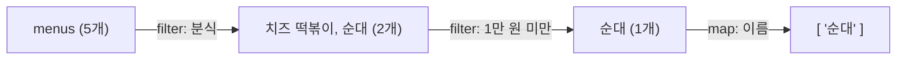

## 들어가며 (Situation)

JavaScript 둘째 날은 배열 고차 함수(`06_higher-order-method.js`)로 시작했다. 고차 함수는 **함수를 인자로 받거나 함수를 반환하는 함수**다. 배열의 `forEach`, `map`, `filter`는 콜백 함수를 받아 배열 요소를 하나씩 처리한다.

```javascript
const menus = [
  { name : '치즈 떡볶이', category : '분식', price : 14000 },
  { name : '순대',       category : '분식', price : 3000 },
  { name : '파스타',     category : '양식', price : 19000 },
  { name : '제육볶음',   category : '한식', price : 10000 },
  { name : '김치찜',     category : '한식', price : 8000 },
];
```

## 문제 상황 (Task)

요구사항은 "분식 중에서 가격이 1만 원 미만인 메뉴의 **이름 목록**"이었다. Java로 배운 방식이라면 이렇게 쓴다.

```javascript
// 예시 코드 : for문 방식
const result = [];
for (let i = 0; i < menus.length; i++) {
  if (menus[i].category === '분식' && menus[i].price < 10000) {
    result.push(menus[i].name);
  }
}
```

반복, 조건, 결과 배열 관리가 한 덩어리에 섞여 있다. 조건이 늘어나면 `if`가 길어지고 무엇을 하는 코드인지 읽기 어려워진다. 고차 함수로 바꾸면 어떻게 달라질까? 그리고 수업에서 함께 다룬 `==`와 `===`는 왜 `===`를 써야 할까?

## 해결 과정 (Action)

### 1. 세 함수의 역할 비교

```bash
node 06_higher-order-method.js
```

| 함수 | 콜백이 돌려주는 것 | 결과 | 원본 배열 |
|------|-------------------|------|-----------|
| `forEach` | 무시됨 | `undefined` | 그대로 |
| `map` | 새 값 | 같은 길이의 **새 배열** | 그대로 |
| `filter` | `true`/`false` | `true`인 요소만 모은 **새 배열** | 그대로 |

```javascript
const names = menus.map( menu => menu.name );
// [ '치즈 떡볶이', '순대', '파스타', '제육볶음', '김치찜' ]

const snacks = menus.filter( menu => menu.category === '분식' );
// [ { name: '치즈 떡볶이', ... }, { name: '순대', ... } ]
```

`map`과 `filter`는 원본을 바꾸지 않고 **새 배열**을 만든다. 그래서 결과에 바로 다음 함수를 이어 붙일 수 있다.

### 2. 체이닝: 단계마다 한 가지 일

```javascript
const result = menus
                .filter(menu => menu.category === '분식')   // 분식만
                .filter(menu => menu.price < 10000)         // 그중 1만 원 미만
                .map(menu => menu.name)                     // 이름만

console.log(result);   // [ '순대' ]
```



| | for문 | filter·map 체이닝 |
|---|---|---|
| 읽는 순서 | 반복 → 조건 → push를 머릿속에서 조립 | 위에서 아래로 "무엇을" 하는지 |
| 결과 배열 관리 | 직접 `push` | 함수가 새 배열 반환 |
| 조건 추가 | `if` 조건이 길어짐 | `.filter()` 한 줄 추가 |
| 원본 변경 위험 | 실수로 바꿀 수 있음 | 원본 그대로 |

Java에서 배운 Stream의 `filter().map().toList()`와 같은 모양이다. 실제로 JPA 미니 프로젝트에서 `menuList.stream().map(MenuDTO::from).toList()`를 썼는데, 같은 생각을 JavaScript 배열이 기본으로 가지고 있었다.

두 `filter`를 하나로 합쳐 `menu.category === '분식' && menu.price < 10000`으로 써도 결과는 같다. 배열을 한 번 덜 도니 조금 더 빠르지만, 수업처럼 조건을 나누면 각 단계가 무엇을 거르는지 이름 붙이듯 읽힌다. 배열이 작을 때는 읽기 쉬운 쪽을 택해도 된다.

### 3. `==`와 `===`

`filter` 조건에 `===`를 쓴 이유도 수업에서 확인했다.

```javascript
console.log(` 1 == '1' : ${1 == '1'}`);    //  1 == '1' : true
console.log(` 1 === '1' : ${1 === '1'}`);  //  1 === '1' : false
```

`==`는 타입이 다르면 **한쪽을 변환한 뒤** 비교한다. 숫자 `1`과 문자열 `'1'`이 같다고 나온 이유다. `===`는 타입이 다르면 바로 `false`다. [동적 타입]()에서는 변수에 어떤 타입이 들어 있을지 장담할 수 없으므로, 암묵적 변환이 없는 `===`가 예측하기 쉽다.

| 비교 | `==` | `===` |
|------|------|-------|
| `1` vs `'1'` | `true` | `false` |
| 타입 변환 | 함 | 안 함 |
| 권장 | 거의 안 씀 | 기본 |

## 결과 (Result)

| 확인 항목 | 결과 |
|-----------|------|
| `map(menu => menu.name)` | 이름 5개 배열 |
| `filter(분식)` | 2개 |
| `filter(1만 원 미만)` | 순대, 김치찜 |
| 분식 + 1만 원 미만 이름 | `[ '순대' ]` |
| `1 == '1'` / `1 === '1'` | `true` / `false` |
| 실행 환경 | Node.js v24.22.1 |

배운 점은 다음과 같다.

- `map`과 `filter`는 원본을 바꾸지 않고 새 배열을 돌려준다. 그래서 체이닝으로 "한 단계에 한 가지 일"을 할 수 있다.
- 비교는 기본으로 `===`를 쓴다. 동적 타입 언어에서 암묵적 변환은 예측하기 어려운 버그를 만든다.

## 더 학습하면 좋은 개념

- **`reduce`** — 배열을 하나의 값(합계, 객체)으로 모으는 고차 함수.
- **`find`, `some`, `every`** — 조건에 맞는 첫 요소 찾기, 하나라도/모두 맞는지 확인하기.
- **불변성(Immutability)** — 원본을 바꾸지 않는 방식이 React 상태 관리에서 중요한 이유.
- **Java Stream API** — 같은 아이디어를 Java에서는 어떻게 쓰는지 비교.

## 참고 자료

- [MDN - Array.prototype.map()](https://developer.mozilla.org/en-US/docs/Web/JavaScript/Reference/Global_Objects/Array/map)
- [MDN - Array.prototype.filter()](https://developer.mozilla.org/en-US/docs/Web/JavaScript/Reference/Global_Objects/Array/filter)
- [MDN - Array.prototype.forEach()](https://developer.mozilla.org/en-US/docs/Web/JavaScript/Reference/Global_Objects/Array/forEach)
- [MDN - Equality comparisons and sameness](https://developer.mozilla.org/en-US/docs/Web/JavaScript/Equality_comparisons_and_sameness)

---

**요약**
1. "분식 중 1만 원 미만 메뉴 이름"을 for문 대신 `filter → filter → map` 체이닝으로 풀었고 결과는 `[ '순대' ]`였다.
2. `map`·`filter`는 원본을 바꾸지 않고 새 배열을 돌려주기 때문에 단계마다 한 가지 일만 하는 체이닝이 가능하다. Java Stream과 같은 생각이다.
3. `1 == '1'`은 타입 변환 후 `true`, `1 === '1'`은 `false`였다. 동적 타입에서는 변환 없는 `===`를 기본으로 쓴다.
