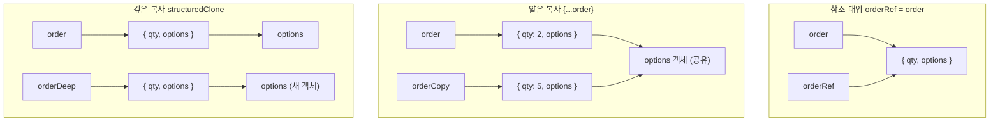

## 들어가며 (Situation)

JavaScript 둘째 날에는 스프레드 문법(`...`)과 구조 분해 할당을 배웠다. 수업 파일(`07_spread-syntax.js`)에는 복사 방식이 이렇게 적혀 있었다.

```javascript
const cart = ['치킨', '피자'];
const cartRef = cart;          // 깊은 복사 (주소값을 복사)
const cartCopy = [...cart];    // 얕은 복사 (값만 복사해서 새로운 배열 생성)

cartRef.push('파스타');
console.log(cart, cartCopy);   // [ '치킨', '피자', '파스타' ] [ '치킨', '피자' ]
```

`cartRef`에 넣은 값은 `cart`에도 보이고, `cartCopy`는 영향을 받지 않았다. 객체도 마찬가지였다.

```javascript
const order = { menuName : '뿌링클', qty : 2 };
const orderRef = order;
const orderCopy = {...order};
console.log(order === orderRef);    // true
console.log(order === orderCopy);   // false
```

## 문제 상황 (Task)

결과는 맞았는데 이름이 마음에 걸렸다. 다른 자료에서는 "깊은 복사"를 **완전히 독립된 사본**이라는 뜻으로 쓴다. 수업 주석에서는 주소만 복사하는 `cartRef = cart`를 깊은 복사라고 했다.

용어가 다르면 나중에 문서를 읽을 때 정반대로 이해하게 된다. 그래서 확인하고 싶었다.

1. `cartRef = cart`는 정말 "복사"일까?
2. 스프레드로 만든 사본은 원본과 완전히 독립일까? 객체 안에 객체가 있으면?

## 해결 과정 (Action)

### 1. 중첩 객체로 실험하기

수업 예제는 값이 전부 문자열·숫자라서 차이가 드러나지 않았다. 그래서 주문에 옵션 객체를 하나 넣었다.

```javascript
const order = { menuName: '뿌링클', qty: 2, options: { sauce: '치즈볼', spicy: false } };
const orderRef  = order;
const orderCopy = { ...order };
const orderDeep = structuredClone(order);

orderCopy.qty = 5;              // 1단계 값 변경
orderCopy.options.spicy = true; // 2단계(중첩 객체) 값 변경

console.log('order       :', JSON.stringify(order));
console.log('orderCopy   :', JSON.stringify(orderCopy));
console.log('orderDeep   :', JSON.stringify(orderDeep));
console.log('order.options === orderCopy.options:', order.options === orderCopy.options);
console.log('order.options === orderDeep.options:', order.options === orderDeep.options);
```

```text
order       : {"menuName":"뿌링클","qty":2,"options":{"sauce":"치즈볼","spicy":true}}
orderCopy   : {"menuName":"뿌링클","qty":5,"options":{"sauce":"치즈볼","spicy":true}}
orderDeep   : {"menuName":"뿌링클","qty":2,"options":{"sauce":"치즈볼","spicy":false}}
order.options === orderCopy.options: true
order.options === orderDeep.options: false
```

사본의 `qty`를 바꿨을 때 원본은 그대로였다. 그런데 사본의 `options.spicy`를 바꾸자 **원본의 `spicy`도 `true`가 됐다.** 두 객체가 같은 `options`를 함께 가리키고 있었다(`===`가 `true`).

배열도 같았다.

```javascript
const carts = [['치킨'], ['피자']];
const cartsCopy = [...carts];
cartsCopy[0].push('콜라');
console.log(JSON.stringify(carts));   // [["치킨","콜라"],["피자"]]
```

### 2. 세 가지를 구분하기



| 방식 | 새 객체가 생기나 | 중첩 객체 | 일반적인 이름 |
|------|------------------|-----------|---------------|
| `orderRef = order` | 아니오 (같은 객체를 가리킴) | 공유 | **참조 복사 / 참조 대입** (복사가 아님) |
| `{...order}`, `[...cart]` | 예, 1단계만 | **공유** | **얕은 복사** |
| `structuredClone(order)` | 예, 모든 단계 | 새로 만듦 | **깊은 복사** |

정리하면 수업 주석의 "깊은 복사(주소값을 복사)"는 보통 **참조 대입**이라고 부른다. 새 객체가 생기지 않으니 복사라고 하기도 어렵다. 스프레드는 "값만 복사"가 아니라 **1단계 프로퍼티만** 복사하는 얕은 복사이고, 그 1단계 값이 객체이면 주소가 복사된다. MDN의 정의도 같다.

> A shallow copy of an object is a copy whose properties share the same references as those of the source object.

주석 아래에 적힌 "한 군데에서 수정하면 다른 곳에서는 영문도 모른 채 값이 변경된다"는 경고는 참조 대입에 정확히 맞는다. 그리고 얕은 복사도 **중첩된 부분에서는** 같은 문제가 남는다.

### 3. `structuredClone`의 한계

깊은 복사는 `structuredClone()`으로 할 수 있다. 다만 모든 값을 복사하지는 못한다.

```javascript
structuredClone({ f: () => 1 });   // DataCloneError
```

함수가 든 객체는 복사할 수 없었다. 데이터(JSON에 가까운 값)를 복사하는 도구라고 보면 된다.

### 4. 구조 분해 할당도 얕은 복사다

`08_destructuring.js`에서는 나머지 문법으로 객체를 복사했다.

```javascript
const {...rest} = menu;
console.log(rest == menu);   // false
```

새 객체가 생겼으니 `false`다. 하지만 이것도 스프레드와 같은 얕은 복사라서, `menu`에 `info: { kcal: 600 }`을 넣고 확인하니 `rest.info === menu.info`가 `true`였다.

구조 분해에서 자주 쓰는 문법도 함께 확인했다.

```javascript
const { price: p, discount = 0, ...others } = menu;   // 이름 바꾸기, 기본값, 나머지
// 7500 0 { name: '치즈알밥', category: '퓨전한식', info: { kcal: 600 } }

const [a, , c = '없음', ...more] = ['치킨', '피자'];   // 건너뛰기, 기본값
// 치킨 없음 []
```

## 결과 (Result)

| 확인 항목 | 결과 |
|-----------|------|
| 스프레드 사본의 1단계 값 변경 | 원본 영향 없음 |
| 스프레드 사본의 중첩 객체 값 변경 | **원본도 변경** |
| `order.options === orderCopy.options` | `true` (공유) |
| `structuredClone` 사본 | 중첩까지 독립 (`false`) |
| `structuredClone(함수 포함 객체)` | `DataCloneError` |
| 실행 환경 | Node.js v24.22.1 |

배운 점은 다음과 같다.

- `b = a`는 복사가 아니라 같은 객체를 가리키게 하는 **참조 대입**이다. 스프레드는 1단계만 복사하는 **얕은 복사**, `structuredClone`이 **깊은 복사**다.
- 수업 예제처럼 값이 문자열·숫자뿐이면 얕은 복사와 깊은 복사의 차이가 보이지 않는다. 중첩 객체를 넣어야 드러난다.

## 더 학습하면 좋은 개념

- **원시 값과 객체의 저장 방식** — 숫자는 값이, 객체는 참조가 복사되는 이유.
- **React의 불변 업데이트** — `setState({...state, options: {...state.options, spicy: true}})`처럼 중첩까지 새로 만드는 이유.
- **`Object.freeze()`와 얕은 동결** — 얕은 복사와 같은 "1단계만" 문제.
- **Java의 얕은 복사 (`clone()`)** — Java 컬렉션 복사도 같은 개념이다.

## 참고 자료

- [MDN - Spread syntax (...)](https://developer.mozilla.org/en-US/docs/Web/JavaScript/Reference/Operators/Spread_syntax)
- [MDN - Shallow copy (Glossary)](https://developer.mozilla.org/en-US/docs/Glossary/Shallow_copy)
- [MDN - Deep copy (Glossary)](https://developer.mozilla.org/en-US/docs/Glossary/Deep_copy)
- [MDN - structuredClone()](https://developer.mozilla.org/en-US/docs/Web/API/Window/structuredClone)
- [MDN - Destructuring assignment](https://developer.mozilla.org/en-US/docs/Web/JavaScript/Reference/Operators/Destructuring)

---

**요약**
1. 옵션 객체를 넣어 실험하니 스프레드 사본의 `options.spicy`를 바꿨을 때 원본도 바뀌었다. 스프레드는 1단계만 복사하는 얕은 복사였다.
2. 수업 주석이 "깊은 복사"라고 부른 `cartRef = cart`는 같은 객체를 가리키는 참조 대입이고, 중첩까지 독립된 사본을 만드는 깊은 복사는 `structuredClone()`이었다.
3. 구조 분해의 `{...rest}`도 얕은 복사였고, `structuredClone`은 함수가 든 객체에서 `DataCloneError`를 냈다.
