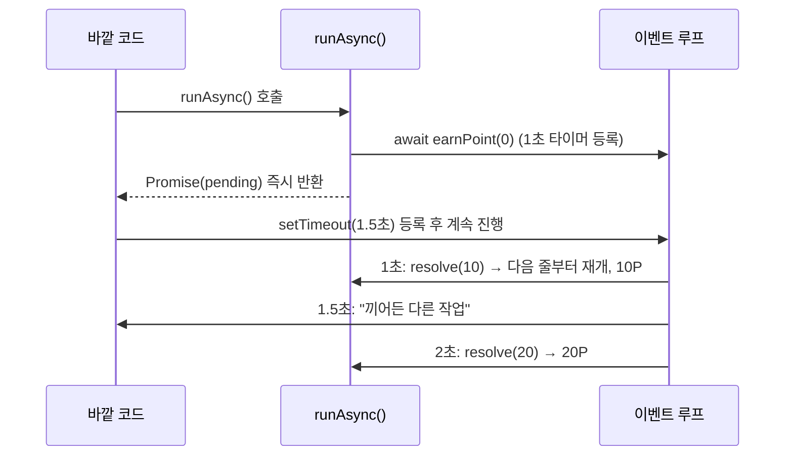

## 들어가며 (Situation)

비동기 단원 마지막 실습(`03_promise-async-await.html`)은 1초마다 10포인트씩 쌓는 기능을 세 가지 방식으로 만드는 것이었다.

**① 콜백** — 순서를 지키려고 콜백 안에 콜백을 넣는다. 수업 주석은 이것을 "콜백 지옥"이라고 불렀다.

```javascript
pointCallback(0 , point => {
console.log(`${point}P`); // 10P
pointCallback(point, point => {
console.log(`${point}P`); // 20P
pointCallback(point , point => {
...
```

**② Promise** — 성공은 `resolve`, 실패는 `reject`로 알린다. 50포인트를 넘으면 거부한다.

```javascript
function earnPoint(point) {
  return new Promise((resolve, reject) => {
    setTimeout(() => {
      const result = point + 10;
      if (result > 50) return reject(new Error("적립 한도 초과!"));
      return resolve(result);
    }, 1000);
  });
}

earnPoint(0)
  .then(point => { console.log(`${point}P`); return earnPoint(point); })
  .then(point => { console.log(`${point}P`); return earnPoint(point); })
  .then(point => { console.log(`${point}P`); return earnPoint(point); })
  .then(point => { console.log(`${point}P`); return earnPoint(point); })
  .catch(e => console.log(e, '발생!!!'))
  .finally(() => console.log("포인트 적립 종료"));
```

**③ async/await** — `then` 대신 `await`, `.catch` 대신 `try-catch`.

```javascript
async function runAsync() {
  try {
    let point = await earnPoint(0);  console.log(`${point}P`);
    point = await earnPoint(point);  console.log(`${point}P`);
    ...                              // 50P까지 출력
    point = await earnPoint(point);  // 60 → reject
  } catch(e) {
    console.log(e, '발생!!!');
  }
}
```

수업 주석은 이렇게 정리했다.

> promise, async, await 는 비동기 처리의 단점인 어느 시점에 실행될 지 모르는 단점을 해결하기 위한 문법이다. 비동기 처리를 동기 방식으로 동작하게 만드는 아주 중요한 문법이다.

## 문제 상황 (Task)

버튼을 눌러 보니 ②와 ③의 결과가 달랐다. 같은 `earnPoint`를 쓰는데 ②는 "적립 한도 초과!"가 나오지 않았다. 그리고 주석의 "동기 방식으로 동작하게 만든다"는 말이 [바로 전에 확인한 이벤트 루프]()와 맞지 않는 것 같았다. `sleep`처럼 메인 흐름이 멈춘다는 뜻일까?

1. ②에서 한도 초과 에러가 안 나온 이유는?
2. `await`로 기다리는 동안 다른 코드는 정말 멈출까?

## 해결 과정 (Action)

### 1. 시간 도장을 찍어 두 방식 실행

브라우저 버튼 대신 Node.js에서 같은 함수를 실행하고, 출력마다 경과 시간을 붙였다.

```text
# ② Promise 체이닝
[1009ms] 10P
[2013ms] 20P
[3025ms] 30P
[4037ms] 40P
[5053ms] 포인트 적립 종료
```

```text
# ③ async/await
[1007ms] 10P
[2023ms] 20P
[3037ms] 30P
[4050ms] 40P
[5065ms] 50P
[6080ms] 적립 한도 초과! 발생!!!
```

②는 40P까지 찍고 끝났다. 네 번째 `then`이 `earnPoint(40)`을 부르면 5초에 `50`으로 resolve되지만, 그 값을 받아 줄 다음 `then`이 없다. 50은 `> 50`이 아니므로 reject도 아니다. 그래서 `catch`가 실행될 일이 없었다. ③은 `await`를 여섯 번 해서 50P를 찍은 뒤 `earnPoint(50)` → `60`에서 reject됐다.

두 코드의 차이는 문법이 아니라 **호출 횟수**였다. "같은 로직"이라고 생각했지만 ②는 5번, ③은 6번 적립을 시도했다.

### 2. `await`는 함수 안에서만 기다린다

`runAsync()`를 부른 직후와 중간에 다른 코드를 끼워 넣었다.

```javascript
const p = runAsync();
console.log(ts(), 'runAsync() 호출 직후 — 반환값:', p);
setTimeout(() => console.log(ts(), '1.5초에 끼어든 다른 작업'), 1500);
p.then(v => console.log(ts(), 'runAsync 끝, 반환값:', v));
```

```text
[   1ms] runAsync() 호출 직후 — 반환값: Promise { <pending> }
[1007ms] 10P
[1507ms] 1.5초에 끼어든 다른 작업
[2023ms] 20P
...
[6080ms] 적립 한도 초과! 발생!!!
[6080ms] runAsync 끝, 반환값: undefined
```

- `runAsync()`는 1ms 만에 **Promise를 돌려주고** 바로 끝났다. 바깥 코드는 기다리지 않았다.
- 10P와 20P 사이(1.5초)에 다른 타이머가 끼어들어 실행됐다. `await`로 기다리는 동안 메인 흐름은 멈추지 않았다.
- `async` 함수는 항상 Promise를 돌려준다. 이번에는 `return`이 없어서 최종 값은 `undefined`였다.



그래서 "동기 방식으로 동작하게 만든다"는 말은 **코드를 읽는 모양**에 대한 것이다. `async` 함수 **안에서는** 위에서 아래로 순서대로 실행되는 것처럼 쓸 수 있다. 하지만 실제로는 `await`를 만날 때마다 함수가 잠시 빠져나가고, 그동안 다른 코드가 실행된다. `sleep`처럼 스레드를 붙잡는 진짜 동기 처리와는 다르다.

| | 콜백 | Promise `then` | `async`/`await` |
|---|---|---|---|
| 순서 표현 | 들여쓰기가 깊어짐 | 체인으로 평평해짐 | 위에서 아래로 |
| 에러 처리 | 콜백마다 따로 | `.catch()` 하나 | `try-catch` |
| 기다리는 동안 메인 흐름 | 계속 | 계속 | 계속 |
| 몇 번 호출하는지 한눈에 | 어려움 | `then` 개수 | `await` 개수 |

## 결과 (Result)

| 확인 항목 | 결과 |
|-----------|------|
| Promise 체이닝 (`then` 4개) | 40P까지 출력, 5번째 결과(50)는 버려짐, `catch` 미실행 |
| async/await (`await` 6번) | 50P까지 출력 후 6초에 "적립 한도 초과!" |
| `runAsync()` 반환 시점 | 1ms, `Promise { <pending> }` |
| `await` 중 다른 타이머 | 1.5초에 끼어들어 실행 |
| 실행 환경 | Node.js v24.22.1 |

배운 점은 다음과 같다.

- 두 방식의 결과가 다르면 먼저 **몇 번 호출했는지** 센다. 이번 차이는 문법이 아니라 호출 횟수였다.
- `await`는 그 `async` 함수 안에서만 기다린다. 함수 밖의 코드와 다른 이벤트는 계속 실행된다.
- async/await는 비동기를 동기 **처럼 읽히게** 해 주는 문법이지, 동기로 바꾸는 것이 아니다.

## 더 학습하면 좋은 개념

- **`Promise.all`, `Promise.allSettled`** — 여러 비동기 작업을 동시에 시작하고 모두 기다리는 방법. 순서가 필요 없는 요청은 하나씩 `await`할 필요가 없다.
- **마이크로태스크 큐** — `then`과 `await` 이후 코드가 `setTimeout`보다 먼저 실행되는 이유.
- **처리되지 않은 Promise 거부(unhandled rejection)** — `catch`가 없는 reject가 생기면 일어나는 일.
- **Java의 `CompletableFuture`** — Java에서 같은 생각을 표현하는 방법.

## 참고 자료

- [MDN - Using promises](https://developer.mozilla.org/en-US/docs/Web/JavaScript/Guide/Using_promises)
- [MDN - Promise](https://developer.mozilla.org/en-US/docs/Web/JavaScript/Reference/Global_Objects/Promise)
- [MDN - async function](https://developer.mozilla.org/en-US/docs/Web/JavaScript/Reference/Statements/async_function)
- [MDN - await](https://developer.mozilla.org/en-US/docs/Web/JavaScript/Reference/Operators/await)

---

**요약**
1. 같은 `earnPoint`인데 Promise 체이닝은 40P에서 끝나고 async/await는 50P 뒤 "적립 한도 초과!"가 나왔다. `then`은 4번, `await`는 6번이라 적립 시도 횟수가 달랐다.
2. `runAsync()`는 1ms 만에 `Promise { <pending> }`을 돌려줬고, `await`로 기다리는 동안 1.5초 타이머가 끼어들어 실행됐다.
3. async/await는 함수 안의 코드를 동기처럼 읽히게 해 줄 뿐 메인 흐름을 멈추지 않는다. 수업 주석의 "동기 방식으로 동작"은 코드 모양에 대한 말이었다.
