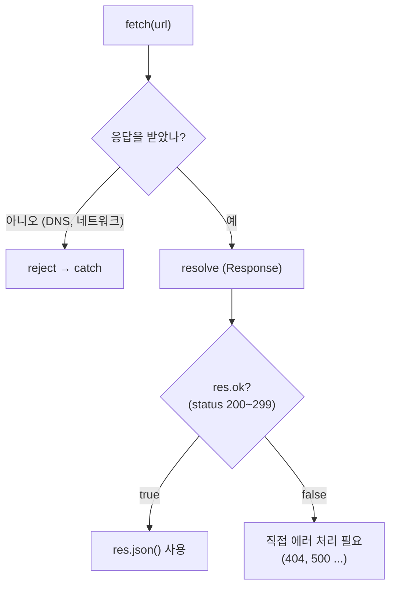

## 들어가며 (Situation)

JavaScript 비동기 단원에서 처음으로 외부 API를 불렀다(`04_fetch.html`). 요구사항은 "리뷰 목록 버튼을 누르면 리뷰 데이터를 보여 준다"였고, 연습용 공개 API인 JSONPlaceholder를 썼다.

```javascript
async function getReviews() {
  const data = fetch('https://jsonplaceholder.typicode.com/posts?_limit=5');
  console.log(data);                 // promise 객체

  const res = await data;            // 응답
  const reviews = await res.json();  // JS 객체 변환
  console.log(reviews);
  console.log(reviews[0].title);
}
```

JPA 미니 프로젝트에서 카테고리 목록을 가져올 때 쓴 `fetch('/menu/category').then(res => res.json())`과 같은 도구다. 그때는 내 서버였고, 이번에는 외부 서버다.

## 문제 상황 (Task)

수업 코드는 응답이 항상 성공한다고 가정한다. 실제로는 주소가 틀리거나 서버가 에러를 낼 수 있다. 그런데 수업의 다른 예제(`Promise`)에서는 실패를 `.catch()`나 `try-catch`로 잡았다. 그렇다면 `fetch`도 404가 오면 `catch`로 갈까?

1. 성공 응답 객체에는 무엇이 들어 있을까?
2. 404가 오면 `fetch`는 reject될까?
3. 그럼 `fetch`가 reject되는 경우는 언제일까?

## 해결 과정 (Action)

### 1. Node.js에서 같은 코드를 실행

Node.js 18부터 `fetch`가 내장돼 있어서 브라우저 없이 같은 코드를 돌릴 수 있었다. 성공, 잘못된 주소, 없는 서버 세 경우를 차례로 실행했다.

```javascript
const data = fetch('https://jsonplaceholder.typicode.com/posts?_limit=5');
console.log('fetch 반환값:', data);
const res = await data;
console.log('status:', res.status, 'ok:', res.ok, 'content-type:', res.headers.get('content-type'));
const reviews = await res.json();
console.log('개수:', reviews.length, '| reviews[0].title:', reviews[0].title);
try { await res.json(); } catch (e) { console.log('body 두 번 읽기 →', e.name + ':', e.message); }

const res404 = await fetch('https://jsonplaceholder.typicode.com/postz');
console.log('잘못된 주소 → status:', res404.status, 'ok:', res404.ok, '(reject 안 됨)');
console.log('404 body json:', await res404.json());

try { await fetch('https://no-such-host.invalid/'); }
catch (e) { console.log('네트워크 실패 → reject:', e.name, e.message); }
```

```text
fetch 반환값: Promise { <pending> }
status: 200 ok: true content-type: application/json; charset=utf-8
개수: 5 | reviews[0].title: sunt aut facere repellat provident occaecati excepturi optio reprehenderit
body 두 번 읽기 → TypeError: Body is unusable: Body has already been read

잘못된 주소 → status: 404 ok: false (reject 안 됨)
404 body json: {}

네트워크 실패 → reject: TypeError fetch failed
```

### 2. `fetch`는 "응답을 받았는가"만 본다

404 응답은 reject되지 않았다. `fetch`의 Promise는 **HTTP 응답을 받기만 하면** resolve된다. 상태 코드가 404든 500이든 서버가 응답을 보냈다면 "요청은 성공"으로 본다. reject되는 것은 DNS 실패, 연결 끊김처럼 **응답 자체를 받지 못한** 경우다. MDN도 같은 내용을 강조한다.

> A `fetch()` promise only rejects when the request fails, for example, because of a badly-formed request URL or a network error. A `fetch()` promise does not reject if the server responds with HTTP status codes that indicate errors (404, 504, etc.).



이번 404 응답은 본문이 `{}`였다. 수업 코드라면 `reviews[0].title`에서 `TypeError: Cannot read properties of undefined`가 났을 것이다. 진짜 원인(404)이 아니라 엉뚱한 곳에서 터지는 셈이다.

### 3. `res.ok`로 먼저 확인한다

`res.ok`는 상태 코드가 200~299이면 `true`다. 본문을 읽기 전에 확인하면 된다. (**예시 코드**)

```javascript
async function getReviews() {
  try {
    const res = await fetch('https://jsonplaceholder.typicode.com/posts?_limit=5');
    if (!res.ok) {
      throw new Error(`리뷰 조회 실패 : ${res.status}`);
    }
    const reviews = await res.json();
    console.log(reviews[0].title);
  } catch (e) {
    console.log(e.message);   // 404도, 네트워크 실패도 여기로
  }
}
```

`!res.ok`일 때 직접 `throw`하면 404와 네트워크 실패를 한 `catch`에서 처리할 수 있다.

### 4. `await`가 두 번 필요한 이유, 본문은 한 번만

`fetch`의 결과(`Response`)는 **헤더가 도착한 시점**에 resolve된다. 본문은 그 뒤에 이어서 받는다. 그래서 `res.json()`도 Promise를 돌려주고, 두 번째 `await`가 필요하다.

| 단계 | 돌려주는 것 | 기다리는 대상 |
|------|-------------|---------------|
| `fetch(url)` | `Promise<Response>` | 상태 코드·헤더 도착 |
| `res.json()` | `Promise<객체>` | 본문 전체 도착 + JSON 파싱 |

본문은 스트림이라 **한 번만** 읽을 수 있다. `res.json()`을 두 번 부르자 `Body has already been read` 에러가 났다. 같은 데이터를 두 번 써야 하면 처음 읽은 결과를 변수에 담아 둔다.

## 결과 (Result)

| 경우 | Promise | `res.status` / `res.ok` |
|------|---------|-------------------------|
| 정상 주소 | resolve | 200 / `true` |
| 잘못된 주소 `/postz` | **resolve** | 404 / `false` |
| 없는 호스트 | reject (`TypeError: fetch failed`) | — |
| 본문 두 번 읽기 | `TypeError: Body is unusable` | — |
| 실행 환경 | Node.js v24.22.1 (내장 fetch) | |

배운 점은 다음과 같다.

- `fetch`는 HTTP 에러 상태(404, 500)에서도 reject되지 않는다. `res.ok`나 `res.status`를 직접 확인해야 한다.
- `fetch`는 두 단계로 기다린다. 응답 헤더를 받는 단계와 본문을 읽는 단계다. 그래서 `await`가 두 번 필요하다.

## 더 학습하면 좋은 개념

- **CORS** — 브라우저에서 다른 출처의 API를 부를 때 생기는 제약. Node.js에서는 없고 브라우저에서만 생기는 이유.
- **HTTP 메서드와 요청 본문** — `fetch(url, { method: 'POST', body: JSON.stringify(...) })`로 데이터 보내기.
- **`AbortController`** — 오래 걸리는 요청을 취소하는 방법.
- **Axios** — 4xx/5xx에서 reject하는 등 `fetch`와 기본 동작이 다른 HTTP 라이브러리.

## 참고 자료

- [MDN - Using the Fetch API (Checking response status)](https://developer.mozilla.org/en-US/docs/Web/API/Fetch_API/Using_Fetch)
- [MDN - Window.fetch()](https://developer.mozilla.org/en-US/docs/Web/API/Window/fetch)
- [MDN - Response.ok](https://developer.mozilla.org/en-US/docs/Web/API/Response/ok)
- [MDN - Response.json()](https://developer.mozilla.org/en-US/docs/Web/API/Response/json)
- [JSONPlaceholder](https://jsonplaceholder.typicode.com/)

---

**요약**
1. 존재하지 않는 주소로 `fetch`하자 404 응답이 왔지만 Promise는 reject되지 않았다. `fetch`는 응답을 받지 못한 네트워크 실패에서만 reject된다.
2. 404 본문은 `{}`라서 수업 코드라면 `reviews[0].title`에서 엉뚱한 `TypeError`가 났을 것이다. 본문을 읽기 전에 `res.ok`를 확인하고 직접 `throw`해야 한다.
3. `fetch`는 헤더 도착과 본문 읽기 두 단계라 `await`가 두 번 필요하고, 본문은 한 번만 읽을 수 있어 두 번째 `res.json()`은 에러였다.
