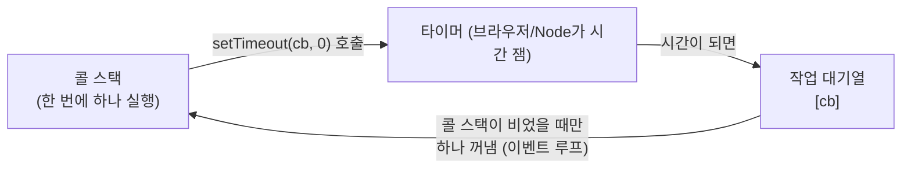

## 들어가며 (Situation)

JavaScript 비동기 단원 첫 실습은 "피자 조리"였다(`01_timer.html`).

```javascript
// 피자를 조리하는데 걸리는 시간 (5초)
setTimeout( () => console.log('5초 경과! 피자 조리 완료~~ 🍕'), 5000 );

// 프로그래밍의 개념으로는 5초 경과 메세지 후에
// 아래 주문 메세지가 나와야 한다. (위 -> 아래 개념)
console.log("주문할 사람~~");

setTimeout( (menuName) => console.log(`3초 경과! ${menuName} 조리 완료~~ 🍗`), 3000, "치킨" );

let count = 1;
const interval = setInterval( () => {
  console.log(`배달 도착까지 ${5 - count} 초`);
  count++;
  if(count == 5) {
    clearInterval(interval);
    console.log('배달 완료~~');
  }
}, 1000 );
```

`02_asynchronous.html`에서는 일부러 3초 동안 CPU를 붙잡는 `sleep` 함수를 만들어 동기 처리의 한계를 보여 줬다.

```javascript
function sleep(func, delay) {
  const delayUntil = Date.now() + delay;
  while(Date.now() < delayUntil);   // 3초 동안 반복만 함
  func();
}
```

## 문제 상황 (Task)

수업 주석은 비동기를 "오래 걸리는 작업을 별도의 공간에서 수행하고 메인 코드의 흐름을 이어 가는 것"이라고 설명했다. 출력 순서는 대략 이해했지만, **정확히 언제** 실행되는지는 감으로만 알았다.

1. 피자·치킨 타이머와 1초 간격 카운트다운이 섞이면 실제 순서와 시간은 어떻게 될까?
2. `sleep`처럼 메인 흐름을 붙잡고 있으면, 그 사이에 시간이 다 된 타이머는 어떻게 될까?

## 해결 과정 (Action)

### 1. 출력마다 경과 시간 찍기

수업 코드를 그대로 두고, `console.log` 앞에 시작 후 경과 시간(ms)만 붙여 Node.js로 실행했다.

```javascript
const t0 = Date.now();
const ts = () => `[${String(Date.now() - t0).padStart(4)}ms]`;
```

```text
[   1ms] 주문할 사람~~
[1011ms] 배달 도착까지 4 초
[2022ms] 배달 도착까지 3 초
[3008ms] 3초 경과! 치킨 조리 완료~~ 🍗
[3023ms] 배달 도착까지 2 초
[4038ms] 배달 도착까지 1 초
[4038ms] 배달 완료~~
[5009ms] 5초 경과! 피자 조리 완료~~ 🍕
```

맨 위의 피자 코드가 맨 마지막에 나왔다. `setTimeout`은 함수를 **예약만 하고** 바로 다음 줄로 넘어간다. 그리고 시간이 정확히 1000ms 단위가 아니라 1011, 2022, 3023처럼 조금씩 밀렸다. 지정한 시간은 "그때 실행"이 아니라 "**최소 그만큼 지난 뒤** 실행 대기열에 넣는다"는 뜻이기 때문이다.

### 2. 메인 흐름을 3초 붙잡으면

`sleep` 예제에 0ms 타이머를 하나 끼워 넣었다.

```javascript
setTimeout(() => console.log(ts(), '타이머 0ms 콜백'), 0);
console.log(ts(), '동기 sleep 시작');
sleep(() => console.log(ts(), '떡볶이 조리 완료! (3초)'), 3000);
console.log(ts(), '다음 손님 주문 하세요~');
```

```text
[   0ms] 동기 sleep 시작
[3002ms] 떡볶이 조리 완료! (3초)
[3002ms] 다음 손님 주문 하세요~
[3002ms] 타이머 0ms 콜백
```

**0ms 타이머가 3002ms에 실행됐다.** 0ms가 지나 이미 실행 대기열에 들어가 있었지만, 메인 코드가 `while`로 3초 동안 실행 중이라 차례가 오지 않았다. JavaScript는 실행하는 줄(콜 스택)이 하나뿐이다. 지금 실행 중인 코드가 끝나야 대기열의 콜백을 꺼낸다.

### 3. 이벤트 루프로 정리



- `setTimeout`을 부르면 시간 재기는 JavaScript 엔진 밖(브라우저나 Node.js)에서 한다.
- 시간이 되면 콜백이 **대기열**에 들어간다.
- **이벤트 루프**는 콜 스택이 비어 있을 때만 대기열에서 콜백을 하나 꺼내 실행한다.

그래서 수업 주석의 "별도의 작업 공간에서 수행"은 **기다리는 일**에 해당한다. 콜백 함수 자체는 결국 같은 하나의 콜 스택에서 실행된다. `sleep`처럼 CPU를 붙잡는 코드는 비동기로 바꿀 수 없고, 그동안 화면 클릭 같은 다른 이벤트도 전부 멈춘다.

| | `setTimeout(cook, 3000)` | `sleep(cook, 3000)` |
|---|---|---|
| 3초 동안 메인 흐름 | 다음 줄 계속 실행 (`takeOrder` 5번 출력) | 멈춤 |
| 3초 동안 다른 이벤트 | 처리됨 | 처리 안 됨 (화면 굳음) |
| 콜백 실행 위치 | 같은 콜 스택 (비었을 때) | 같은 콜 스택 (즉시) |

### 4. `setInterval`은 종료 조건이 필수

카운트다운은 `count`가 5가 되자 `clearInterval(interval)`로 멈췄다. `setInterval`이 돌려준 ID를 변수에 담아 둔 이유다. 종료 조건이 없으면 페이지를 닫을 때까지 1초마다 계속 실행된다. 수업 주석이 "종료의 조건을 달아주는 것이 중요하다"고 강조한 부분이다.

## 결과 (Result)

| 확인 항목 | 결과 |
|-----------|------|
| 코드상 첫 줄의 피자(5초) | 맨 마지막 출력 (5009ms) |
| 1초 간격 카운트다운 | 1011 → 2022 → 3023 → 4038ms (조금씩 밀림) |
| 메인 흐름을 3초 막은 뒤 0ms 타이머 | 3002ms에 실행 |
| 실행 환경 | Node.js v24.22.1 (브라우저도 같은 이벤트 루프 모델) |

배운 점은 다음과 같다.

- `setTimeout`의 시간은 "그때 실행"이 아니라 "최소 대기 시간"이다. 실행은 콜 스택이 비어야 한다.
- 비동기는 **기다리는 동안** 다른 일을 하게 해 줄 뿐, 무거운 계산을 대신 처리해 주지 않는다.

## 더 학습하면 좋은 개념

- **마이크로태스크 큐** — Promise의 `then` 콜백은 `setTimeout`보다 먼저 실행된다. 다음 글의 Promise와 이어진다.
- **Web Worker** — CPU를 오래 쓰는 계산을 정말로 다른 스레드에서 돌리는 방법.
- **디바운스·스로틀** — `setTimeout`을 이용해 너무 잦은 이벤트를 줄이는 패턴.
- **Java의 스레드와 비교** — Java는 여러 스레드로 동시에 처리하고, JavaScript는 하나의 스레드와 이벤트 루프로 처리한다.

## 참고 자료

- [MDN - setTimeout() (Reasons for delays longer than specified)](https://developer.mozilla.org/en-US/docs/Web/API/Window/setTimeout)
- [MDN - setInterval()](https://developer.mozilla.org/en-US/docs/Web/API/Window/setInterval)
- [MDN - JavaScript execution model (event loop)](https://developer.mozilla.org/en-US/docs/Web/JavaScript/Reference/Execution_model)
- [Node.js - The Node.js Event Loop](https://nodejs.org/en/learn/asynchronous-work/event-loop-timers-and-nexttick)

---

**요약**
1. 경과 시간을 찍어 보니 코드 첫 줄의 피자 타이머가 5009ms로 마지막에 나왔고, 1초 간격 카운트다운도 1011, 2022, 3023ms처럼 조금씩 밀렸다.
2. 메인 흐름을 `while`로 3초 붙잡자 0ms 타이머가 3002ms에 실행됐다. 콜백은 콜 스택이 비었을 때만 대기열에서 꺼내진다.
3. 비동기는 기다리는 동안 다른 일을 하게 해 줄 뿐이고 콜백은 같은 하나의 콜 스택에서 실행되므로, CPU를 붙잡는 코드는 여전히 모든 것을 멈춘다.
