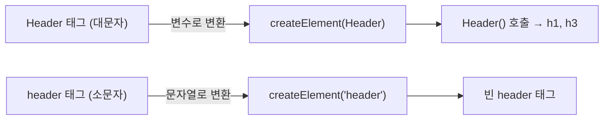
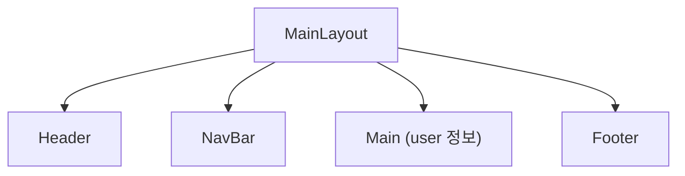

## 들어가며 (Situation)

React 첫날 후반에는 JSX 규칙과 함수형 컴포넌트를 배웠다. `02_fragment.html`에서는 최상위 요소가 둘이면 문법 에러가 난다는 것을 확인했다.

```javascript
// 1. 최상위 엘리먼트가 두 개 이상 (== 같은 레벨) 이면 문법 에러
// const element = (
//   <h1>{user.name}</h1>
//   <h3>{user.phone}</h3>
// );

// 3. <></> (React.Fragment)
const element = (
  <>
    <h1>{user.name}</h1>
    <h3>{user.phone}</h3>
  </>
);
```

`01_function-component.html`에서는 컴포넌트 규칙을 주석으로 적었다.

```javascript
// 함수형 컴포넌트의 특징
// 1. 앞글자 대문자!
// 2. return 엘리먼트!
function Header() {
  return (
    <>
      <h1>헤더입니다!</h1>
      <h3>사이트 이름</h3>
    </>
  );
}
ReactDOM.createRoot(document.getElementById('root'))
        // 컴포넌트의 앞글자가 소문자면 컴포넌트로 인식하는 것이
        // 아닌 단순 html 요소로 인식하게 된다.
        .render(<Header/>);
```

## 문제 상황 (Task)

두 규칙 모두 "그렇게 하면 안 된다"고만 배웠다. 어기면 정확히 무슨 일이 일어나는지는 보지 못했다.

1. 최상위 요소가 둘이면 어떤 에러가 나고, 왜 안 될까?
2. 컴포넌트 이름이 소문자면 "HTML 요소로 인식"된다는데, 화면에는 무엇이 나올까? 에러가 날까?

## 해결 과정 (Action)

### 1. 형제 요소 두 개를 Babel에 넣어 보기

페이지의 Babel로 주석 처리된 코드를 그대로 변환해 봤다.

```javascript
Babel.transform('const element = (\n  <h1>{user.name}</h1>\n  <h3>{user.phone}</h3>\n);', { presets: ['react'] })
```

```text
Adjacent JSX elements must be wrapped in an enclosing tag. Did you want a JSX fragment <>...</>? (3:2)

  1 | const element = (
  2 |   <h1>{user.name}</h1>
> 3 |   <h3>{user.phone}</h3>
    |   ^
```

에러 메시지가 해결책(Fragment)까지 알려 줬다. 이유는 [JSX가 `createElement` 호출]()이라는 데 있다. `(<h1/> <h3/>)`는 `(createElement('h1') createElement('h3'))`처럼 함수 호출 두 개를 나란히 놓은 것이 된다. JavaScript 식 하나에는 값이 하나여야 하므로 문법 오류다.

Fragment로 감싸면 어떻게 바뀌는지도 변환해 봤다.

```javascript
React.createElement(React.Fragment, null,
  React.createElement("h1", null, user.name),
  React.createElement("h3", null, user.phone));
```

하나의 `createElement(React.Fragment, ...)` 호출 안에 두 요소가 자식으로 들어갔다. `React.Fragment`는 실제 DOM에 아무 태그도 만들지 않는다. 수업 주석대로 `<div>`로 감싸면 쓸모없는 `<div>`가 하나 더 생기지만, Fragment는 그렇지 않다.

### 2. 컴포넌트 이름을 소문자로 바꿔 보기

원본은 두고 사본에서 `Header`를 `header`로 바꿨다.

```javascript
function header() { return (<> <h1>헤더입니다!</h1> <h3>사이트 이름</h3> </>); }
ReactDOM.createRoot(document.getElementById('root')).render(<header/>);
```

결과는 에러가 아니었다.

```html
<div id="root"><header></header></div>
```

**빈 `<header>` 태그**가 그려졌다. 콘솔에는 Babel 안내 말고는 아무 경고도 없었다. `<header>`는 진짜 HTML 태그라서 React 입장에서는 이상할 것이 없었기 때문이다. 내가 만든 `header` 함수는 한 번도 호출되지 않았다.

Babel 변환 결과를 보면 이유가 바로 보인다.

```javascript
<Header/>   →  React.createElement(Header, null);     // 변수(함수)를 넘김
<header/>   →  React.createElement("header", null);   // 문자열을 넘김
```



Babel은 태그 이름의 **첫 글자**만 보고 판단한다. 소문자면 HTML 태그 이름(문자열)으로, 대문자면 같은 이름의 변수로 바꾼다. 그래서 대문자 규칙은 관습이 아니라 **JSX 문법 규칙**이다. 특히 이번처럼 이름이 우연히 실제 HTML 태그(`header`, `nav`, `main`, `footer`)와 같으면 에러도 경고도 없이 빈 태그만 남아서 더 찾기 어렵다.

### 3. 컴포넌트 조합

`02_composition.html`에서는 작은 컴포넌트를 모아 레이아웃을 만들었다.


```javascript
function MainLayout() {
  return (
    <div style={{border : '1px solid black', backgroundColor : 'lightgreen'}}>
      <Header/>
      <NavBar/>
      <Main/>
      <Footer/>
    </div>
  )
}
```


`style={{ ... }}`의 바깥 중괄호는 "여기는 JavaScript 표현식", 안쪽 중괄호는 "스타일 객체"다. CSS 속성 이름은 `background-color`가 아니라 camelCase인 `backgroundColor`다.



Java로 치면 작은 클래스를 조합해 큰 기능을 만드는 것과 같다. 각 컴포넌트는 자기 부분만 책임지고, `MainLayout`은 배치만 한다.

## 결과 (Result)

| 확인 항목 | 결과 |
|-----------|------|
| 형제 JSX 요소 두 개 | Babel 에러 `Adjacent JSX elements must be wrapped in an enclosing tag` |
| Fragment 변환 | `createElement(React.Fragment, null, h1, h3)` |
| 소문자 컴포넌트 `<header/>` | 에러·경고 없이 빈 `<header></header>` 렌더링 |
| 변환 차이 | `createElement(Header)` vs `createElement("header")` |
| 환경 | React 18.3.1 UMD, @babel/standalone 8.1.3, Playwright Chromium |

배운 점은 다음과 같다.

- JSX 규칙은 대부분 "JSX = `createElement` 호출"에서 나온다. 식 하나에 값이 하나여야 하니 Fragment가 필요하다.
- 컴포넌트 대문자 규칙은 Babel이 문자열과 변수를 구분하는 기준이다. 이름이 실제 HTML 태그와 겹치면 아무 경고 없이 빈 태그가 된다.

## 더 학습하면 좋은 개념

- **props와 children** — 컴포넌트에 값을 넘기고, `<Layout>...</Layout>` 사이의 내용을 받는 방법.
- **`key`가 있는 Fragment** — 목록을 그릴 때 `<Fragment key={...}>`가 필요한 경우.
- **조건부 렌더링** — JSX 안에서 `if` 대신 삼항 연산자나 `&&`를 쓰는 이유(표현식만 가능).
- **ESLint `react/jsx-pascal-case`** — 이름 규칙 실수를 도구로 잡는 방법.

## 참고 자료

- [React - Fragment](https://react.dev/reference/react/Fragment)
- [React - Your First Component](https://react.dev/learn/your-first-component)
- [React - Writing Markup with JSX (Return a single root element)](https://react.dev/learn/writing-markup-with-jsx)
- [React - Passing Props to a Component](https://react.dev/learn/passing-props-to-a-component)

---

**요약**
1. 형제 JSX 요소 두 개는 Babel에서 `Adjacent JSX elements must be wrapped...` 에러였다. JSX는 `createElement` 호출이라 식 하나에 값이 하나여야 하고, Fragment는 DOM 태그 없이 이를 묶는다.
2. 컴포넌트 이름을 `header`로 바꾸자 에러나 경고 없이 빈 `<header></header>`가 그려졌다. 소문자 태그는 문자열 `"header"`로 변환되어 내 함수가 호출되지 않았다.
3. 작은 컴포넌트(`Header`, `NavBar`, `Main`, `Footer`)를 `MainLayout`에서 조합했고, `style={{...}}`는 표현식 중괄호 안의 스타일 객체다.
