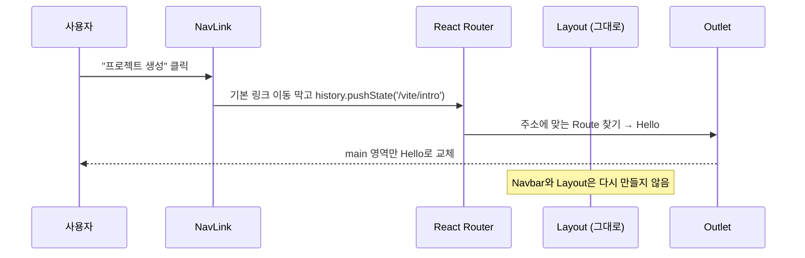
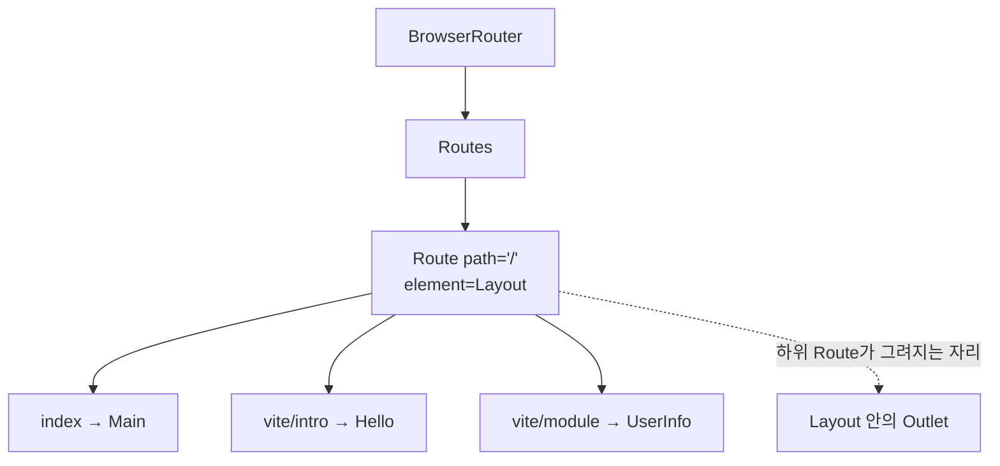

## 들어가며 (Situation)

Vite 프로젝트에 컴포넌트가 늘어나자 `App.jsx`에 전부 넣어 둘 수가 없었다. 수업 주석이 그 이유를 적었다.

```javascript
/*
  현재 02_module 폴더까지 진행했을 때, 사용자 화면에 우리가 만든 컴포넌트를 보여주기 위해서는
  App 컴포넌트에 집어 넣어야 한다. 하지만, 현실 세계의 프로젝트는 여러 페이지가 존재하며
  페이지 별로 보여야 하는 컴포넌트, 보이면 안되는 컴포넌트가 존재한다.
*/
```

그래서 `react-router-dom`으로 주소에 따라 다른 컴포넌트를 보여 주는 라우팅을 붙였다.

```javascript
<BrowserRouter>
  <Routes>
    <Route path="/" element={<Layout/>}>
      <Route index element = {<Main/>}/>
      <Route path="vite/intro" element = {<Hello/>}/>
      <Route path="vite/module" element = {<UserInfo/>}/>
    </Route>
  </Routes>
</BrowserRouter>
```

```javascript
function Layout() {
  return (
    <div className={styles.layout}>
      <Navbar/>
      <main className={styles.content}>
        <Outlet/>   {/* 주소에 맞는 하위 Route의 컴포넌트가 여기에 그려진다 */}
      </main>
    </div>
  );
}
```

메뉴는 `<a>` 대신 `NavLink`, 스타일은 CSS Module(`Navbar.module.css`)을 썼다.

```javascript
import styles from './Navbar.module.css';
const activeStyle = ({isActive}) => isActive ? {backgroundColor: 'orangered', color: 'white'} : undefined;

<nav className={styles.nav}>
  <h2><NavLink to="/">React 챕터</NavLink></h2>
  <NavLink to="/vite/intro" style={activeStyle}>프로젝트 생성</NavLink>
  <NavLink to="/vite/module" style={activeStyle}>모듈</NavLink>
</nav>
```

## 문제 상황 (Task)

수업 주석에는 세 가지 설명이 있었다.

1. `<a href>`는 페이지 전체를 새로 불러오지만, `Link`는 새로고침 없이 주소만 바꿔 컴포넌트를 교체한다.
2. `NavLink`는 현재 주소와 맞으면 `isActive`가 `true`가 된다.
3. CSS Module의 클래스명은 `Navbar-module__nav__xxxxx`처럼 고유한 이름으로 바뀐다.

화면으로만 보면 "그렇구나" 하고 넘어가게 된다. 각각을 확인할 방법을 찾아 직접 보기로 했다. 실습 프로젝트는 `Main.jsx`의 export 누락([이전 글]())을 고친 **사본**으로 실행했다.

## 해결 과정 (Action)

### 1. 새로고침이 없었다는 것을 어떻게 확인할까

페이지를 새로 불러오면 JavaScript의 전역 상태가 모두 사라진다. 그래서 `window`에 표식을 하나 남긴 뒤 `NavLink`를 클릭하고, 표식이 남아 있는지 확인했다.

```javascript
window.__marker = 'still-same-document';
document.querySelector('nav a[href="/vite/intro"]').click();
await new Promise(r => setTimeout(r, 300));
// location.pathname : /vite/intro
// window.__marker === 'still-same-document' : true
// main 내용 : Hello World!!!
```

주소는 `/vite/module`에서 `/vite/intro`로 바뀌었고, `<main>`의 내용은 `UserInfo`(양승빈 / 20 / abc@abc.com)에서 `Hello World!!!`로 바뀌었다. 그런데 표식은 **그대로** 있었다. 문서를 새로 불러오지 않고 같은 페이지 안에서 컴포넌트만 바꾼 것이다.



`NavLink`도 실제 DOM은 `<a href="/vite/intro">`다. 다른 점은 클릭했을 때 브라우저의 기본 이동을 막고, History API로 주소만 바꾼 뒤 React Router가 화면을 다시 그린다는 것이다. 그래서 `Navbar`는 그대로 있고 `Outlet` 자리만 바뀐다.

### 2. `NavLink`의 활성 표시

`/vite/module`에서 메뉴 링크의 상태를 읽었다.

```text
React 챕터[ -], 프로젝트 생성[ -], 모듈[page orangered]
```

현재 주소와 맞는 "모듈" 링크에만 `aria-current="page"`와 `orangered` 배경이 붙었다. `aria-current`는 화면 낭독기에게 "현재 페이지"를 알려 주는 속성으로, `NavLink`가 자동으로 붙인다.

`to="/"`인 "React 챕터"는 활성이 아니었다. 모든 주소가 `/`로 시작하므로 "앞부분이 맞으면 활성"이라면 항상 켜져 있어야 한다. React Router는 루트 경로(`/`)의 `NavLink`만은 **정확히 `/`일 때만** 활성으로 본다. 다른 경로도 정확히 일치할 때만 켜고 싶다면 `end` 속성을 쓴다.

### 3. CSS Module의 실제 클래스 이름

개발 서버와 빌드 결과에서 클래스 이름을 확인했다.

```text
nav class: _nav_masue_1 | layout class: _content_1tt32_11
```

빌드한 CSS 파일(`dist/assets/index-BSYHW384.css`)에도 같은 `_nav_masue_1`이 들어 있었다. 수업 주석의 `Navbar-module__nav__xxxxx` 형태가 아니었다. 고유한 이름으로 바꾼다는 원리는 같지만, **구체적인 이름 규칙은 도구와 버전에 따라 다르다.** 이번 프로젝트(Vite 8)는 `_원래이름_해시_번호` 형태를 썼다. 그래서 코드에서는 실제 이름을 직접 쓰지 말고 항상 `styles.nav`로 가져와야 한다.

| | 일반 CSS (`import './style.css'`) | CSS Module (`import styles from './x.module.css'`) |
|---|---|---|
| 적용 범위 | 페이지 전체 | 그 컴포넌트 |
| 클래스 이름 | 쓴 그대로 (`.nav`) | 고유 이름으로 변환 (`_nav_masue_1`) |
| 사용 | `className="nav"` | `className={styles.nav}` |
| 이름 충돌 | 다른 파일의 `.nav`와 충돌 가능 | 없음 |

`Navbar.module.css`의 `.nav h4`, `.nav a` 같은 하위 선택자는 `.nav` 부분만 바뀌고 `h4`, `a` 태그 선택자는 그대로 적용됐다. 클래스 이름만 지역화된다.

### 4. 중첩 라우트 구조 정리



부모 `Route`의 `element`(`Layout`)는 항상 그려지고, 자식 `Route` 중 주소에 맞는 하나가 `Layout`의 `<Outlet/>` 자리에 들어간다. `index`는 부모 경로(`/`)와 정확히 같을 때 들어가는 기본 자식이다. 이전 글의 흰 화면 문제가 났던 `Main`이 바로 이 `index` 자리였다.

## 결과 (Result)

| 확인 항목 | 결과 |
|-----------|------|
| `NavLink` 클릭 후 `window.__marker` | 남아 있음 (새로고침 없음) |
| 바뀐 영역 | `<main>`의 `Outlet` 부분만 |
| 활성 링크 | 현재 주소 링크에 `aria-current="page"` + `orangered` |
| 루트 `NavLink to="/"` | 다른 경로에서는 비활성 |
| CSS Module 클래스 이름 | `_nav_masue_1`, `_content_1tt32_11` (주석의 형태와 다름) |
| 환경 | React 19.3.1, react-router-dom 7.18.6, Vite 8.3.8, Playwright Chromium |

배운 점은 다음과 같다.

- SPA의 화면 전환은 페이지 이동이 아니라 **같은 문서에서 컴포넌트를 바꾸는 것**이다. 전역 값이 유지되는지로 확인할 수 있다.
- `Outlet`은 부모 레이아웃 안에서 자식 화면이 들어갈 자리다. 공통 메뉴는 한 번만 그린다.
- CSS Module이 만드는 이름은 도구마다 다르다. 이름을 외우지 말고 `styles.클래스`로만 쓴다.

## 더 학습하면 좋은 개념

- **History API (`pushState`, `popstate`)** — 새로고침 없이 주소를 바꾸고 뒤로 가기를 처리하는 브라우저 기능.
- **SPA와 서버 설정** — `/vite/intro`에서 새로고침했을 때 서버가 `index.html`을 돌려줘야 하는 이유(Spring에서 정적 파일로 배포할 때 특히 중요).
- **`useParams`, `useNavigate`** — 주소의 값을 읽고 코드로 이동하는 React Router 훅.
- **CSS-in-JS와 Tailwind** — 컴포넌트 단위 스타일을 다루는 다른 방법들.

## 참고 자료

- [React Router - Routing (Declarative mode)](https://reactrouter.com/start/declarative/routing)
- [React Router - NavLink](https://reactrouter.com/api/components/NavLink)
- [React Router - Outlet](https://reactrouter.com/api/components/Outlet)
- [Vite - CSS Modules](https://vite.dev/guide/features#css-modules)
- [MDN - History API](https://developer.mozilla.org/en-US/docs/Web/API/History_API)

---

**요약**
1. `window`에 표식을 남기고 `NavLink`를 클릭하니 주소와 `<main>` 내용은 바뀌었지만 표식은 남아 있었다. React Router는 새로고침 없이 `Outlet` 자리의 컴포넌트만 바꿨다.
2. 현재 주소의 `NavLink`에만 `aria-current="page"`와 `orangered` 배경이 붙었고, 루트 `to="/"` 링크는 다른 경로에서 비활성이었다.
3. CSS Module 클래스는 수업 주석의 `Navbar-module__nav__xxxxx`가 아니라 `_nav_masue_1` 형태였다. 이름 규칙은 도구마다 다르므로 항상 `styles.nav`로 참조한다.
