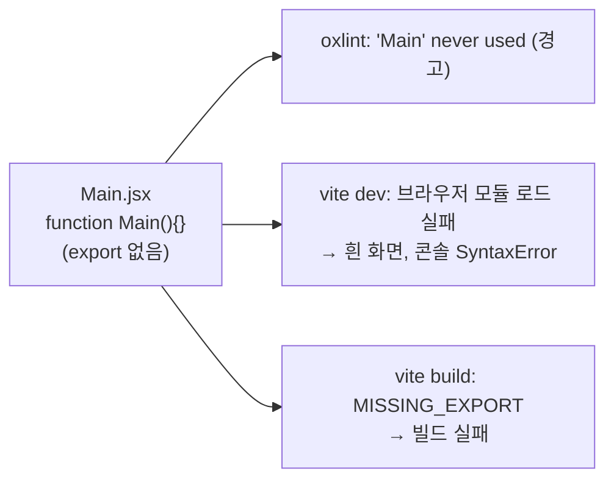

## 들어가며 (Situation)

React 둘째 날에는 CDN을 떠나 Vite로 프로젝트(`component-app`)를 만들었다. 이제 컴포넌트를 파일 하나에 하나씩 나누고 `import`/`export`로 연결한다.

```javascript
// module/02_module/user.js : 이름 있는 export
export const user = { name : '양승빈', age : 20, email : "abc@abc.com" };
```

```javascript
// module/02_module/AgeCard.jsx
/*
  export default 는 {} 없이 이름으로 import 를 받을 수 있지만, 파일 당 1 개로 제한이 된다.
  export 는 {} 를 통해서 import 받을 수 있으며, 여러 개를 하나의 파일에서 내보낼 수 있다.
*/
import { user } from "./user";
export default function AgeCard() { ... }
```

오전 마지막에는 라우팅을 붙이면서 메인 페이지 컴포넌트를 만들었다.

```javascript
// src/pages/Main.jsx
function Main() {
  return (
    <>
      <h1>React!</h1>
      <p>왼쪽 메뉴바에서 챕터를 선택해주세요</p>
    </>
  )
}
```

```javascript
// src/App.jsx
import Main from "./pages/Main";
...
<Route index element = {<Main/>}/>
```

## 문제 상황 (Task)

블로그 정리를 위해 실습 프로젝트를 다시 실행해 보니 화면이 **하얗게 비어** 있었다. 메뉴바조차 나오지 않았다. 문법 오류 표시도 없었다.

`App.jsx`의 주석에는 이런 말이 있었다.

```javascript
/*
  React 에서는 import / export 가 굉장히 중요하다.
  만약 import 를 했는데 실제로 사용하지 않으면 오류가 발생할 수 있기
  때문에 오류 발생 시 첫 번째로 확인하면 좋은 것은 import 구문이다.
*/
```

주석대로 import부터 의심해야 할까? 원인을 찾아야 했다.

## 해결 과정 (Action)

### 1. 개발 서버의 콘솔 확인

Vite 개발 서버를 띄우고 Playwright로 열어 콘솔 에러를 봤다.

```text
The requested module '/src/pages/Main.jsx' does not provide an export named 'default'
```

`#root`의 자식 요소 수는 0이었다. React가 시작조차 못 했다. Vite 개발 서버는 각 파일을 **브라우저의 ES 모듈**로 그대로 보낸다. 브라우저는 `App.jsx`를 불러오다가 `Main.jsx`에 `default` 내보내기가 없다는 것을 발견하고 **모듈 전체의 실행을 멈췄다.** `main.jsx` → `App.jsx` → `Main.jsx`로 이어지는 연결이 끊기니 `createRoot(...).render()`까지 가지 못해 흰 화면이 됐다.

### 2. 빌드는 더 분명하게 알려 준다

원본 폴더를 건드리지 않도록 출력 폴더만 임시 경로로 바꿔 빌드했다.

```bash
npx vite build --outDir <임시 폴더> --emptyOutDir
```

```text
vite v8.3.8 building client environment for production...
✓ 33 modules transformed.
✗ Build failed in 108ms
error during build:
[MISSING_EXPORT] "default" is not exported by "src/pages/Main.jsx".
   ╭─[ src/App.jsx:5:8 ]
 5 │ import Main from "./pages/Main";
   │        ──┬─
   │          ╰─── Missing export
```

`Main.jsx` 마지막에 `export default Main;`이 빠져 있었다. 다른 컴포넌트 파일(`Navbar.jsx`, `Layout.jsx`, `UserInfo.jsx`)은 모두 마지막 줄에 `export default`가 있었다.

### 3. 린터는 이미 힌트를 주고 있었다

프로젝트에 들어 있는 `oxlint`도 돌려 봤다.

```bash
npx oxlint
```

```text
src/pages/Main.jsx:1:10: warning eslint(no-unused-vars): Function 'Main' is declared but never used.
src/pages/Main.jsx:1:10: warning react(only-export-components): Fast refresh only works when a file has exports.
```

"`Main`을 선언했는데 아무도 안 쓴다"는 경고였다. 파일 안에서 쓰지 않고 내보내지도 않으니, 이 함수는 어디서도 쓰일 수 없다. 에러가 아니라 경고라서 그냥 지나치기 쉽지만, 원인을 정확히 가리키고 있었다.



### 4. 한 줄 추가로 확인

원본은 그대로 두고, 프로젝트를 임시 폴더에 복사한 뒤 `Main.jsx` 끝에 한 줄만 붙였다.

```javascript
export default Main;
```

```text
✓ 33 modules transformed.
dist/index.html                   0.46 kB │ gzip:  0.29 kB
dist/assets/index-BSYHW384.css    0.25 kB │ gzip:  0.18 kB
dist/assets/index-DxHnkoxl.js   259.41 kB │ gzip: 82.55 kB
✓ built in 133ms
```

빌드가 통과했고, 개발 서버에서도 메뉴바와 페이지가 정상으로 나왔다.

### 5. 주석의 "사용하지 않는 import는 오류"는 반대였다

이번 오류는 **사용하지 않는 import**가 아니라 **없는 export를 import**한 것이었다. 사용하지 않는 import는 린터가 경고만 하고 빌드는 통과한다. 반대로 상대 파일에 없는 이름을 가져오면 브라우저와 빌드 도구 모두 멈춘다. 주석의 "오류가 나면 import부터 확인하라"는 조언 자체는 맞았다. 다만 확인할 것은 "그 import가 가리키는 파일이 정말 그 이름을 내보내는가"였다.

| 상황 | 린터 | 개발 서버 | 빌드 |
|------|------|-----------|------|
| import했는데 안 씀 | 경고 | 정상 | 정상 |
| 선언했는데 export 안 함 (`Main.jsx`) | 경고 (`never used`) | — | — |
| 없는 default를 import (`App.jsx`) | — | **흰 화면 + 콘솔 에러** | **MISSING_EXPORT** |

default와 이름 있는 export의 차이도 다시 정리했다.

| | `export default` | `export` (named) |
|---|---|---|
| 파일당 개수 | 1개 | 여러 개 |
| import 문법 | `import Main from './Main'` (이름 자유) | `import { user } from './user'` (이름 일치) |
| 없을 때 에러 | `does not provide an export named 'default'` | `does not provide an export named 'user'` |

## 결과 (Result)

| 확인 항목 | 결과 |
|-----------|------|
| 개발 서버 | 흰 화면, `#root` 자식 0개, 콘솔 `does not provide an export named 'default'` |
| `vite build` | `[MISSING_EXPORT] "default" is not exported by "src/pages/Main.jsx"` |
| `oxlint` | `Function 'Main' is declared but never used` 경고 |
| `export default Main;` 추가 후 | 빌드 133ms 성공, 화면 정상 |
| 환경 | React 19.3.1, Vite 8.3.8, oxlint |

배운 점은 다음과 같다.

- 흰 화면은 보통 **콘솔**에 이유가 있다. 개발 서버에서는 모듈 하나만 실패해도 앱 전체가 시작되지 않는다.
- 빌드(`vite build`)와 린트(`oxlint`)는 개발 서버보다 문제를 더 정확한 위치로 알려 준다. 수업 중에도 가끔 돌려 볼 가치가 있다.
- "선언했는데 안 쓴다"는 경고는 무시할 대상이 아니다. 이번에는 export를 빠뜨렸다는 신호였다.

## 더 학습하면 좋은 개념

- **ES 모듈 (`import`/`export`)** — 브라우저가 모듈을 불러오고 연결하는 방식과 순환 import.
- **Vite의 개발 서버와 번들링** — 개발 중에는 파일을 따로 보내고, 빌드 때는 하나로 묶는 이유.
- **React Fast Refresh** — `only-export-components` 경고가 말하는 "컴포넌트만 export하는 파일" 규칙.
- **에러 바운더리(Error Boundary)** — 렌더링 중 에러로 화면 전체가 하얘지는 것을 막는 방법.

## 참고 자료

- [MDN - export](https://developer.mozilla.org/en-US/docs/Web/JavaScript/Reference/Statements/export)
- [MDN - import](https://developer.mozilla.org/en-US/docs/Web/JavaScript/Reference/Statements/import)
- [React - Importing and Exporting Components](https://react.dev/learn/importing-and-exporting-components)
- [Vite - Building for Production](https://vite.dev/guide/build)
- [Oxlint - no-unused-vars](https://oxc.rs/docs/guide/usage/linter/rules/eslint/no-unused-vars.html)

---

**요약**
1. 실습 프로젝트가 흰 화면이었고, 콘솔에는 `'/src/pages/Main.jsx' does not provide an export named 'default'`가 있었다. `Main.jsx`에 `export default`가 빠져 모듈 연결이 끊겨 React가 시작조차 못 했다.
2. `vite build`는 `[MISSING_EXPORT]`로 `App.jsx` 5번째 줄을 정확히 가리켰고, `oxlint`는 이미 `Function 'Main' is declared but never used` 경고로 힌트를 주고 있었다.
3. `export default Main;` 한 줄로 빌드와 화면이 정상이 됐다. 문제는 "사용하지 않는 import"가 아니라 "내보내지 않은 것을 import"한 것이었다.
