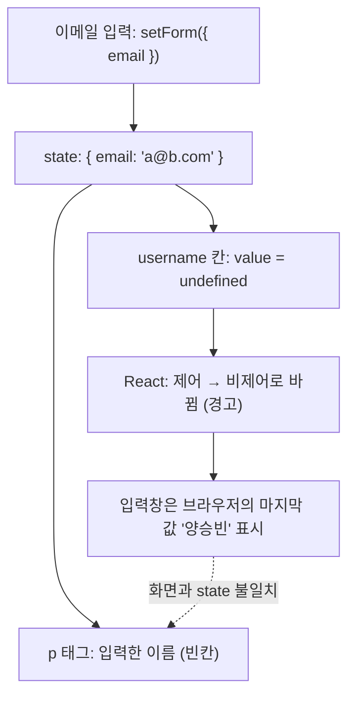

## 들어가며 (Situation)

세 번째 주제는 이벤트와 입력값(`03_event.jsx`)이었다. [DOM 이벤트]()와 다른 점부터 정리했다.

| | DOM (지난주) | React |
|---|---|---|
| 속성 이름 | `onclick` | `onClick` (camelCase) |
| 값 | 코드 문자열 또는 `addEventListener` | 함수 |
| 입력값 읽기 | `input.value`를 직접 | state에 담아 두고 읽기 |

회원가입 폼은 이름과 이메일을 **객체 state 하나**와 **핸들러 하나**로 관리한다.

```javascript
const [form, setForm] = useState({ username: '', email: '' });

const onChangeHandler = e => {
    // 프로퍼티 키에 [] 를 씌우게 되면 값이 곧 key 가 된다.
    setForm({
        ...form,    // 기존 값을 스프레드 문법으로 복사하지 않으면
                    // form 에 묶여있는 다른 값을 수정하면 기존 값이 초기화 된다.
        [e.target.name] : e.target.value
    })
};

<input name="username" value={form.username} onChange={onChangeHandler}/>
<input name="email"    value={form.email}    onChange={onChangeHandler}/>
<button onClick={onResetHandler}>초기화</button>
<p>입력한 이름: {form.username} / 이메일: {form.email}</p>
```

## 문제 상황 (Task)

주석에 "스프레드로 복사하지 않으면 다른 값이 초기화된다"고 적었다. 정말 그런지, 초기화된다면 화면에는 어떻게 보이는지 보지는 못했다. 또 TODO 3은 "`value`를 연결해야 초기화 버튼이 input까지 비운다"고 했다. `value`가 없으면 어떻게 되는 걸까?

## 해결 과정 (Action)

### 1. 수업 코드 동작 확인

Playwright로 두 칸에 차례로 입력하고 초기화를 눌렀다.

```text
입력 후:   입력한 이름: 양승빈 / 이메일: a@b.com
초기화 후: 입력한 이름:  / 이메일:  | input 값 "", ""
```

`[e.target.name]`(계산된 프로퍼티 이름) 덕분에 핸들러 하나가 `name` 속성으로 어떤 칸인지 구분했다. 초기화 버튼은 state를 비웠고, `value={form.username}`이 연결돼 있어서 입력창도 같이 비었다.

### 2. `...form`을 뺀 버전

같은 React로 스프레드만 뺀 컴포넌트를 만들어 같은 순서로 입력했다.

```javascript
const on = e => setForm({ [e.target.name]: e.target.value });   // ...form 없음
```

```text
이름 입력 후:   {"username":"양승빈"}
이메일 입력 후: {"email":"a@b.com"}  | 이름 칸 화면 "양승빈"
console.error:
  A component is changing a controlled input to be uncontrolled. ...
  A component is changing an uncontrolled input to be controlled. ...
```

주석대로 이메일을 입력하자 state에서 `username`이 **사라졌다**. setter는 기존 객체에 합쳐 주는 것이 아니라 **통째로 바꾼다**. 새 객체에 `email`만 있으니 `username`은 없어졌다.

그런데 이상한 점이 있었다. state에는 이름이 없는데 **이름 칸에는 "양승빈"이 그대로 보였다.** 콘솔 경고 두 줄이 이유를 알려 줬다.

### 3. 제어 컴포넌트와 비제어 컴포넌트

`value`에 state를 연결한 input은 **제어 컴포넌트**다. 화면의 값은 항상 state가 정한다. 그런데 `form.username`이 `undefined`가 되자 `value={undefined}`가 됐다. React에서 `value`가 `undefined`면 "값을 정하지 않음"으로 보고 input을 **비제어**로 바꾼다. 그러면 입력창은 브라우저가 가진 마지막 값(양승빈)을 그대로 보여 준다.



화면에는 이름이 있는데 state에는 없다. 이 상태로 "가입" 버튼이 state를 서버로 보내면 이름이 빠진 채 전송된다. 사용자가 보기에는 멀쩡해서 더 찾기 어려운 버그다.

| | 제어 컴포넌트 | 비제어 컴포넌트 |
|---|---|---|
| 값의 주인 | React state (`value={state}`) | 브라우저 DOM |
| 값 읽기 | state | `ref`로 DOM에서 |
| 초기화 | `setForm(...)`만 하면 입력창도 비워짐 | DOM을 직접 비워야 함 |
| 조건 | `value`가 항상 정의돼 있어야 함 | `value` 없음 (`defaultValue` 사용) |

TODO 3의 말도 같은 이야기다. `value`를 연결하지 않으면 input은 처음부터 비제어라서, 초기화 버튼이 state를 비워도 입력창의 글자는 남는다.

### 4. `...form`이 하는 일

`{ ...form, [e.target.name]: e.target.value }`는 기존 프로퍼티를 [얕은 복사]()로 모두 옮긴 뒤, 바뀐 칸 하나만 덮어쓴 **새 객체**를 만든다. 원본 `form`을 직접 바꾸지 않고 새 객체를 넘겨야 React가 "바뀌었다"를 알아차린다.

## 결과 (Result)

| 확인 항목 | 결과 |
|-----------|------|
| 수업 코드 입력·초기화 | state와 입력창 모두 정상, 초기화 시 함께 비워짐 |
| `...form` 없이 이름 → 이메일 입력 | state `{"email":"a@b.com"}`, `username` 사라짐 |
| 그때 이름 입력창 | "양승빈" 그대로 표시 (비제어로 바뀜) |
| 콘솔 | `changing a controlled input to be uncontrolled` 경고 |
| 환경 | React 19.3.1, Vite 8, Playwright Chromium |

배운 점은 다음과 같다.

- 객체 state의 setter는 합치지 않고 **교체**한다. 일부만 바꾸려면 `...기존객체`로 나머지를 복사해야 한다.
- 제어 컴포넌트의 `value`가 `undefined`가 되면 React가 손을 놓아 화면과 state가 달라진다. 콘솔 경고가 신호다.

## 더 학습하면 좋은 개념

- **계산된 프로퍼티 이름 (`[key]: value`)** — 변수 값을 객체 키로 쓰는 문법.
- **`e.preventDefault()`와 form 제출** — `<form onSubmit>`으로 제출을 처리할 때 새로고침을 막는 방법.
- **`useRef`와 비제어 컴포넌트** — 값을 state 대신 DOM에서 읽어야 할 때.
- **폼 라이브러리 (React Hook Form)** — 입력이 많을 때 검증과 상태 관리를 맡기는 방법.

## 참고 자료

- [React - Responding to Events](https://react.dev/learn/responding-to-events)
- [React - Updating Objects in State](https://react.dev/learn/updating-objects-in-state)
- [React - input (Controlling an input with a state variable)](https://react.dev/reference/react-dom/components/input)
- [MDN - Computed property names](https://developer.mozilla.org/en-US/docs/Web/JavaScript/Reference/Operators/Object_initializer#computed_property_names)

---

**요약**
1. 객체 state 하나와 `[e.target.name]` 핸들러 하나로 두 input을 관리했고, `value`를 연결해서 초기화 버튼이 state와 입력창을 함께 비웠다.
2. `...form`을 빼자 이메일을 입력하는 순간 state에서 `username`이 사라졌다. setter는 객체를 합치지 않고 통째로 교체한다.
3. 그때 이름 칸은 `value={undefined}`가 되어 비제어로 바뀌면서 "양승빈"을 그대로 보여 줬고, 콘솔에만 controlled→uncontrolled 경고가 남았다.
