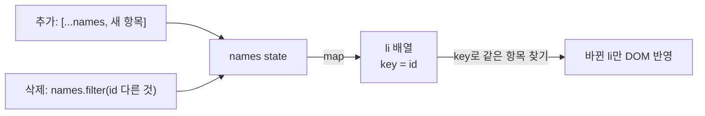

## 들어가며 (Situation)

오늘 마지막 주제는 반복 렌더링(`04_iteration.jsx`)이었다. 이름 목록을 `map`으로 그리고, 입력창으로 추가하고, 더블클릭으로 삭제한다.

```javascript
const [names, setNames] = useState([
    {id: 1, name: '홍길동'},
    {id: 2, name: '유관순'},
    {id: 3, name: '이순신'}
]);
const [inputText, setInputText] = useState('');
const [nextId, setNextId] = useState(4);

const onClickHandler = () => {
    setNames([ ...names , {id : nextId , name : inputText} ]);
    setNextId(nextId + 1);
    setInputText('');
};

const onRemove = id => {
    setNames(names.filter(name => name.id !== id));
};

...
{names.map( name =>
    <li key={name.id} on onDoubleClick={() => onRemove(name.id)}>{name.id} 번 {name.name}</li>
)}
```

[지난주 배운 `map`과 `filter`]()가 그대로 쓰였다. `map`은 데이터 배열을 `<li>` 배열로 바꾸고, `filter`는 지울 항목만 뺀 새 배열을 만든다.

## 문제 상황 (Task)

추가와 삭제는 화면에서 잘 됐다. 그런데 `/iteration`을 열면 콘솔에 빨간 에러가 하나 있었다. TODO 1에서 key를 빼고 경고를 확인한 뒤 `key={name.id}`를 넣었으니 key 경고는 아닐 것이다. 무엇이 문제일까?

그리고 몇 가지 동작도 확인하고 싶었다. 입력창을 비운 채 추가를 누르면? 가운데 항목을 지운 뒤 번호는 어떻게 될까?

## 해결 과정 (Action)

### 1. 콘솔 에러 읽기

```text
[ERROR] Received `true` for a non-boolean attribute `on`.

If you want to write it to the DOM, pass a string instead: on="true" or on={value.toString()}.
```

`on`이라는 속성이 있다는 뜻이다. 코드를 다시 보니 `<li key={name.id} on onDoubleClick=...>`에 **`on`** 이 하나 따로 있었다. `onDoubleClick`을 치다가 남은 것으로 보인다.

JSX에서 값 없이 이름만 쓴 속성은 `true`로 처리된다. HTML의 `disabled`처럼 쓰는 문법이다. 그래서 `on={true}`가 됐다. 그런데 `on`은 React가 아는 불리언 속성이 아니라서 경고를 내고 **DOM에는 넣지 않았다**(`li.getAttribute('on')`은 `null`). 동작에는 영향이 없어서 화면만 보면 알 수 없고, 콘솔에만 흔적이 남았다.

| JSX | 처리 |
|-----|------|
| `<input disabled/>` | `disabled={true}` → 알려진 불리언 속성, DOM에 반영 |
| `<li on/>` | `on={true}` → 모르는 속성에 불리언, 경고 후 DOM에서 제외 |
| `<li on="true"/>` | 문자열이라 DOM에 `on="true"`로 들어감 |

고칠 것은 `on` 한 단어를 지우는 것이다.

### 2. 추가·삭제 동작 확인

Playwright로 입력, 추가, 더블클릭을 순서대로 실행했다.

```text
처음:            1 번 홍길동, 2 번 유관순, 3 번 이순신
조평훈 추가:     ..., 4 번 조평훈 | 입력창=""
빈 입력으로 추가: ..., 4 번 조평훈, 5 번
2번 더블클릭:     1 번 홍길동, 3 번 이순신, 4 번 조평훈, 5 번
```

- 추가하면 `nextId`가 1 오르고 입력창이 비었다.
- **빈 입력으로도 추가가 됐다.** 이름 없는 "5 번"이 생겼다. 화면 쪽 검증이 없다. 추가 전에 `if (!inputText.trim()) return;` 같은 확인이 필요하다. (**예시 코드**)
- 2번을 지워도 나머지의 번호는 바뀌지 않았다. 번호가 배열 위치가 아니라 각 항목의 `id`이기 때문이다.

### 3. key는 "몇 번째"가 아니라 "누구인지"

`id`가 따로 있는 이유가 key와 이어진다. 수업 주석에 "index는 항목이 추가/삭제되면 바뀌므로 쓰지 않는 것이 좋다"고 적었다. 2번 유관순을 지운 경우를 표로 그려 봤다.

| 항목 | 삭제 전 index | 삭제 후 index | id |
|------|--------------|---------------|----|
| 홍길동 | 0 | 0 | 1 |
| 유관순 | 1 | (삭제) | 2 |
| 이순신 | 2 | **1** | 3 |
| 조평훈 | 3 | **2** | 4 |

index를 key로 쓰면 삭제 뒤 이순신이 "key 1"이 된다. React는 key로 "같은 항목"을 찾으므로, 이순신을 "아까 key 1이던 유관순 자리"로 착각한다. 글자만 보여 줄 때는 티가 덜 나지만, 각 `<li>` 안에 입력창이나 체크박스처럼 **자기 상태**를 가진 요소가 있으면 상태가 엉뚱한 항목으로 옮겨 붙는다. `id`처럼 항목과 함께 움직이는 값을 key로 쓰면 이런 일이 없다. 수업 주석대로 DB 데이터라면 PK가 그 역할을 한다.



### 4. 원본을 바꾸지 않는 이유

추가는 `push` 대신 `[...names, 새 항목]`, 삭제는 `splice` 대신 `filter`를 썼다. 둘 다 **새 배열**을 만든다. `names.push(...)` 후 `setNames(names)`를 하면 배열 주소가 그대로라서 React가 "바뀌지 않았다"고 보고 리렌더링을 건너뛸 수 있다. [객체 state]()에서 `...form`으로 새 객체를 만든 것과 같은 규칙이다.

## 결과 (Result)

| 확인 항목 | 결과 |
|-----------|------|
| 콘솔 에러 | `Received true for a non-boolean attribute on` (`<li ... on onDoubleClick>`) |
| `li`의 `on` 속성 | DOM에는 없음 (`null`) |
| 빈 입력으로 추가 | 이름 없는 "5 번" 항목 생성 |
| 2번 삭제 후 | 1, 3, 4, 5번 (id 유지) |
| 환경 | React 19.3.1, Vite 8, Playwright Chromium |

배운 점은 다음과 같다.

- 화면이 멀쩡해도 콘솔부터 본다. 이번에는 오타 하나가 경고로만 드러났다.
- key는 항목이 "누구인지"를 알려 주는 값이다. 추가·삭제가 있는 목록에는 index 대신 고유한 `id`를 쓴다.
- state 배열은 `push`/`splice`로 고치지 않고 스프레드와 `filter`로 새 배열을 만든다.

## 더 학습하면 좋은 개념

- **재조정(Reconciliation)과 key** — React가 이전 목록과 새 목록을 비교하는 방법.
- **불리언 속성과 JSX** — `disabled`, `checked`처럼 값 없이 쓰는 속성이 처리되는 규칙.
- **입력 검증과 버튼 비활성화** — `disabled={!inputText.trim()}`로 빈 입력을 막는 UI 패턴.
- **`useEffect`** — 다음 수업 주제. 목록을 서버에서 받아와 state에 넣는 시점.

## 참고 자료

- [React - Rendering Lists](https://react.dev/learn/rendering-lists)
- [React - Rules of keys](https://react.dev/learn/rendering-lists#rules-of-keys)
- [React - Updating Arrays in State](https://react.dev/learn/updating-arrays-in-state)
- [React - Common components (props)](https://react.dev/reference/react-dom/components/common)

---

**요약**
1. `/iteration`의 콘솔 에러는 `<li key={name.id} on onDoubleClick=...>`에 남은 `on` 한 단어였다. 값 없는 속성은 `true`가 되어 `Received true for a non-boolean attribute on` 경고가 났다.
2. 추가는 `[...names, 새 항목]`, 삭제는 `filter`로 새 배열을 만들어 동작했지만, 빈 입력으로도 이름 없는 항목이 추가됐다.
3. 2번을 지워도 나머지 번호가 그대로인 것은 key와 번호가 index가 아니라 항목의 `id`이기 때문이고, 그래서 추가·삭제가 있는 목록의 key는 `id`로 쓴다.
