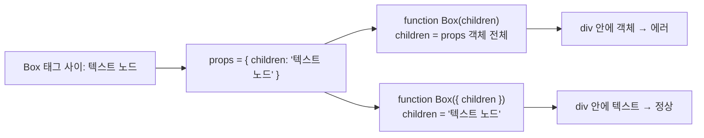

## 들어가며 (Situation)

React 마지막 파트는 강사님이 라우터와 메뉴를 미리 만들어 둔 `data-fetch-app-skeleton`에서 `src/chap` 파일의 TODO를 채우는 방식이다. 첫 주제는 props였다. [어제 만든 컴포넌트]()들은 바깥 변수 `user`를 직접 읽었는데, 이제는 부모가 값을 **넘겨준다**.

```javascript
function Title(props) {
    console.log(props.name);
    return <h1>안녕하세요 {props.name}님 반갑습니다.</h1>;
}

function Profile(props) {
    return <>
        <h3>{props.name}님은 {props.age}살입니다.</h3>
        <h4>서른까지 {30-props.age}년 남았습니다.</h4>
    </>;
}

export default function Props() {
    return (
        <>
            <Title name="양승빈"/>
            <Title name="Seungbin"/>
            <Profile name="조성원" age={25}/>

            <Box>텍스트 노드</Box>
            <Box><Profile name="강감찬" age={30}/></Box>
        </>
    );
}
```

## 문제 상황 (Task)

`/props` 화면에는 `Title` 두 개와 조성원의 `Profile`이 잘 나왔다. 그런데 아래쪽 `Box` 두 개는 **빈 테두리**만 있었다. `Box` 안에 넣은 "텍스트 노드"도, 강감찬의 `Profile`도 보이지 않았다. 남은 TODO 3이 `Box` 코드였다.

```javascript
// TODO 3: 매개변수를 {children}으로 받아서 div 안에 출력하자.
function Box(children) {
    return <div style={...}></div>;
}
```

매개변수 이름은 이미 `children`이다. div 안에 `{children}`만 넣으면 끝날까?

## 해결 과정 (Action)

### 1. 화면과 콘솔 확인

개발 서버를 띄우고 Playwright로 `/props`를 열었다.

```text
H1: 안녕하세요 양승빈님 반갑습니다.
H1: 안녕하세요 Seungbin님 반갑습니다.
H3: 조성원님은 25살입니다.
H4: 서른까지 5년 남았습니다.
DIV: ""
DIV: ""
```

콘솔에는 `Title`의 `console.log(props.name)`이 `양승빈`, `Seungbin`으로 두 번 찍혔다. `oxlint`는 `Box`에 경고를 냈다.

```text
src/chap/01_props.jsx:37:14: warning eslint(no-unused-vars): Parameter 'children' is declared but never used.
```

`Box`가 받은 값을 쓰지 않으니 빈 div가 된 것은 당연했다.

### 2. 매개변수 이름이 `children`이어도 그 값은 props 전체다

React는 컴포넌트 함수를 부를 때 **인자 하나**만 넘긴다. 태그에 쓴 속성들과 태그 사이의 내용을 모두 담은 **props 객체**다. 매개변수 이름은 아무렇게나 지어도 된다. `function Box(children)`의 `children`도 이름만 그럴 뿐, 들어오는 값은 props 객체다.

같은 React로 두 가지 `Box`를 따로 만들어 확인했다.

```javascript
function BoxWrong(children) {      // 수업 코드처럼 받고, 그대로 출력
    return <div>{children}</div>;
}
function BoxRight({ children }) {  // 구조 분해 할당
    return <div>{children}</div>;
}
```

```text
BoxWrong 매개변수의 키: ["children"], typeof children.children = string
BoxWrong → 렌더링 실패
  Objects are not valid as a React child (found: object with keys {children}).
BoxRight → <div>텍스트 노드</div>
```

`BoxWrong`에 들어온 값의 키는 `children` 하나였다. 즉 `{ children: '텍스트 노드' }`라는 **객체**다. React는 객체를 화면에 그릴 수 없어서 에러를 냈다. 에러 메시지의 `found: object with keys {children}`가 바로 props 객체를 가리킨다.



### 3. 구조 분해 할당으로 받기

[JavaScript 구조 분해]()를 매개변수 자리에 쓰면 props 객체에서 필요한 키만 꺼낼 수 있다. TODO 3의 정답이자, `Profile`의 TODO 2-2도 같은 방식이다. (**예시 코드**)


```javascript
function Profile({ name, age }) {
    return <>
        <h3>{name}님은 {age}살입니다.</h3>
        <h4>서른까지 {30 - age}년 남았습니다.</h4>
    </>;
}

function Box({ children }) {
    return <div style={{border: '1px solid orangered', padding: 10, margin: 5}}>{children}</div>;
}
```


| 쓰는 법 | 매개변수에 들어오는 값 | `name` 쓰기 |
|---------|----------------------|-------------|
| `function Profile(props)` | props 객체 | `props.name` |
| `function Profile({ name, age })` | 구조 분해된 값 | `name` |
| `function Box(children)` | **props 객체** (이름만 children) | `children.children` |
| `function Box({ children })` | 태그 사이의 내용 | `children` |

### 4. 숫자는 중괄호로 넘긴다

`age={25}`처럼 중괄호로 넘겨야 숫자다. `age="25"`로 쓰면 문자열 `"25"`가 들어간다. 이번 코드의 `30 - props.age`는 JavaScript가 빼기에서 문자열을 숫자로 바꿔 주므로 우연히 맞게 나오지만, `props.age + 1`이면 `"251"`이 된다. [`==`와 `===`에서 본 암묵적 변환]()과 같은 문제다.

## 결과 (Result)

| 확인 항목 | 결과 |
|-----------|------|
| `Title`, `Profile` | 넘긴 값대로 출력, 콘솔에 `양승빈`, `Seungbin` |
| 수업 코드의 `Box` 두 개 | 빈 div (내용 미사용, oxlint `children` 미사용 경고) |
| `Box(children)`로 받아 그대로 출력 | `Objects are not valid as a React child (found: object with keys {children})` |
| `Box({ children })` | `<div>텍스트 노드</div>` |
| 환경 | React 19.3.1, Vite 8, Playwright Chromium |

배운 점은 다음과 같다.

- 컴포넌트 함수는 항상 **props 객체 하나**를 받는다. 매개변수 이름은 값과 상관없다.
- 태그 사이의 내용은 `props.children`으로 들어온다. 그래서 `{ children }`처럼 중괄호로 꺼내야 한다.

## 더 학습하면 좋은 개념

- **단방향 데이터 흐름** — 값은 부모에서 자식으로만 내려간다. 자식이 부모 값을 바꾸려면 함수를 props로 받는다.
- **props 기본값** — `function Profile({ name, age = 0 })`처럼 구조 분해에서 기본값 주기.
- **TypeScript props 타입** — 넘겨야 할 props를 빠뜨리거나 타입을 틀리면 미리 알려 준다.
- **합성(Composition)과 children** — 레이아웃 컴포넌트를 children으로 재사용하는 패턴.

## 참고 자료

- [React - Passing Props to a Component](https://react.dev/learn/passing-props-to-a-component)
- [React - Passing JSX as children](https://react.dev/learn/passing-props-to-a-component#passing-jsx-as-children)
- [MDN - Destructuring assignment (function parameters)](https://developer.mozilla.org/en-US/docs/Web/JavaScript/Reference/Operators/Destructuring)

---

**요약**
1. `Box` 두 개가 빈 테두리로 나온 것은 `Box`가 받은 값을 쓰지 않았기 때문이다. `oxlint`도 `children` 미사용 경고를 냈다.
2. `function Box(children)`의 `children`은 이름만 그럴 뿐 props 객체 전체였고, 그대로 출력하자 `Objects are not valid as a React child (found: object with keys {children})` 에러가 났다.
3. `function Box({ children })`처럼 구조 분해로 받아야 태그 사이의 내용이 그려지며, props는 항상 객체 하나로 들어온다.
