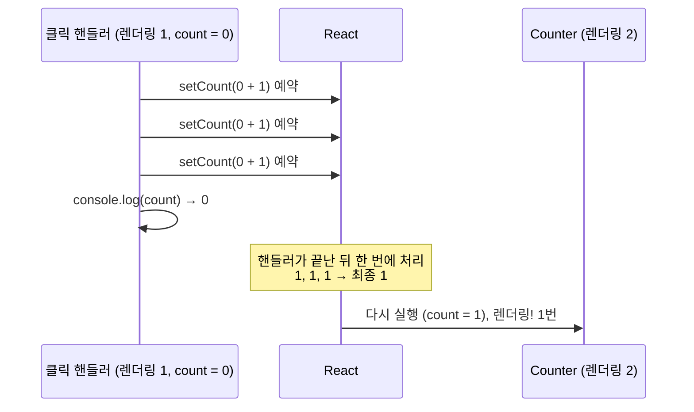

## 들어가며 (Situation)

[props]()는 부모가 주는 읽기 전용 값이었다. 두 번째 주제 state(`02_state.jsx`)는 **컴포넌트 안에서 바뀌는 값**이다. 카운터를 만들면서 TODO를 순서대로 채웠다.

```javascript
function Counter() {
    console.log('렌더링!');

    // TODO 1 : 처음에는 let으로
    // let count = 0;
    // const onClickPlusOne = () => { count = count + 1; console.log(`count: ${count}`); };

    const [count, setCount] = useState(0);

    const onClickPlusOne = () => {
        setCount(count + 1);
        console.log(`count: ${count}`);
    };

    // TODO 2 : setCount(count + 1)을 세 번 → 그다음 prev로
    const onClickPlusThree = () => {
        setCount(prev => prev + 1);
        setCount(prev => prev + 1);
        setCount(prev => prev + 1);
        console.log(`count: ${count}`);
    };
    ...
}
```

## 문제 상황 (Task)

수업 흐름은 세 번의 "왜?"로 이어졌다.

1. `let count`를 바꾸면 콘솔 값은 오르는데 화면은 왜 그대로일까?
2. `setCount(count + 1)` 바로 다음 줄의 `console.log`는 왜 **이전 값**을 찍을까?
3. `setCount(count + 1)`을 세 번 부르면 왜 1만 오를까?

수업 코드는 이미 `prev` 방식으로 바뀌어 있어서, 세 질문을 다시 확인하려면 각 버전을 따로 실행해야 했다.

## 해결 과정 (Action)

### 1. 수업 코드 그대로 버튼 누르기

개발 서버를 띄우고 Playwright로 버튼을 눌러 화면과 콘솔을 기록했다.

| 클릭 | 화면 | 콘솔 |
|------|------|------|
| `+ 1` | `count : 1` | `count: 0` → `렌더링!` |
| `+ 1` | `count : 2` | `count: 1` → `렌더링!` |
| `+ 3` | `count : 5` | `count: 2` → `렌더링!` (한 번) |
| `초기화` | `count : 0` | `렌더링!` |

화면은 맞게 바뀌는데, 핸들러 안의 `console.log`는 항상 **한 박자 늦은** 값을 찍었다. 그리고 `+ 3`은 setter를 세 번 불렀는데 `렌더링!`은 한 번만 나왔다.

### 2. 세 가지 버전을 나란히 실행

같은 페이지에 로드된 React로 작은 컴포넌트 세 개를 만들어 버튼을 눌렀다.

```javascript
function Same() {                       // setCount(count + 1) 세 번
    const [c, set] = useState(0);
    return <button onClick={() => { set(c + 1); set(c + 1); set(c + 1); }}>{c}</button>;
}
function Let() {                        // 일반 변수
    let c = 0;
    return <button onClick={() => { c = c + 1; console.log(c); }}>{c}</button>;
}
function Prev() {                       // prev 함수 세 번
    const [c, set] = useState(0);
    return <button onClick={() => { set(p => p + 1); set(p => p + 1); set(p => p + 1); }}>{c}</button>;
}
```

```text
setCount(count+1) x3     → 화면 1
let 변수 1번째 클릭       → 화면 0  (핸들러 안의 c = 1)
let 변수 2번째 클릭       → 화면 0  (핸들러 안의 c = 2)
setCount(prev=>prev+1) x3 → 화면 3  (리렌더링 1번)
```

### 3. 화면은 "함수를 다시 실행한 결과"다

함수 컴포넌트의 화면은 함수가 **반환한 JSX**다. 화면을 바꾸려면 함수를 다시 실행(리렌더링)해야 한다.

- `let c`를 바꿔도 React는 모른다. 함수가 다시 실행되지 않으니 화면은 처음 반환한 `0` 그대로다. 핸들러 안의 `c`만 1, 2로 오른다.
- `setCount`를 부르면 React가 "값이 바뀌었다"를 알고 함수를 **다시 실행**한다. 다시 실행될 때 `useState`가 새 값을 돌려준다.

리렌더링 때마다 `let c = 0`이 다시 실행되는 것도 문제다. state는 React가 함수 바깥에 보관해 두기 때문에 다시 실행돼도 값이 유지된다.

### 4. `count`는 그 렌더링의 "사진"이다

`setCount(count + 1)` 다음 줄에서 이전 값이 찍힌 이유는, `count`가 **이번 렌더링 때 받은 상수**이기 때문이다. setter는 "다음 렌더링에서 쓸 값"을 예약할 뿐, 지금 실행 중인 함수의 `count`를 바꾸지 않는다. React 문서는 이를 스냅샷이라고 부른다.



그래서 `setCount(count + 1)`을 세 번 불러도 세 번 모두 `0 + 1`이다. 결과는 1이다.

### 5. `prev` 함수는 "앞선 예약의 결과"를 받는다

setter에 값 대신 **함수**를 넘기면, React는 예약된 순서대로 그 함수를 부르면서 앞 결과를 다음 함수에 넘긴다.

| 호출 | 큐에 쌓인 것 | 처리 결과 |
|------|--------------|-----------|
| `set(c + 1)` x3 (c = 0) | "1로 바꾸기" x3 | 1 |
| `set(p => p + 1)` x3 | "p+1" x3 | 0→1→2→3 |

여러 번 setter를 불러도 리렌더링은 한 번이었다. React는 이벤트 핸들러 안의 state 변경을 모아서(batching) 핸들러가 끝난 뒤 한 번에 반영한다. 수업 주석의 "이벤트 핸들러가 끝난 뒤 한 번에 반영된다"가 확인됐다.

## 결과 (Result)

| 방식 | 화면 | 핸들러 안 `console.log` |
|------|------|------------------------|
| `let count` 변경 | 0 그대로 | 1, 2 … 증가 |
| `setCount(count + 1)` | 정상 증가 | 이전 값 (0, 1 …) |
| `setCount(count + 1)` x3 | +1 | — |
| `setCount(prev => prev + 1)` x3 | +3, 리렌더링 1번 | — |
| 환경 | React 19.3.1, Vite 8, Playwright Chromium | |

배운 점은 다음과 같다.

- 화면을 바꾸려면 리렌더링이 필요하고, 리렌더링을 일으키는 것이 setter다. 일반 변수는 화면과 연결되지 않는다.
- 한 렌더링 안의 state는 바뀌지 않는 사진이다. 이전 값에 이어서 계산해야 하면 `prev => ...` 함수를 넘긴다.

## 더 학습하면 좋은 개념

- **`useReducer`** — 상태 변경 규칙이 복잡해질 때 쓰는 훅.
- **자동 배칭(Automatic Batching)** — React 18부터 `setTimeout`, Promise 안의 변경도 묶어서 처리한다.
- **클로저** — 핸들러가 "자기가 만들어진 렌더링의 `count`"를 기억하는 이유.
- **`useRef`** — 값은 유지하되 바뀌어도 리렌더링하지 않을 때 쓰는 훅. `let` 변수의 올바른 대안.

## 참고 자료

- [React - State: A Component's Memory](https://react.dev/learn/state-a-components-memory)
- [React - State as a Snapshot](https://react.dev/learn/state-as-a-snapshot)
- [React - Queueing a Series of State Updates](https://react.dev/learn/queueing-a-series-of-state-updates)
- [React - useState](https://react.dev/reference/react/useState)

---

**요약**
1. `let count`를 바꾸면 핸들러 안의 값만 1, 2로 오르고 화면은 0 그대로였다. 화면을 바꾸는 리렌더링은 setter를 불러야 일어난다.
2. `setCount(count + 1)` 직후 `console.log`가 이전 값을 찍은 것은 `count`가 그 렌더링의 스냅샷이기 때문이고, 그래서 세 번 불러도 모두 `0 + 1`이라 1만 올랐다.
3. `setCount(prev => prev + 1)`을 세 번 부르자 3이 올랐고, 여러 번의 setter 호출은 모아서 리렌더링 1번으로 처리됐다.
